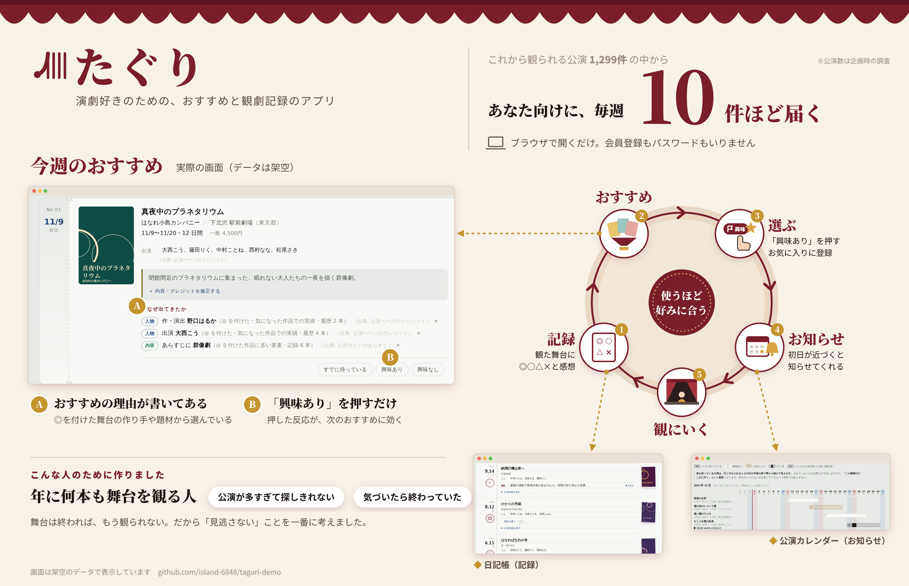

# たぐり：演劇のおすすめと観劇記録のアプリ

<p align="center"></p>

観た演劇の記録と評価をもとに、次に観たい公演を毎週届けるWebアプリです。個人開発です。

**デモ版**: https://island-6848.github.io/taguri-demo/ （見本の記録で操作を試せる。入力は消えることがあります）

**サービス版**: 準備中（記録を残して使う版。常時稼働の VM ＋ Cloudflare で立てる。[サービス化の進め方](docs/service-roadmap.md)・[デモ版とサービス版](docs/editions.md)）

（画面はGitHub Pages配信、推薦計算・データはRender上のAPI（`tools/taguri/serve_cloud.py`）が持つ。
無料枠のため、しばらくアクセスがないと初回の読み込みに10〜20秒ほどかかることがあります）

**プレゼン資料**: https://island-6848.github.io/taguri-demo/docs/000003-final-presentation-taguri.html

**使い方ガイド（使う方向け）**: https://island-6848.github.io/taguri-demo/docs/000010-user-guide-taguri.html

## 公開デモで試せる操作

このデモは、事前に用意した公演情報と仮の体験データで操作を試すためのものです。
評価・感想・興味あり・お気に入り・観劇記録の追加は、訪問者ごとに保存します。
公演カタログの更新で入力内容・認証データを消さないよう、保存領域を分離しています。
ただし、現在の公開先で永続ディスクが設定・検証されるまでは、サーバーの再起動や
再デプロイで記録が消える場合があります。復旧コードだけでは消えた記録を復元できません。
保存設定と検証手順は [永続保存と運用ログ](docs/demo-state-storage.md) を参照してください。

安定して体験できるよう、デモの操作から外部サイトへの取得やLLM呼び出しは行いません。
検索と公演への結び付けは用意した情報の範囲に限り、公演のあらすじ・題材・共通画像の
編集は無効にしています。保存後は、次の画面移動で新しい内容を読み込みます。

おすすめは、保存済みの全候補に対し、本人の現在の評価から作り手の得点と理由を
計算します。評価の変更・保留・記録の取り消しは、次におすすめを開いたときに反映されます。
公演の結び付けや作り手の情報がない記録では、人物の一致を計算できません。
感想で明示された特徴への評価を、公演に登録された題材と照合して本人の順位に補正します。
意味類似や自動重み学習は使いません。
この接続は推薦精度の改善を証明するものではありません。
実装・検証・残る制約は[評価から推薦への接続](docs/user-recommendation-loop.md)に記録しています。

## たぐりでできること

観たかった舞台が、気づいたら終わっていた。たぐりは、そんな見逃しを減らすための演劇アプリです。これから観られる公演の中から、あなたに合いそうな舞台を毎週届けます。

使い方は3つの動きだけです。

1. **おすすめを開く。** 公演ごとに「なぜおすすめなのか」の理由が書いてあります。
2. **「興味あり」を押す。** 押した公演は一覧と公演カレンダーに並び、いつまで観られるかが分かります。
3. **観たら◎○△×と感想を残す。** 記録は日記帳にたまり、評価に応じて次のおすすめが更新されます。

感想で「家族の描写がよかった」「恋愛は苦手だった」と書くと、公演に登録された特徴と
照合して、本人のおすすめ順位を補正します。編集・削除は次の画面取得から反映します。
解析には外部APIを使いません。仕組みと適用範囲は
[`docs/impression-preferences.md`](docs/impression-preferences.md)にあります。

初めての方は、デモ画面の右下にある「使い方」から、実際の画面で試せる操作ツアーと、約70秒の説明動画を開けます（動画は[`web/assets/taguri-howto.mp4`](web/assets/taguri-howto.mp4)）。

## 安心して使える理由

- **登録もパスワードもいりません。** 初回に発行される復旧コード（128bit）とセッションCookieで利用者を見分けるので、メールアドレスもパスワードも預かりません。実装は`tools/taguri/auth.py`にあります。
- **おすすめの理由が見えます。** 順位づけにLLMは使わず、記録から数えた統計で決めています。そのため、理由を毎回示せます。LLM（Gemini API）を使うのは、あらすじから要素を取り出す作業だけです。根拠と実測は`docs/000007-taguri-design.md`にあります。
- **外部への送信を絞っています。** 画面から外部サイトを直接呼ぶことはなく、公演情報の取得は専用のバッチ処理だけが、1リクエスト/秒を守って行います。詳細は`docs/000007-taguri-security-rules.md`にあります。
- **Pythonの標準ライブラリだけで動きます。** pipで追加のインストールをしなくても、環境が変わって動かなくなることがありません（`urllib`・`sqlite3`・`http.server`で完結）。

## 技術構成

- Python標準ライブラリのみ（Webフレームワーク不使用、`http.server`を直接使用）
- SQLite（永続化）
- Gemini API（あらすじ・要素抽出のみ、順位づけには使わない）
- 公演情報の取得元: CoRich・ステイジーズカレンダー

### 公開デモの構成（GitHub Pages + Render）

画面（`web/`、静的ファイルのみ）はGitHub Pagesから配信し、推薦計算・DB書き込みは
今までどおりRender上のAPI（`tools/taguri/serve_cloud.py`）が担う。`web/`のJSが
CORS越しにRenderのJSON API（`/api/screen/*`・`/api/react`等）を叩き、返ってきた
HTML断片を画面に差し込む形にした。GitHub Pagesは静的配信専用でサーバサイド
コードを実行できないため、DB書き込みを伴う本体はRenderに残している。
ローカル・EC2向けの`run.py`経路（`127.0.0.1`固定・起動ごとトークン認証）は
この移行の影響を受けず、今までどおり動く。

## ドキュメント

設計判断とその理由を記録したドキュメントを同梱しています。

- [`docs/000007-taguri-design.md`](docs/000007-taguri-design.md) ── 全体設計
- [`docs/editions.md`](docs/editions.md) ── デモ版とサービス版の切り分けと、サービス版の立て方
- [`docs/service-roadmap.md`](docs/service-roadmap.md) ── サービス化の進め方と検証項目
- [`docs/knowledge/README.md`](docs/knowledge/README.md) ── 調べたこと・今後調べること・決めたことのナレッジグラフ
- [`docs/recommendation-exposure.md`](docs/recommendation-exposure.md) ── 推薦の取得・画面内接触ログの定義、API、保存と制約
- [`docs/recommendation-product-ux-plan.md`](docs/recommendation-product-ux-plan.md) ── 推薦中心の機能案・UI/UX・検証計画
- [`docs/recommendation-ux-design.md`](docs/recommendation-ux-design.md) ── 文献に基づく推薦UI/UXの詳細仕様・検証手順
- [`docs/research/recommendation-ux-literature.md`](docs/research/recommendation-ux-literature.md) ── 論文・設計指針の読書記録と適用上の限界
- [`docs/000007-taguri-security-rules.md`](docs/000007-taguri-security-rules.md) ── セキュリティ規約
- [`docs/000007-taguri-terms-of-use.md`](docs/000007-taguri-terms-of-use.md) ── 利用規約
- [`docs/000003-final-presentation-taguri.html`](https://island-6848.github.io/taguri-demo/docs/000003-final-presentation-taguri.html) ── プレゼン資料（ブラウザで表示。[ソース](docs/000003-final-presentation-taguri.html)）
- [`docs/000010-user-guide-taguri.html`](https://island-6848.github.io/taguri-demo/docs/000010-user-guide-taguri.html) ── 使う方向けの使い方ガイド（ブラウザで表示。[ソース](docs/000010-user-guide-taguri.html)）

## ローカルで動かす

```bash
python3 tools/taguri/run.py --no-open   # 動作確認用（画面は開かない）
```

## 補足

このリポジトリは公開用に、実データ・検証記録を除いたコードとドキュメントのみで構成しています。デモ用の体験データ（`data/review/`）は架空の評価・お気に入りを含みますが、公演情報自体は実在するものです。


