# たぐり ナレッジグラフ

調べたこと・今後調べること・決めたことを 1 件ずつ記録し、つながりで管理する。
**このファイルと `graph.json` は `tools/knowledge/build_graph.py` が作る。手で直さない。**

## 書き足し方

1. `docs/knowledge/notes/<id>.md` を作る（形は `tools/knowledge/build_graph.py` の冒頭）
2. 調べたら `type: finding`。出典 URL を `sources` に、確かめた日を `date` に書く。一次情報（公式文書・実物の確認）で確かめたものだけ `confirmed`。ブログや推測は `unverified`
3. 分からないことは `type: question`（`open`）。答えが出たら答えの finding に `answers: <問いの id>` を書き、問いを `answered` にする
4. 古くなった事実は消さずに `outdated`、取り消した決定は `superseded` にして、新しい方から `supersedes` でつなぐ
5. 計画などの文書（`docs/*.md`）から項目を指すときは `〔id〕` と書く。無い id を指すと検査で失敗する
6. `python3 tools/knowledge/build_graph.py` で索引と図を作り直してからコミットする（CI が `--check` で確かめる）

つながりの種類: `supports`（根拠になる）、`contradicts`（食い違う）、`raises`（新たな問いを生む）、`answers`（答える）、`affects`（影響する）、`depends_on`（前提にする）、`supersedes`（置き換える）、`verifies`（検証項目）

## 図

形: 丸＝調べたこと、六角＝今後調べること、二重枠＝決めたこと、平行四辺形＝仕組みの部品。点線の枠は未確認・提案中。灰色は古い・回答済み・置き換え済み。

```mermaid
flowchart LR
  n0("AWS の無料枠は 2025 年 7 月 15 日以降の新しい口座ではクレジット制（最大 200 ドル・6 か月）")
  n1("AWS は公開 IPv4 アドレス 1 つにつき 1 時間 0.005 ドル（月 3.6 ドルほど）かかる")
  n2("利用規約は公演情報を第三者へ再配布しないと約束している")
  n3("Cloudflare Access は 50 人まで無料（古い公式資料）")
  n4("この作業環境からは Cloudflare・Firebase の公式文書や外部サイトが読めない")
  n5("Cloudflare Registrar では .jp を取れない。DNS だけ Cloudflare に置くことはできる")
  n6("Cloudflare Tunnel は無料で使え、ドメインを Cloudflare の DNS に置く必要がある")
  n7("Tunnel の後ろのサーバーからは、すべての接続元が自分自身に見える")
  n8(".com の卸値は 2026 年 11 月 1 日から年 10.97 ドルに上がる")
  n9[/"登録・復旧の試行回数の制限（auth.py）"/]
  n10[/"公演カタログの取得と配布（publish_catalog.py）"/]
  n11[/"Cloudflare Worker（cloudflare/src/worker.js）"/]
  n12[/"取得の作法（polite_http.py）"/]
  n13[/"Cloudflare D1（taguri-demo データベース）"/]
  n14[/"本人の書き出し（/export.json・/data.zip）"/]
  n15[/"ログイン：Firebase Authentication（Google・メールリンク）"/]
  n16[/"画面（web/・config.js）"/]
  n17[/"元の画面の Worker 版（cloudflare/src/screens/）"/]
  n18[/"ログイン：パスキー（Google を使わない人向け）"/]
  n19[/"公開版のサーバー（serve_cloud.py・serve.py）"/]
  n20[/"推薦の索引の作成（build_recommend_index.py）"/]
  n21[/"本人向けのおすすめ計算（user_recommender.py）"/]
  n22[/"利用者の保存先とバックアップ"/]
  n23[/"サービス版の VM（cloudflared・systemd）"/]
  n24("取得元の実際の robots.txt はまだ読めていない")
  n25("Pages と Render は別サイトなので、Cookie が別サイトの扱いになる")
  n26("D1 の無料枠は 1 日に読み 500 万行・書き 10 万行、保存 5GB")
  n27("D1 の無料枠は 1 日 10 万行の書き込み・500 万行の読み込み（記憶による数値）")
  n28("D1 は 1 つの問い合わせに 100 個までの値しか渡せず、1 文は 100 KB まで")
  n29[["アカウント削除は「削除」の入力と直近 10 分以内のログインを求める"]]
  n30[["Cloudflare Workers への完全移行は今は見送る（見直し中）"]]
  n31[["デモ版は Render の無料プランのまま残す"]]
  n32[["デモ版とサービス版を分ける"]]
  n33[["会員ログインは Firebase Authentication にする"]]
  n34[["Render の他人の記録も、持ち主の EC2 の記録も、新しいアカウントには移さない"]]
  n35[["独自ドメインを取り、画面と API を同じドメインの下に置く"]]
  n36[["Google を使いたくない人のために、パスキーを新しく作る"]]
  n37[["取得はすべて polite_http を通す"]]
  n38[["おすすめ（人物得点）は索引をバッチで作り、Worker で計算する"]]
  n39[["Render をやめ、元の画面を Worker に移す（見た目はそのまま・最後に一度だけ切り替え）"]]
  n40[["サービス版を Render の有料サービスで立てる"]]
  n41[["記録を公演に結び付ける検索には、公開カタログの公演だけを出す"]]
  n42[["サービス版は空から始め、デモの記録を移さない"]]
  n43[["ログインしていない人に見せるのは「ログイン」と「たぐりとは」だけ"]]
  n44[["サービス版は常時稼働の VM で動かし、前段に Cloudflare を置く"]]
  n45[["無料で起動を速くするため、Cloudflare Workers＋D1 で動かす"]]
  n46("見本の記録のうち推薦の材料になるのは 6 割ほど（見積もり）")
  n47("東京の t4g.micro は 1 時間 0.0108 ドル（月 8 ドルほど）、t3.micro は 0.0136 ドル")
  n48("Firebase の Web 用 API キーは秘密ではない（使える範囲は承認済みドメインとキーの制限で絞る）")
  n49("LLM の呼び出しには月の上限がある（既定 300 回）")
  n50("Gmail の読み取りは制限付きの権限で、毎年の第三者の審査が要る")
  n51(".jp は年 4,000 円前後（税の扱い・年額かは未確認）")
  n52("test_digest と test_impressions は以前から失敗している")
  n53("Oracle Always Free の ARM は 2 OCPU・12GB まで。使用が少ないと回収されうる")
  n54("GitHub Pages は知らない道に 404.html を返し、画面はそれで深い道を開いている")
  n55("パスキーはドメインに結び付くので、ドメインを変えると使えなくなる")
  n56("本番の Worker は PR のブランチ（cloudflare-d1-preview）から自動で deploy されている")
  n57("公開版の書き出しが他の利用者の記録まで渡していた（修正済み）")
  n58("Python の画面は一時保存先・固定日付・通信なしで、テストの中から動かせる")
  n59("別の作業で、元の画面の Python を Python Workers で動かす移行版も作られている")
  n60{{"検証中に自分だけを通す方法（Cloudflare Access の無料枠）"}}
  n61{{"CF-Connecting-IP をどう信頼するか"}}
  n62{{"Tunnel の公式の制限・料金・必要な設定"}}
  n63{{"D1 のバックアップと復元をどうするか"}}
  n64{{"Python Workers の CPU の制限と成熟度"}}
  n65{{"サービス版の基盤を「VM＋Cloudflare の前段」と「Workers＋D1」のどちらに寄せるか"}}
  n66{{"どのドメインをどこで取るか"}}
  n67{{"今の EC2 の種類・口座の作成日・月額"}}
  n68{{"Firebase Authentication の無料枠の正確な範囲（メールリンク・利用者数）"}}
  n69{{"Firebase の API キーに制限（Web サイト・使う API）を掛けたか"}}
  n70{{"アカウント削除で Firebase 側の利用者も本当に消えているか"}}
  n71{{"Worker の依存とログイン画面の組み立てを再現できるようにするか（lockfile）"}}
  n72{{"メールリンクのログインで、メールアドレスを端末に残してよいか"}}
  n73{{"無料で使える外形監視と通知"}}
  n74{{"バックアップをどこに、どう暗号化して、いつまで置くか"}}
  n75{{"Oracle の公式の無料枠と回収の条件"}}
  n76{{"Oracle を従量課金の契約にすると、無料枠と回収の扱いは変わるか"}}
  n77{{"元の画面の Content-Security-Policy を強められるか"}}
  n78{{"パスキーは実機（iPhone・Android・Mac・Windows）で登録・ログインできるか"}}
  n79{{"昔の公演を、公開情報だけで探せるようにするにはどうするか"}}
  n80{{"個人情報保護法で何が求められるか"}}
  n81{{"本番に deploy するブランチをどれにするか（PR のブランチのままにしない）"}}
  n82{{"サーバーの Python を何版に揃えるか"}}
  n83{{"R2 の公式料金と、今の boto3 のコードで読み書きできるか"}}
  n84{{"ログイン・登録・検索の回数制限を Worker でどう掛けるか"}}
  n85{{"実カタログで、推薦の索引の行数と Worker の CPU 時間がどうなるか"}}
  n86{{"Render の無料プランでサービス版を動かせるか"}}
  n87{{"Safari で Cookie が通るか（実機）"}}
  n88{{"取得元の利用規約・robots.txt・ポスター画像の権利"}}
  n89{{"サービス版の VM は Oracle Always Free と今の EC2 のどちらにするか"}}
  n90{{"VM でおすすめが 3 秒以内に開くか"}}
  n91{{"移した画面は Workers 無料枠の CPU 10 ミリ秒に収まるか"}}
  n92{{"Cloudflare の無料枠だけで、今のコードのまま動かせるか"}}
  n93("R2 は 10GB まで無料で、取り出しの通信料がかからない")
  n94("おすすめは開くたびに全候補を計算している")
  n95("Worker の推薦は Python（person-feedback-v1）と同じ結果を出す")
  n96("Render の無料プランは永続ディスクを付けられない")
  n97("Render の無料プランは 15 分でスリープし、起動に約 1 分かかる")
  n98("Render の有料プランならスリープせずディスクも付く（単価は二次情報）")
  n99("Render の利用者（tg_session）とログインしたアカウント（D1）は別人として扱われている")
  n100("元の画面は Python が HTML を組んで JSON で返している（約 2.5 万行）")
  n101("Python の robotparser は小数の Crawl-delay を読めない")
  n102("サービス版の保存先の検査が Render を前提にしている")
  n103("バックアップの検査が Python 3.13 では 1 件失敗する")
  n104("サーバーは標準ライブラリの http.server と sqlite3 で書いてある")
  n105("試行回数の制限は接続元のアドレスで数えている")
  n106("題名の正規化（title_key）は JS でも Python と同じにできる")
  n107("Worker での推薦計算は 1 回 10〜12 ミリ秒、重い想定で 39 ミリ秒（見積もり）")
  n108("push するたびに Workers Builds が D1 の migration を当ててから deploy する")
  n109("コミットの ✗ は Workers Builds が cloudflare/ の無い master を組もうとして失敗していたため")
  n110("別の作業で、Workers＋D1 の版が workers.dev で動き始めている")
  n111("Workers の無料プランは 1 要求あたり CPU 10 ミリ秒・1 日 10 万要求まで")
  n0 -- 影響する --> n67
  n1 -- 影響する --> n67
  n2 -- 新たな問いを生む --> n88
  n2 -- 影響する --> n10
  n3 -- 影響する --> n60
  n5 -- 影響する --> n66
  n6 -- 根拠になる --> n44
  n6 -- 根拠になる --> n35
  n6 -- 新たな問いを生む --> n62
  n7 -- 影響する --> n9
  n7 -- 新たな問いを生む --> n61
  n8 -- 影響する --> n66
  n13 -- 影響する --> n22
  n17 -- 影響する --> n19
  n17 -- 影響する --> n16
  n20 -- 前提にする --> n10
  n20 -- 影響する --> n21
  n23 -- 前提にする --> n89
  n24 -- 新たな問いを生む --> n88
  n25 -- 根拠になる --> n35
  n25 -- 新たな問いを生む --> n87
  n25 -- 影響する --> n16
  n26 -- 影響する --> n64
  n26 -- 影響する --> n65
  n27 -- 答える --> n64
  n27 -- 新たな問いを生む --> n85
  n27 -- 根拠になる --> n26
  n28 -- 影響する --> n20
  n29 -- 影響する --> n13
  n29 -- 新たな問いを生む --> n70
  n30 -- 影響する --> n21
  n30 -- 前提にする --> n65
  n31 -- 前提にする --> n32
  n32 -- 影響する --> n19
  n32 -- 影響する --> n16
  n33 -- 影響する --> n15
  n33 -- 新たな問いを生む --> n69
  n33 -- 新たな問いを生む --> n68
  n34 -- 根拠になる --> n42
  n34 -- 前提にする --> n96
  n35 -- 影響する --> n16
  n35 -- 前提にする --> n66
  n36 -- 影響する --> n18
  n36 -- 新たな問いを生む --> n78
  n37 -- 影響する --> n12
  n38 -- 置き換える --> n94
  n38 -- 前提にする --> n95
  n38 -- 影響する --> n21
  n39 -- 食い違う --> n30
  n39 -- 食い違う --> n44
  n39 -- 前提にする --> n100
  n39 -- 影響する --> n17
  n39 -- 影響する --> n19
  n39 -- 影響する --> n65
  n41 -- 新たな問いを生む --> n79
  n42 -- 前提にする --> n32
  n43 -- 影響する --> n11
  n44 -- 置き換える --> n40
  n44 -- 前提にする --> n35
  n44 -- 影響する --> n19
  n44 -- 影響する --> n9
  n44 -- 影響する --> n23
  n45 -- 食い違う --> n30
  n45 -- 前提にする --> n111
  n45 -- 影響する --> n11
  n45 -- 影響する --> n65
  n46 -- 影響する --> n21
  n47 -- 影響する --> n67
  n48 -- 新たな問いを生む --> n69
  n49 -- 影響する --> n10
  n51 -- 影響する --> n66
  n53 -- 答える --> n75
  n53 -- 新たな問いを生む --> n76
  n53 -- 根拠になる --> n44
  n54 -- 影響する --> n16
  n55 -- 影響する --> n66
  n55 -- 根拠になる --> n35
  n56 -- 新たな問いを生む --> n81
  n57 -- 影響する --> n14
  n58 -- 根拠になる --> n39
  n59 -- 影響する --> n65
  n59 -- 新たな問いを生む --> n64
  n60 -- 前提にする --> n44
  n63 -- 影響する --> n13
  n63 -- 前提にする --> n74
  n65 -- 前提にする --> n85
  n65 -- 前提にする --> n89
  n66 -- 前提にする --> n65
  n71 -- 影響する --> n11
  n72 -- 影響する --> n15
  n74 -- 前提にする --> n83
  n77 -- 影響する --> n17
  n79 -- 前提にする --> n37
  n79 -- 前提にする --> n2
  n83 -- 前提にする --> n89
  n84 -- 前提にする --> n9
  n84 -- 影響する --> n11
  n85 -- 前提にする --> n67
  n87 -- 前提にする --> n35
  n89 -- 前提にする --> n76
  n89 -- 前提にする --> n67
  n89 -- 前提にする --> n65
  n90 -- 前提にする --> n89
  n91 -- 前提にする --> n111
  n91 -- 影響する --> n17
  n93 -- 根拠になる --> n44
  n93 -- 新たな問いを生む --> n83
  n93 -- 影響する --> n10
  n94 -- 根拠になる --> n30
  n94 -- 影響する --> n21
  n94 -- 答える --> n92
  n95 -- 影響する --> n21
  n96 -- 根拠になる --> n44
  n96 -- 答える --> n86
  n96 -- 影響する --> n22
  n97 -- 根拠になる --> n44
  n97 -- 根拠になる --> n31
  n98 -- 根拠になる --> n40
  n99 -- 新たな問いを生む --> n65
  n99 -- 根拠になる --> n39
  n100 -- 影響する --> n19
  n101 -- 影響する --> n12
  n102 -- 影響する --> n19
  n102 -- 影響する --> n23
  n103 -- 新たな問いを生む --> n82
  n103 -- 影響する --> n22
  n104 -- 根拠になる --> n30
  n104 -- 根拠になる --> n44
  n104 -- 答える --> n92
  n105 -- 影響する --> n9
  n105 -- 新たな問いを生む --> n61
  n107 -- 食い違う --> n30
  n107 -- 新たな問いを生む --> n85
  n107 -- 影響する --> n65
  n108 -- 影響する --> n13
  n109 -- 影響する --> n11
  n110 -- 食い違う --> n30
  n110 -- 影響する --> n65
  n110 -- 影響する --> n21
  n111 -- 根拠になる --> n30
  n111 -- 答える --> n92
  class n0 finding_confirmed
  class n1 finding_confirmed
  class n2 finding_confirmed
  class n3 finding_unverified
  class n4 finding_confirmed
  class n5 finding_unverified
  class n6 finding_unverified
  class n7 finding_unverified
  class n8 finding_confirmed
  class n9 component_current
  class n10 component_current
  class n11 component_current
  class n12 component_current
  class n13 component_current
  class n14 component_current
  class n15 component_current
  class n16 component_current
  class n17 component_planned
  class n18 component_current
  class n19 component_current
  class n20 component_current
  class n21 component_current
  class n22 component_current
  class n23 component_planned
  class n24 finding_unverified
  class n25 finding_confirmed
  class n26 finding_confirmed
  class n27 finding_unverified
  class n28 finding_unverified
  class n29 decision_adopted
  class n30 decision_proposed
  class n31 decision_proposed
  class n32 decision_adopted
  class n33 decision_adopted
  class n34 decision_adopted
  class n35 decision_proposed
  class n36 decision_adopted
  class n37 decision_adopted
  class n38 decision_adopted
  class n39 decision_adopted
  class n40 decision_superseded
  class n41 decision_adopted
  class n42 decision_adopted
  class n43 decision_adopted
  class n44 decision_adopted
  class n45 decision_adopted
  class n46 finding_unverified
  class n47 finding_unverified
  class n48 finding_unverified
  class n49 finding_confirmed
  class n50 finding_confirmed
  class n51 finding_unverified
  class n52 finding_confirmed
  class n53 finding_confirmed
  class n54 finding_confirmed
  class n55 finding_confirmed
  class n56 finding_confirmed
  class n57 finding_confirmed
  class n58 finding_confirmed
  class n59 finding_confirmed
  class n60 question_open
  class n61 question_open
  class n62 question_open
  class n63 question_open
  class n64 question_open
  class n65 question_open
  class n66 question_open
  class n67 question_open
  class n68 question_open
  class n69 question_open
  class n70 question_open
  class n71 question_open
  class n72 question_open
  class n73 question_open
  class n74 question_open
  class n75 question_answered
  class n76 question_open
  class n77 question_open
  class n78 question_open
  class n79 question_open
  class n80 question_open
  class n81 question_open
  class n82 question_open
  class n83 question_open
  class n84 question_open
  class n85 question_open
  class n86 question_answered
  class n87 question_open
  class n88 question_open
  class n89 question_open
  class n90 question_open
  class n91 question_open
  class n92 question_answered
  class n93 finding_unverified
  class n94 finding_confirmed
  class n95 finding_confirmed
  class n96 finding_confirmed
  class n97 finding_confirmed
  class n98 finding_unverified
  class n99 finding_confirmed
  class n100 finding_confirmed
  class n101 finding_confirmed
  class n102 finding_confirmed
  class n103 finding_unverified
  class n104 finding_confirmed
  class n105 finding_confirmed
  class n106 finding_confirmed
  class n107 finding_unverified
  class n108 finding_confirmed
  class n109 finding_confirmed
  class n110 finding_confirmed
  class n111 finding_confirmed
  classDef finding_confirmed fill:#e6f4ea,stroke:#2e7d32
  classDef finding_unverified fill:#fff8e1,stroke:#b26a00,stroke-dasharray:4 3
  classDef finding_outdated fill:#eeeeee,stroke:#9e9e9e
  classDef question_open fill:#fdecea,stroke:#c62828
  classDef question_answered fill:#eeeeee,stroke:#9e9e9e
  classDef question_dropped fill:#eeeeee,stroke:#9e9e9e
  classDef decision_adopted fill:#e3f2fd,stroke:#1565c0
  classDef decision_proposed fill:#e3f2fd,stroke:#1565c0,stroke-dasharray:4 3
  classDef decision_superseded fill:#eeeeee,stroke:#9e9e9e
  classDef component_current fill:#f3e5f5,stroke:#6a1b9a
  classDef component_planned fill:#f3e5f5,stroke:#6a1b9a,stroke-dasharray:4 3
  classDef component_retired fill:#eeeeee,stroke:#9e9e9e
```

## 今後調べること（30 件）

| 項目 | 状態 | 日付 | 検証項目 | つながり |
| --- | --- | --- | --- | --- |
| [検証中に自分だけを通す方法（Cloudflare Access の無料枠）](notes/q-cf-access.md) | 未着手 | 2026-10-13 | S30 | 前提にする → [サービス版は常時稼働の VM で動かし、前段に Cloudflare を置く](notes/dec-vm-cloudflare.md) [Cloudflare Access は 50 人まで無料（古い公式資料）](notes/cf-access-free-50.md) が影響する |
| [CF-Connecting-IP をどう信頼するか](notes/q-cf-connecting-ip-trust.md) | 未着手 | 2026-10-13 | S13 | [Tunnel の後ろのサーバーからは、すべての接続元が自分自身に見える](notes/cf-tunnel-origin-localhost.md) が新たな問いを生む [試行回数の制限は接続元のアドレスで数えている](notes/throttle-keyed-by-client-address.md) が新たな問いを生む |
| [Tunnel の公式の制限・料金・必要な設定](notes/q-cf-tunnel-official.md) | 未着手 | 2026-10-13 | S22 | [Cloudflare Tunnel は無料で使え、ドメインを Cloudflare の DNS に置く必要がある](notes/cf-tunnel-free.md) が新たな問いを生む |
| [D1 のバックアップと復元をどうするか](notes/q-d1-backup.md) | 未着手 | 2026-10-13 | ─ | 影響する → [Cloudflare D1（taguri-demo データベース）](notes/comp-d1.md) 前提にする → [バックアップをどこに、どう暗号化して、いつまで置くか](notes/q-offsite-backup.md) |
| [Python Workers の CPU の制限と成熟度](notes/q-d1-python-workers.md) | 未着手 | 2026-10-13 | ─ | [D1 の無料枠は 1 日に読み 500 万行・書き 10 万行、保存 5GB](notes/d1-free-limits.md) が影響する [D1 の無料枠は 1 日 10 万行の書き込み・500 万行の読み込み（記憶による数値）](notes/d1-free-write-limit.md) が答える [別の作業で、元の画面の Python を Python Workers で動かす移行版も作られている](notes/python-workers-migration-state.md) が新たな問いを生む |
| [サービス版の基盤を「VM＋Cloudflare の前段」と「Workers＋D1」のどちらに寄せるか](notes/q-direction.md) | 未着手 | 2026-10-13 | S12 | 前提にする → [実カタログで、推薦の索引の行数と Worker の CPU 時間がどうなるか](notes/q-real-catalog-stats.md) 前提にする → [サービス版の VM は Oracle Always Free と今の EC2 のどちらにするか](notes/q-vm-host-choice.md) [D1 の無料枠は 1 日に読み 500 万行・書き 10 万行、保存 5GB](notes/d1-free-limits.md) が影響する [Cloudflare Workers への完全移行は今は見送る（見直し中）](notes/dec-defer-workers.md) が前提にする [Render をやめ、元の画面を Worker に移す（見た目はそのまま・最後に一度だけ切り替え）](notes/dec-render-full-migration.md) が影響する [無料で起動を速くするため、Cloudflare Workers＋D1 で動かす](notes/dec-workers-d1.md) が影響する [別の作業で、元の画面の Python を Python Workers で動かす移行版も作られている](notes/python-workers-migration-state.md) が影響する [どのドメインをどこで取るか](notes/q-domain.md) が前提にする [サービス版の VM は Oracle Always Free と今の EC2 のどちらにするか](notes/q-vm-host-choice.md) が前提にする [Render の利用者（tg_session）とログインしたアカウント（D1）は別人として扱われている](notes/render-two-identities.md) が新たな問いを生む [Worker での推薦計算は 1 回 10〜12 ミリ秒、重い想定で 39 ミリ秒（見積もり）](notes/worker-reco-cpu-estimate.md) が影響する [別の作業で、Workers＋D1 の版が workers.dev で動き始めている](notes/workers-d1-preview-state.md) が影響する |
| [どのドメインをどこで取るか](notes/q-domain.md) | 未着手 | 2026-10-13 | S04 | 前提にする → [サービス版の基盤を「VM＋Cloudflare の前段」と「Workers＋D1」のどちらに寄せるか](notes/q-direction.md) [Cloudflare Registrar では .jp を取れない。DNS だけ Cloudflare に置くことはできる](notes/cf-registrar-no-jp.md) が影響する [.com の卸値は 2026 年 11 月 1 日から年 10.97 ドルに上がる](notes/com-wholesale-2026.md) が影響する [独自ドメインを取り、画面と API を同じドメインの下に置く](notes/dec-own-domain.md) が前提にする [.jp は年 4,000 円前後（税の扱い・年額かは未確認）](notes/jp-domain-price.md) が影響する [パスキーはドメインに結び付くので、ドメインを変えると使えなくなる](notes/passkey-rpid-domain.md) が影響する |
| [今の EC2 の種類・口座の作成日・月額](notes/q-ec2-cost.md) | 未着手 | 2026-10-13 | S12 | [AWS の無料枠は 2025 年 7 月 15 日以降の新しい口座ではクレジット制（最大 200 ドル・6 か月）](notes/aws-free-plan-2025.md) が影響する [AWS は公開 IPv4 アドレス 1 つにつき 1 時間 0.005 ドル（月 3.6 ドルほど）かかる](notes/aws-ipv4-charge.md) が影響する [東京の t4g.micro は 1 時間 0.0108 ドル（月 8 ドルほど）、t3.micro は 0.0136 ドル](notes/ec2-tokyo-price.md) が影響する [実カタログで、推薦の索引の行数と Worker の CPU 時間がどうなるか](notes/q-real-catalog-stats.md) が前提にする [サービス版の VM は Oracle Always Free と今の EC2 のどちらにするか](notes/q-vm-host-choice.md) が前提にする |
| [Firebase Authentication の無料枠の正確な範囲（メールリンク・利用者数）](notes/q-firebase-free-tier.md) | 未着手 | 2026-10-13 | ─ | [会員ログインは Firebase Authentication にする](notes/dec-firebase-auth.md) が新たな問いを生む |
| [Firebase の API キーに制限（Web サイト・使う API）を掛けたか](notes/q-firebase-key-restriction.md) | 未着手 | 2026-10-13 | ─ | [会員ログインは Firebase Authentication にする](notes/dec-firebase-auth.md) が新たな問いを生む [Firebase の Web 用 API キーは秘密ではない（使える範囲は承認済みドメインとキーの制限で絞る）](notes/firebase-apikey-public.md) が新たな問いを生む |
| [アカウント削除で Firebase 側の利用者も本当に消えているか](notes/q-firebase-user-deletion.md) | 未着手 | 2026-10-13 | ─ | [アカウント削除は「削除」の入力と直近 10 分以内のログインを求める](notes/dec-account-deletion.md) が新たな問いを生む |
| [Worker の依存とログイン画面の組み立てを再現できるようにするか（lockfile）](notes/q-lockfile-reproducible.md) | 未着手 | 2026-10-13 | ─ | 影響する → [Cloudflare Worker（cloudflare/src/worker.js）](notes/comp-cf-worker.md) |
| [メールリンクのログインで、メールアドレスを端末に残してよいか](notes/q-login-email-storage.md) | 未着手 | 2026-10-13 | ─ | 影響する → [ログイン：Firebase Authentication（Google・メールリンク）](notes/comp-firebase-login.md) |
| [無料で使える外形監視と通知](notes/q-monitoring.md) | 未着手 | 2026-10-13 | S22, S23 | ─ |
| [バックアップをどこに、どう暗号化して、いつまで置くか](notes/q-offsite-backup.md) | 未着手 | 2026-10-13 | S07, S10 | 前提にする → [R2 の公式料金と、今の boto3 のコードで読み書きできるか](notes/q-r2-boto3.md) [D1 のバックアップと復元をどうするか](notes/q-d1-backup.md) が前提にする |
| [Oracle を従量課金の契約にすると、無料枠と回収の扱いは変わるか](notes/q-oracle-payg.md) | 未着手 | 2026-10-13 | S29 | [Oracle Always Free の ARM は 2 OCPU・12GB まで。使用が少ないと回収されうる](notes/oracle-always-free.md) が新たな問いを生む [サービス版の VM は Oracle Always Free と今の EC2 のどちらにするか](notes/q-vm-host-choice.md) が前提にする |
| [元の画面の Content-Security-Policy を強められるか](notes/q-original-ui-csp.md) | 未着手 | 2026-10-13 | ─ | 影響する → [元の画面の Worker 版（cloudflare/src/screens/）](notes/comp-native-screens.md) |
| [パスキーは実機（iPhone・Android・Mac・Windows）で登録・ログインできるか](notes/q-passkey-real-devices.md) | 未着手 | 2026-10-13 | ─ | [Google を使いたくない人のために、パスキーを新しく作る](notes/dec-passkeys.md) が新たな問いを生む |
| [昔の公演を、公開情報だけで探せるようにするにはどうするか](notes/q-past-stage-catalogue.md) | 未着手 | 2026-10-13 | ─ | 前提にする → [取得はすべて polite_http を通す](notes/dec-polite-crawling.md) 前提にする → [利用規約は公演情報を第三者へ再配布しないと約束している](notes/catalog-terms-no-redistribution.md) [記録を公演に結び付ける検索には、公開カタログの公演だけを出す](notes/dec-search-public-only.md) が新たな問いを生む |
| [個人情報保護法で何が求められるか](notes/q-privacy-law.md) | 未着手 | 2026-10-13 | S10, S25 | ─ |
| [本番に deploy するブランチをどれにするか（PR のブランチのままにしない）](notes/q-production-branch.md) | 未着手 | 2026-10-13 | ─ | [本番の Worker は PR のブランチ（cloudflare-d1-preview）から自動で deploy されている](notes/pr-branch-is-production.md) が新たな問いを生む |
| [サーバーの Python を何版に揃えるか](notes/q-python-version.md) | 未着手 | 2026-10-13 | S07 | [バックアップの検査が Python 3.13 では 1 件失敗する](notes/state-backup-py313.md) が新たな問いを生む |
| [R2 の公式料金と、今の boto3 のコードで読み書きできるか](notes/q-r2-boto3.md) | 未着手 | 2026-10-13 | ─ | 前提にする → [サービス版の VM は Oracle Always Free と今の EC2 のどちらにするか](notes/q-vm-host-choice.md) [バックアップをどこに、どう暗号化して、いつまで置くか](notes/q-offsite-backup.md) が前提にする [R2 は 10GB まで無料で、取り出しの通信料がかからない](notes/r2-free-tier.md) が新たな問いを生む |
| [ログイン・登録・検索の回数制限を Worker でどう掛けるか](notes/q-rate-limiting.md) | 未着手 | 2026-10-13 | ─ | 前提にする → [登録・復旧の試行回数の制限（auth.py）](notes/comp-auth-throttle.md) 影響する → [Cloudflare Worker（cloudflare/src/worker.js）](notes/comp-cf-worker.md) |
| [実カタログで、推薦の索引の行数と Worker の CPU 時間がどうなるか](notes/q-real-catalog-stats.md) | 未着手 | 2026-10-13 | S20, S21 | 前提にする → [今の EC2 の種類・口座の作成日・月額](notes/q-ec2-cost.md) [D1 の無料枠は 1 日 10 万行の書き込み・500 万行の読み込み（記憶による数値）](notes/d1-free-write-limit.md) が新たな問いを生む [サービス版の基盤を「VM＋Cloudflare の前段」と「Workers＋D1」のどちらに寄せるか](notes/q-direction.md) が前提にする [Worker での推薦計算は 1 回 10〜12 ミリ秒、重い想定で 39 ミリ秒（見積もり）](notes/worker-reco-cpu-estimate.md) が新たな問いを生む |
| [Safari で Cookie が通るか（実機）](notes/q-safari-cookies.md) | 未着手 | 2026-10-13 | S04, S19 | 前提にする → [独自ドメインを取り、画面と API を同じドメインの下に置く](notes/dec-own-domain.md) [Pages と Render は別サイトなので、Cookie が別サイトの扱いになる](notes/cross-origin-cookies.md) が新たな問いを生む |
| [取得元の利用規約・robots.txt・ポスター画像の権利](notes/q-source-terms.md) | 未着手 | 2026-10-13 | S11, S24 | [利用規約は公演情報を第三者へ再配布しないと約束している](notes/catalog-terms-no-redistribution.md) が新たな問いを生む [取得元の実際の robots.txt はまだ読めていない](notes/corich-robots-unchecked.md) が新たな問いを生む |
| [サービス版の VM は Oracle Always Free と今の EC2 のどちらにするか](notes/q-vm-host-choice.md) | 未着手 | 2026-10-13 | S12 | 前提にする → [Oracle を従量課金の契約にすると、無料枠と回収の扱いは変わるか](notes/q-oracle-payg.md) 前提にする → [今の EC2 の種類・口座の作成日・月額](notes/q-ec2-cost.md) 前提にする → [サービス版の基盤を「VM＋Cloudflare の前段」と「Workers＋D1」のどちらに寄せるか](notes/q-direction.md) [サービス版の VM（cloudflared・systemd）](notes/comp-vm-host.md) が前提にする [サービス版の基盤を「VM＋Cloudflare の前段」と「Workers＋D1」のどちらに寄せるか](notes/q-direction.md) が前提にする [R2 の公式料金と、今の boto3 のコードで読み書きできるか](notes/q-r2-boto3.md) が前提にする [VM でおすすめが 3 秒以内に開くか](notes/q-vm-performance.md) が前提にする |
| [VM でおすすめが 3 秒以内に開くか](notes/q-vm-performance.md) | 未着手 | 2026-10-13 | S20 | 前提にする → [サービス版の VM は Oracle Always Free と今の EC2 のどちらにするか](notes/q-vm-host-choice.md) |
| [移した画面は Workers 無料枠の CPU 10 ミリ秒に収まるか](notes/q-workers-cpu-real.md) | 未着手 | 2026-10-13 | ─ | 前提にする → [Workers の無料プランは 1 要求あたり CPU 10 ミリ秒・1 日 10 万要求まで](notes/workers-free-cpu-10ms.md) 影響する → [元の画面の Worker 版（cloudflare/src/screens/）](notes/comp-native-screens.md) |

## 決めたこと（17 件）

| 項目 | 状態 | 日付 | 検証項目 | つながり |
| --- | --- | --- | --- | --- |
| [デモ版とサービス版を分ける](notes/dec-edition-split.md) | 採用 | 2026-10-12 | S01, S09 | 影響する → [公開版のサーバー（serve_cloud.py・serve.py）](notes/comp-public-server.md) 影響する → [画面（web/・config.js）](notes/comp-frontend.md) [デモ版は Render の無料プランのまま残す](notes/dec-demo-stays-render-free.md) が前提にする [サービス版は空から始め、デモの記録を移さない](notes/dec-service-starts-empty.md) が前提にする |
| [取得はすべて polite_http を通す](notes/dec-polite-crawling.md) | 採用 | 2026-10-12 | S15, S24 | 影響する → [取得の作法（polite_http.py）](notes/comp-crawler.md) [昔の公演を、公開情報だけで探せるようにするにはどうするか](notes/q-past-stage-catalogue.md) が前提にする |
| [サービス版は空から始め、デモの記録を移さない](notes/dec-service-starts-empty.md) | 採用 | 2026-10-12 | S01 | 前提にする → [デモ版とサービス版を分ける](notes/dec-edition-split.md) [Render の他人の記録も、持ち主の EC2 の記録も、新しいアカウントには移さない](notes/dec-no-render-data-migration.md) が根拠になる |
| [アカウント削除は「削除」の入力と直近 10 分以内のログインを求める](notes/dec-account-deletion.md) | 採用 | 2026-10-13 | ─ | 影響する → [Cloudflare D1（taguri-demo データベース）](notes/comp-d1.md) 新たな問いを生む → [アカウント削除で Firebase 側の利用者も本当に消えているか](notes/q-firebase-user-deletion.md) |
| [会員ログインは Firebase Authentication にする](notes/dec-firebase-auth.md) | 採用 | 2026-10-13 | ─ | 影響する → [ログイン：Firebase Authentication（Google・メールリンク）](notes/comp-firebase-login.md) 新たな問いを生む → [Firebase の API キーに制限（Web サイト・使う API）を掛けたか](notes/q-firebase-key-restriction.md) 新たな問いを生む → [Firebase Authentication の無料枠の正確な範囲（メールリンク・利用者数）](notes/q-firebase-free-tier.md) |
| [Render の他人の記録も、持ち主の EC2 の記録も、新しいアカウントには移さない](notes/dec-no-render-data-migration.md) | 採用 | 2026-10-13 | ─ | 根拠になる → [サービス版は空から始め、デモの記録を移さない](notes/dec-service-starts-empty.md) 前提にする → [Render の無料プランは永続ディスクを付けられない](notes/render-free-no-disk.md) |
| [Google を使いたくない人のために、パスキーを新しく作る](notes/dec-passkeys.md) | 採用 | 2026-10-13 | ─ | 影響する → [ログイン：パスキー（Google を使わない人向け）](notes/comp-passkeys.md) 新たな問いを生む → [パスキーは実機（iPhone・Android・Mac・Windows）で登録・ログインできるか](notes/q-passkey-real-devices.md) |
| [おすすめ（人物得点）は索引をバッチで作り、Worker で計算する](notes/dec-reco-on-worker.md) | 採用 | 2026-10-13 | ─ | 置き換える → [おすすめは開くたびに全候補を計算している](notes/reco-computed-per-request.md) 前提にする → [Worker の推薦は Python（person-feedback-v1）と同じ結果を出す](notes/reco-js-parity.md) 影響する → [本人向けのおすすめ計算（user_recommender.py）](notes/comp-recommender.md) |
| [Render をやめ、元の画面を Worker に移す（見た目はそのまま・最後に一度だけ切り替え）](notes/dec-render-full-migration.md) | 採用 | 2026-10-13 | ─ | 食い違う → [Cloudflare Workers への完全移行は今は見送る（見直し中）](notes/dec-defer-workers.md) 食い違う → [サービス版は常時稼働の VM で動かし、前段に Cloudflare を置く](notes/dec-vm-cloudflare.md) 前提にする → [元の画面は Python が HTML を組んで JSON で返している（約 2.5 万行）](notes/render-ui-server-rendered.md) 影響する → [元の画面の Worker 版（cloudflare/src/screens/）](notes/comp-native-screens.md) 影響する → [公開版のサーバー（serve_cloud.py・serve.py）](notes/comp-public-server.md) 影響する → [サービス版の基盤を「VM＋Cloudflare の前段」と「Workers＋D1」のどちらに寄せるか](notes/q-direction.md) [Python の画面は一時保存先・固定日付・通信なしで、テストの中から動かせる](notes/python-screens-harness.md) が根拠になる [Render の利用者（tg_session）とログインしたアカウント（D1）は別人として扱われている](notes/render-two-identities.md) が根拠になる |
| [記録を公演に結び付ける検索には、公開カタログの公演だけを出す](notes/dec-search-public-only.md) | 採用 | 2026-10-13 | ─ | 新たな問いを生む → [昔の公演を、公開情報だけで探せるようにするにはどうするか](notes/q-past-stage-catalogue.md) |
| [ログインしていない人に見せるのは「ログイン」と「たぐりとは」だけ](notes/dec-signed-out-gate.md) | 採用 | 2026-10-13 | ─ | 影響する → [Cloudflare Worker（cloudflare/src/worker.js）](notes/comp-cf-worker.md) |
| [サービス版は常時稼働の VM で動かし、前段に Cloudflare を置く](notes/dec-vm-cloudflare.md) | 採用 | 2026-10-13 | S02, S13, S22 | 置き換える → [サービス版を Render の有料サービスで立てる](notes/dec-render-service-beta.md) 前提にする → [独自ドメインを取り、画面と API を同じドメインの下に置く](notes/dec-own-domain.md) 影響する → [公開版のサーバー（serve_cloud.py・serve.py）](notes/comp-public-server.md) 影響する → [登録・復旧の試行回数の制限（auth.py）](notes/comp-auth-throttle.md) 影響する → [サービス版の VM（cloudflared・systemd）](notes/comp-vm-host.md) [Cloudflare Tunnel は無料で使え、ドメインを Cloudflare の DNS に置く必要がある](notes/cf-tunnel-free.md) が根拠になる [Render をやめ、元の画面を Worker に移す（見た目はそのまま・最後に一度だけ切り替え）](notes/dec-render-full-migration.md) が食い違う [Oracle Always Free の ARM は 2 OCPU・12GB まで。使用が少ないと回収されうる](notes/oracle-always-free.md) が根拠になる [検証中に自分だけを通す方法（Cloudflare Access の無料枠）](notes/q-cf-access.md) が前提にする [R2 は 10GB まで無料で、取り出しの通信料がかからない](notes/r2-free-tier.md) が根拠になる [Render の無料プランは永続ディスクを付けられない](notes/render-free-no-disk.md) が根拠になる [Render の無料プランは 15 分でスリープし、起動に約 1 分かかる](notes/render-free-spin-down.md) が根拠になる [サーバーは標準ライブラリの http.server と sqlite3 で書いてある](notes/stdlib-server-sqlite.md) が根拠になる |
| [無料で起動を速くするため、Cloudflare Workers＋D1 で動かす](notes/dec-workers-d1.md) | 採用 | 2026-10-13 | ─ | 食い違う → [Cloudflare Workers への完全移行は今は見送る（見直し中）](notes/dec-defer-workers.md) 前提にする → [Workers の無料プランは 1 要求あたり CPU 10 ミリ秒・1 日 10 万要求まで](notes/workers-free-cpu-10ms.md) 影響する → [Cloudflare Worker（cloudflare/src/worker.js）](notes/comp-cf-worker.md) 影響する → [サービス版の基盤を「VM＋Cloudflare の前段」と「Workers＋D1」のどちらに寄せるか](notes/q-direction.md) |
| [Cloudflare Workers への完全移行は今は見送る（見直し中）](notes/dec-defer-workers.md) | 提案 | 2026-10-13 | ─ | 影響する → [本人向けのおすすめ計算（user_recommender.py）](notes/comp-recommender.md) 前提にする → [サービス版の基盤を「VM＋Cloudflare の前段」と「Workers＋D1」のどちらに寄せるか](notes/q-direction.md) [Render をやめ、元の画面を Worker に移す（見た目はそのまま・最後に一度だけ切り替え）](notes/dec-render-full-migration.md) が食い違う [無料で起動を速くするため、Cloudflare Workers＋D1 で動かす](notes/dec-workers-d1.md) が食い違う [おすすめは開くたびに全候補を計算している](notes/reco-computed-per-request.md) が根拠になる [サーバーは標準ライブラリの http.server と sqlite3 で書いてある](notes/stdlib-server-sqlite.md) が根拠になる [Worker での推薦計算は 1 回 10〜12 ミリ秒、重い想定で 39 ミリ秒（見積もり）](notes/worker-reco-cpu-estimate.md) が食い違う [別の作業で、Workers＋D1 の版が workers.dev で動き始めている](notes/workers-d1-preview-state.md) が食い違う [Workers の無料プランは 1 要求あたり CPU 10 ミリ秒・1 日 10 万要求まで](notes/workers-free-cpu-10ms.md) が根拠になる |
| [デモ版は Render の無料プランのまま残す](notes/dec-demo-stays-render-free.md) | 提案 | 2026-10-13 | ─ | 前提にする → [デモ版とサービス版を分ける](notes/dec-edition-split.md) [Render の無料プランは 15 分でスリープし、起動に約 1 分かかる](notes/render-free-spin-down.md) が根拠になる |
| [独自ドメインを取り、画面と API を同じドメインの下に置く](notes/dec-own-domain.md) | 提案 | 2026-10-13 | S04, S09 | 影響する → [画面（web/・config.js）](notes/comp-frontend.md) 前提にする → [どのドメインをどこで取るか](notes/q-domain.md) [Cloudflare Tunnel は無料で使え、ドメインを Cloudflare の DNS に置く必要がある](notes/cf-tunnel-free.md) が根拠になる [Pages と Render は別サイトなので、Cookie が別サイトの扱いになる](notes/cross-origin-cookies.md) が根拠になる [サービス版は常時稼働の VM で動かし、前段に Cloudflare を置く](notes/dec-vm-cloudflare.md) が前提にする [パスキーはドメインに結び付くので、ドメインを変えると使えなくなる](notes/passkey-rpid-domain.md) が根拠になる [Safari で Cookie が通るか（実機）](notes/q-safari-cookies.md) が前提にする |
| [サービス版を Render の有料サービスで立てる](notes/dec-render-service-beta.md) | 置き換え済み | 2026-10-13 | ─ | [サービス版は常時稼働の VM で動かし、前段に Cloudflare を置く](notes/dec-vm-cloudflare.md) が置き換える [Render の有料プランならスリープせずディスクも付く（単価は二次情報）](notes/render-paid-disk-cost.md) が根拠になる |

## 調べたこと（47 件）

| 項目 | 状態 | 日付 | 検証項目 | つながり |
| --- | --- | --- | --- | --- |
| [Gmail の読み取りは制限付きの権限で、毎年の第三者の審査が要る](notes/gmail-restricted-scope.md) | 確認済み | 2026-08-28 | ─ | ─ |
| [test_digest と test_impressions は以前から失敗している](notes/legacy-test-failures.md) | 確認済み | 2026-10-12 | ─ | ─ |
| [GitHub Pages は知らない道に 404.html を返し、画面はそれで深い道を開いている](notes/pages-404-fallback.md) | 確認済み | 2026-10-12 | S09 | 影響する → [画面（web/・config.js）](notes/comp-frontend.md) |
| [おすすめは開くたびに全候補を計算している](notes/reco-computed-per-request.md) | 確認済み | 2026-10-12 | S20 | 根拠になる → [Cloudflare Workers への完全移行は今は見送る（見直し中）](notes/dec-defer-workers.md) 影響する → [本人向けのおすすめ計算（user_recommender.py）](notes/comp-recommender.md) 答える → [Cloudflare の無料枠だけで、今のコードのまま動かせるか](notes/q-workers-free-viable.md) [おすすめ（人物得点）は索引をバッチで作り、Worker で計算する](notes/dec-reco-on-worker.md) が置き換える |
| [Python の robotparser は小数の Crawl-delay を読めない](notes/robotparser-decimal-delay.md) | 確認済み | 2026-10-12 | ─ | 影響する → [取得の作法（polite_http.py）](notes/comp-crawler.md) |
| [AWS の無料枠は 2025 年 7 月 15 日以降の新しい口座ではクレジット制（最大 200 ドル・6 か月）](notes/aws-free-plan-2025.md) | 確認済み | 2026-10-13 | S12 | 影響する → [今の EC2 の種類・口座の作成日・月額](notes/q-ec2-cost.md) |
| [AWS は公開 IPv4 アドレス 1 つにつき 1 時間 0.005 ドル（月 3.6 ドルほど）かかる](notes/aws-ipv4-charge.md) | 確認済み | 2026-10-13 | S12 | 影響する → [今の EC2 の種類・口座の作成日・月額](notes/q-ec2-cost.md) |
| [利用規約は公演情報を第三者へ再配布しないと約束している](notes/catalog-terms-no-redistribution.md) | 確認済み | 2026-10-13 | S11 | 新たな問いを生む → [取得元の利用規約・robots.txt・ポスター画像の権利](notes/q-source-terms.md) 影響する → [公演カタログの取得と配布（publish_catalog.py）](notes/comp-catalog-pipeline.md) [昔の公演を、公開情報だけで探せるようにするにはどうするか](notes/q-past-stage-catalogue.md) が前提にする |
| [この作業環境からは Cloudflare・Firebase の公式文書や外部サイトが読めない](notes/cf-docs-blocked-here.md) | 確認済み | 2026-10-13 | ─ | ─ |
| [.com の卸値は 2026 年 11 月 1 日から年 10.97 ドルに上がる](notes/com-wholesale-2026.md) | 確認済み | 2026-10-13 | ─ | 影響する → [どのドメインをどこで取るか](notes/q-domain.md) |
| [Pages と Render は別サイトなので、Cookie が別サイトの扱いになる](notes/cross-origin-cookies.md) | 確認済み | 2026-10-13 | S04 | 根拠になる → [独自ドメインを取り、画面と API を同じドメインの下に置く](notes/dec-own-domain.md) 新たな問いを生む → [Safari で Cookie が通るか（実機）](notes/q-safari-cookies.md) 影響する → [画面（web/・config.js）](notes/comp-frontend.md) |
| [D1 の無料枠は 1 日に読み 500 万行・書き 10 万行、保存 5GB](notes/d1-free-limits.md) | 確認済み | 2026-10-13 | S20, S21 | 影響する → [Python Workers の CPU の制限と成熟度](notes/q-d1-python-workers.md) 影響する → [サービス版の基盤を「VM＋Cloudflare の前段」と「Workers＋D1」のどちらに寄せるか](notes/q-direction.md) [D1 の無料枠は 1 日 10 万行の書き込み・500 万行の読み込み（記憶による数値）](notes/d1-free-write-limit.md) が根拠になる |
| [LLM の呼び出しには月の上限がある（既定 300 回）](notes/gemini-budget-cap.md) | 確認済み | 2026-10-13 | S27 | 影響する → [公演カタログの取得と配布（publish_catalog.py）](notes/comp-catalog-pipeline.md) |
| [Oracle Always Free の ARM は 2 OCPU・12GB まで。使用が少ないと回収されうる](notes/oracle-always-free.md) | 確認済み | 2026-10-13 | S12, S29 | 答える → [Oracle の公式の無料枠と回収の条件](notes/q-oracle-official.md) 新たな問いを生む → [Oracle を従量課金の契約にすると、無料枠と回収の扱いは変わるか](notes/q-oracle-payg.md) 根拠になる → [サービス版は常時稼働の VM で動かし、前段に Cloudflare を置く](notes/dec-vm-cloudflare.md) |
| [パスキーはドメインに結び付くので、ドメインを変えると使えなくなる](notes/passkey-rpid-domain.md) | 確認済み | 2026-10-13 | S04 | 影響する → [どのドメインをどこで取るか](notes/q-domain.md) 根拠になる → [独自ドメインを取り、画面と API を同じドメインの下に置く](notes/dec-own-domain.md) |
| [本番の Worker は PR のブランチ（cloudflare-d1-preview）から自動で deploy されている](notes/pr-branch-is-production.md) | 確認済み | 2026-10-13 | ─ | 新たな問いを生む → [本番に deploy するブランチをどれにするか（PR のブランチのままにしない）](notes/q-production-branch.md) |
| [公開版の書き出しが他の利用者の記録まで渡していた（修正済み）](notes/public-export-leak.md) | 確認済み | 2026-10-13 | S03 | 影響する → [本人の書き出し（/export.json・/data.zip）](notes/comp-export.md) |
| [Python の画面は一時保存先・固定日付・通信なしで、テストの中から動かせる](notes/python-screens-harness.md) | 確認済み | 2026-10-13 | ─ | 根拠になる → [Render をやめ、元の画面を Worker に移す（見た目はそのまま・最後に一度だけ切り替え）](notes/dec-render-full-migration.md) |
| [別の作業で、元の画面の Python を Python Workers で動かす移行版も作られている](notes/python-workers-migration-state.md) | 確認済み | 2026-10-13 | ─ | 影響する → [サービス版の基盤を「VM＋Cloudflare の前段」と「Workers＋D1」のどちらに寄せるか](notes/q-direction.md) 新たな問いを生む → [Python Workers の CPU の制限と成熟度](notes/q-d1-python-workers.md) |
| [Worker の推薦は Python（person-feedback-v1）と同じ結果を出す](notes/reco-js-parity.md) | 確認済み | 2026-10-13 | ─ | 影響する → [本人向けのおすすめ計算（user_recommender.py）](notes/comp-recommender.md) [おすすめ（人物得点）は索引をバッチで作り、Worker で計算する](notes/dec-reco-on-worker.md) が前提にする |
| [Render の無料プランは永続ディスクを付けられない](notes/render-free-no-disk.md) | 確認済み | 2026-10-13 | S02 | 根拠になる → [サービス版は常時稼働の VM で動かし、前段に Cloudflare を置く](notes/dec-vm-cloudflare.md) 答える → [Render の無料プランでサービス版を動かせるか](notes/q-render-free-viable.md) 影響する → [利用者の保存先とバックアップ](notes/comp-state-storage.md) [Render の他人の記録も、持ち主の EC2 の記録も、新しいアカウントには移さない](notes/dec-no-render-data-migration.md) が前提にする |
| [Render の無料プランは 15 分でスリープし、起動に約 1 分かかる](notes/render-free-spin-down.md) | 確認済み | 2026-10-13 | ─ | 根拠になる → [サービス版は常時稼働の VM で動かし、前段に Cloudflare を置く](notes/dec-vm-cloudflare.md) 根拠になる → [デモ版は Render の無料プランのまま残す](notes/dec-demo-stays-render-free.md) |
| [Render の利用者（tg_session）とログインしたアカウント（D1）は別人として扱われている](notes/render-two-identities.md) | 確認済み | 2026-10-13 | ─ | 新たな問いを生む → [サービス版の基盤を「VM＋Cloudflare の前段」と「Workers＋D1」のどちらに寄せるか](notes/q-direction.md) 根拠になる → [Render をやめ、元の画面を Worker に移す（見た目はそのまま・最後に一度だけ切り替え）](notes/dec-render-full-migration.md) |
| [元の画面は Python が HTML を組んで JSON で返している（約 2.5 万行）](notes/render-ui-server-rendered.md) | 確認済み | 2026-10-13 | ─ | 影響する → [公開版のサーバー（serve_cloud.py・serve.py）](notes/comp-public-server.md) [Render をやめ、元の画面を Worker に移す（見た目はそのまま・最後に一度だけ切り替え）](notes/dec-render-full-migration.md) が前提にする |
| [サービス版の保存先の検査が Render を前提にしている](notes/serve-cloud-render-guard.md) | 確認済み | 2026-10-13 | S02 | 影響する → [公開版のサーバー（serve_cloud.py・serve.py）](notes/comp-public-server.md) 影響する → [サービス版の VM（cloudflared・systemd）](notes/comp-vm-host.md) |
| [サーバーは標準ライブラリの http.server と sqlite3 で書いてある](notes/stdlib-server-sqlite.md) | 確認済み | 2026-10-13 | ─ | 根拠になる → [Cloudflare Workers への完全移行は今は見送る（見直し中）](notes/dec-defer-workers.md) 根拠になる → [サービス版は常時稼働の VM で動かし、前段に Cloudflare を置く](notes/dec-vm-cloudflare.md) 答える → [Cloudflare の無料枠だけで、今のコードのまま動かせるか](notes/q-workers-free-viable.md) |
| [試行回数の制限は接続元のアドレスで数えている](notes/throttle-keyed-by-client-address.md) | 確認済み | 2026-10-13 | S13 | 影響する → [登録・復旧の試行回数の制限（auth.py）](notes/comp-auth-throttle.md) 新たな問いを生む → [CF-Connecting-IP をどう信頼するか](notes/q-cf-connecting-ip-trust.md) |
| [題名の正規化（title_key）は JS でも Python と同じにできる](notes/title-key-parity.md) | 確認済み | 2026-10-13 | ─ | ─ |
| [push するたびに Workers Builds が D1 の migration を当ててから deploy する](notes/workers-builds-applies-migrations.md) | 確認済み | 2026-10-13 | ─ | 影響する → [Cloudflare D1（taguri-demo データベース）](notes/comp-d1.md) |
| [コミットの ✗ は Workers Builds が cloudflare/ の無い master を組もうとして失敗していたため](notes/workers-builds-master-fail.md) | 確認済み | 2026-10-13 | ─ | 影響する → [Cloudflare Worker（cloudflare/src/worker.js）](notes/comp-cf-worker.md) |
| [別の作業で、Workers＋D1 の版が workers.dev で動き始めている](notes/workers-d1-preview-state.md) | 確認済み | 2026-10-13 | S10, S20 | 食い違う → [Cloudflare Workers への完全移行は今は見送る（見直し中）](notes/dec-defer-workers.md) 影響する → [サービス版の基盤を「VM＋Cloudflare の前段」と「Workers＋D1」のどちらに寄せるか](notes/q-direction.md) 影響する → [本人向けのおすすめ計算（user_recommender.py）](notes/comp-recommender.md) |
| [Workers の無料プランは 1 要求あたり CPU 10 ミリ秒・1 日 10 万要求まで](notes/workers-free-cpu-10ms.md) | 確認済み | 2026-10-13 | ─ | 根拠になる → [Cloudflare Workers への完全移行は今は見送る（見直し中）](notes/dec-defer-workers.md) 答える → [Cloudflare の無料枠だけで、今のコードのまま動かせるか](notes/q-workers-free-viable.md) [無料で起動を速くするため、Cloudflare Workers＋D1 で動かす](notes/dec-workers-d1.md) が前提にする [移した画面は Workers 無料枠の CPU 10 ミリ秒に収まるか](notes/q-workers-cpu-real.md) が前提にする |
| [取得元の実際の robots.txt はまだ読めていない](notes/corich-robots-unchecked.md) | 未確認 | 2026-10-12 | S24 | 新たな問いを生む → [取得元の利用規約・robots.txt・ポスター画像の権利](notes/q-source-terms.md) |
| [見本の記録のうち推薦の材料になるのは 6 割ほど（見積もり）](notes/demo-seed-link-rate.md) | 未確認 | 2026-10-12 | ─ | 影響する → [本人向けのおすすめ計算（user_recommender.py）](notes/comp-recommender.md) |
| [Cloudflare Access は 50 人まで無料（古い公式資料）](notes/cf-access-free-50.md) | 未確認 | 2026-10-13 | S30 | 影響する → [検証中に自分だけを通す方法（Cloudflare Access の無料枠）](notes/q-cf-access.md) |
| [Cloudflare Registrar では .jp を取れない。DNS だけ Cloudflare に置くことはできる](notes/cf-registrar-no-jp.md) | 未確認 | 2026-10-13 | S04 | 影響する → [どのドメインをどこで取るか](notes/q-domain.md) |
| [Cloudflare Tunnel は無料で使え、ドメインを Cloudflare の DNS に置く必要がある](notes/cf-tunnel-free.md) | 未確認 | 2026-10-13 | ─ | 根拠になる → [サービス版は常時稼働の VM で動かし、前段に Cloudflare を置く](notes/dec-vm-cloudflare.md) 根拠になる → [独自ドメインを取り、画面と API を同じドメインの下に置く](notes/dec-own-domain.md) 新たな問いを生む → [Tunnel の公式の制限・料金・必要な設定](notes/q-cf-tunnel-official.md) |
| [Tunnel の後ろのサーバーからは、すべての接続元が自分自身に見える](notes/cf-tunnel-origin-localhost.md) | 未確認 | 2026-10-13 | S13 | 影響する → [登録・復旧の試行回数の制限（auth.py）](notes/comp-auth-throttle.md) 新たな問いを生む → [CF-Connecting-IP をどう信頼するか](notes/q-cf-connecting-ip-trust.md) |
| [D1 の無料枠は 1 日 10 万行の書き込み・500 万行の読み込み（記憶による数値）](notes/d1-free-write-limit.md) | 未確認 | 2026-10-13 | ─ | 答える → [Python Workers の CPU の制限と成熟度](notes/q-d1-python-workers.md) 新たな問いを生む → [実カタログで、推薦の索引の行数と Worker の CPU 時間がどうなるか](notes/q-real-catalog-stats.md) 根拠になる → [D1 の無料枠は 1 日に読み 500 万行・書き 10 万行、保存 5GB](notes/d1-free-limits.md) |
| [D1 は 1 つの問い合わせに 100 個までの値しか渡せず、1 文は 100 KB まで](notes/d1-query-limits.md) | 未確認 | 2026-10-13 | ─ | 影響する → [推薦の索引の作成（build_recommend_index.py）](notes/comp-rec-index.md) |
| [東京の t4g.micro は 1 時間 0.0108 ドル（月 8 ドルほど）、t3.micro は 0.0136 ドル](notes/ec2-tokyo-price.md) | 未確認 | 2026-10-13 | S12 | 影響する → [今の EC2 の種類・口座の作成日・月額](notes/q-ec2-cost.md) |
| [Firebase の Web 用 API キーは秘密ではない（使える範囲は承認済みドメインとキーの制限で絞る）](notes/firebase-apikey-public.md) | 未確認 | 2026-10-13 | ─ | 新たな問いを生む → [Firebase の API キーに制限（Web サイト・使う API）を掛けたか](notes/q-firebase-key-restriction.md) |
| [.jp は年 4,000 円前後（税の扱い・年額かは未確認）](notes/jp-domain-price.md) | 未確認 | 2026-10-13 | ─ | 影響する → [どのドメインをどこで取るか](notes/q-domain.md) |
| [R2 は 10GB まで無料で、取り出しの通信料がかからない](notes/r2-free-tier.md) | 未確認 | 2026-10-13 | ─ | 根拠になる → [サービス版は常時稼働の VM で動かし、前段に Cloudflare を置く](notes/dec-vm-cloudflare.md) 新たな問いを生む → [R2 の公式料金と、今の boto3 のコードで読み書きできるか](notes/q-r2-boto3.md) 影響する → [公演カタログの取得と配布（publish_catalog.py）](notes/comp-catalog-pipeline.md) |
| [Render の有料プランならスリープせずディスクも付く（単価は二次情報）](notes/render-paid-disk-cost.md) | 未確認 | 2026-10-13 | ─ | 根拠になる → [サービス版を Render の有料サービスで立てる](notes/dec-render-service-beta.md) |
| [バックアップの検査が Python 3.13 では 1 件失敗する](notes/state-backup-py313.md) | 未確認 | 2026-10-13 | ─ | 新たな問いを生む → [サーバーの Python を何版に揃えるか](notes/q-python-version.md) 影響する → [利用者の保存先とバックアップ](notes/comp-state-storage.md) |
| [Worker での推薦計算は 1 回 10〜12 ミリ秒、重い想定で 39 ミリ秒（見積もり）](notes/worker-reco-cpu-estimate.md) | 未確認 | 2026-10-13 | S20 | 食い違う → [Cloudflare Workers への完全移行は今は見送る（見直し中）](notes/dec-defer-workers.md) 新たな問いを生む → [実カタログで、推薦の索引の行数と Worker の CPU 時間がどうなるか](notes/q-real-catalog-stats.md) 影響する → [サービス版の基盤を「VM＋Cloudflare の前段」と「Workers＋D1」のどちらに寄せるか](notes/q-direction.md) |

## 仕組みの部品（15 件）

| 項目 | 状態 | 日付 | 検証項目 | つながり |
| --- | --- | --- | --- | --- |
| [取得の作法（polite_http.py）](notes/comp-crawler.md) | 現行 | 2026-10-12 | ─ | [取得はすべて polite_http を通す](notes/dec-polite-crawling.md) が影響する [Python の robotparser は小数の Crawl-delay を読めない](notes/robotparser-decimal-delay.md) が影響する |
| [本人向けのおすすめ計算（user_recommender.py）](notes/comp-recommender.md) | 現行 | 2026-10-12 | ─ | [推薦の索引の作成（build_recommend_index.py）](notes/comp-rec-index.md) が影響する [Cloudflare Workers への完全移行は今は見送る（見直し中）](notes/dec-defer-workers.md) が影響する [おすすめ（人物得点）は索引をバッチで作り、Worker で計算する](notes/dec-reco-on-worker.md) が影響する [見本の記録のうち推薦の材料になるのは 6 割ほど（見積もり）](notes/demo-seed-link-rate.md) が影響する [おすすめは開くたびに全候補を計算している](notes/reco-computed-per-request.md) が影響する [Worker の推薦は Python（person-feedback-v1）と同じ結果を出す](notes/reco-js-parity.md) が影響する [別の作業で、Workers＋D1 の版が workers.dev で動き始めている](notes/workers-d1-preview-state.md) が影響する |
| [登録・復旧の試行回数の制限（auth.py）](notes/comp-auth-throttle.md) | 現行 | 2026-10-13 | ─ | [Tunnel の後ろのサーバーからは、すべての接続元が自分自身に見える](notes/cf-tunnel-origin-localhost.md) が影響する [サービス版は常時稼働の VM で動かし、前段に Cloudflare を置く](notes/dec-vm-cloudflare.md) が影響する [ログイン・登録・検索の回数制限を Worker でどう掛けるか](notes/q-rate-limiting.md) が前提にする [試行回数の制限は接続元のアドレスで数えている](notes/throttle-keyed-by-client-address.md) が影響する |
| [公演カタログの取得と配布（publish_catalog.py）](notes/comp-catalog-pipeline.md) | 現行 | 2026-10-13 | ─ | [利用規約は公演情報を第三者へ再配布しないと約束している](notes/catalog-terms-no-redistribution.md) が影響する [推薦の索引の作成（build_recommend_index.py）](notes/comp-rec-index.md) が前提にする [LLM の呼び出しには月の上限がある（既定 300 回）](notes/gemini-budget-cap.md) が影響する [R2 は 10GB まで無料で、取り出しの通信料がかからない](notes/r2-free-tier.md) が影響する |
| [Cloudflare Worker（cloudflare/src/worker.js）](notes/comp-cf-worker.md) | 現行 | 2026-10-13 | ─ | [ログインしていない人に見せるのは「ログイン」と「たぐりとは」だけ](notes/dec-signed-out-gate.md) が影響する [無料で起動を速くするため、Cloudflare Workers＋D1 で動かす](notes/dec-workers-d1.md) が影響する [Worker の依存とログイン画面の組み立てを再現できるようにするか（lockfile）](notes/q-lockfile-reproducible.md) が影響する [ログイン・登録・検索の回数制限を Worker でどう掛けるか](notes/q-rate-limiting.md) が影響する [コミットの ✗ は Workers Builds が cloudflare/ の無い master を組もうとして失敗していたため](notes/workers-builds-master-fail.md) が影響する |
| [Cloudflare D1（taguri-demo データベース）](notes/comp-d1.md) | 現行 | 2026-10-13 | ─ | 影響する → [利用者の保存先とバックアップ](notes/comp-state-storage.md) [アカウント削除は「削除」の入力と直近 10 分以内のログインを求める](notes/dec-account-deletion.md) が影響する [D1 のバックアップと復元をどうするか](notes/q-d1-backup.md) が影響する [push するたびに Workers Builds が D1 の migration を当ててから deploy する](notes/workers-builds-applies-migrations.md) が影響する |
| [本人の書き出し（/export.json・/data.zip）](notes/comp-export.md) | 現行 | 2026-10-13 | ─ | [公開版の書き出しが他の利用者の記録まで渡していた（修正済み）](notes/public-export-leak.md) が影響する |
| [ログイン：Firebase Authentication（Google・メールリンク）](notes/comp-firebase-login.md) | 現行 | 2026-10-13 | ─ | [会員ログインは Firebase Authentication にする](notes/dec-firebase-auth.md) が影響する [メールリンクのログインで、メールアドレスを端末に残してよいか](notes/q-login-email-storage.md) が影響する |
| [画面（web/・config.js）](notes/comp-frontend.md) | 現行 | 2026-10-13 | ─ | [元の画面の Worker 版（cloudflare/src/screens/）](notes/comp-native-screens.md) が影響する [Pages と Render は別サイトなので、Cookie が別サイトの扱いになる](notes/cross-origin-cookies.md) が影響する [デモ版とサービス版を分ける](notes/dec-edition-split.md) が影響する [独自ドメインを取り、画面と API を同じドメインの下に置く](notes/dec-own-domain.md) が影響する [GitHub Pages は知らない道に 404.html を返し、画面はそれで深い道を開いている](notes/pages-404-fallback.md) が影響する |
| [ログイン：パスキー（Google を使わない人向け）](notes/comp-passkeys.md) | 現行 | 2026-10-13 | ─ | [Google を使いたくない人のために、パスキーを新しく作る](notes/dec-passkeys.md) が影響する |
| [公開版のサーバー（serve_cloud.py・serve.py）](notes/comp-public-server.md) | 現行 | 2026-10-13 | ─ | [元の画面の Worker 版（cloudflare/src/screens/）](notes/comp-native-screens.md) が影響する [デモ版とサービス版を分ける](notes/dec-edition-split.md) が影響する [Render をやめ、元の画面を Worker に移す（見た目はそのまま・最後に一度だけ切り替え）](notes/dec-render-full-migration.md) が影響する [サービス版は常時稼働の VM で動かし、前段に Cloudflare を置く](notes/dec-vm-cloudflare.md) が影響する [元の画面は Python が HTML を組んで JSON で返している（約 2.5 万行）](notes/render-ui-server-rendered.md) が影響する [サービス版の保存先の検査が Render を前提にしている](notes/serve-cloud-render-guard.md) が影響する |
| [推薦の索引の作成（build_recommend_index.py）](notes/comp-rec-index.md) | 現行 | 2026-10-13 | ─ | 前提にする → [公演カタログの取得と配布（publish_catalog.py）](notes/comp-catalog-pipeline.md) 影響する → [本人向けのおすすめ計算（user_recommender.py）](notes/comp-recommender.md) [D1 は 1 つの問い合わせに 100 個までの値しか渡せず、1 文は 100 KB まで](notes/d1-query-limits.md) が影響する |
| [利用者の保存先とバックアップ](notes/comp-state-storage.md) | 現行 | 2026-10-13 | ─ | [Cloudflare D1（taguri-demo データベース）](notes/comp-d1.md) が影響する [Render の無料プランは永続ディスクを付けられない](notes/render-free-no-disk.md) が影響する [バックアップの検査が Python 3.13 では 1 件失敗する](notes/state-backup-py313.md) が影響する |
| [元の画面の Worker 版（cloudflare/src/screens/）](notes/comp-native-screens.md) | 予定 | 2026-10-13 | ─ | 影響する → [公開版のサーバー（serve_cloud.py・serve.py）](notes/comp-public-server.md) 影響する → [画面（web/・config.js）](notes/comp-frontend.md) [Render をやめ、元の画面を Worker に移す（見た目はそのまま・最後に一度だけ切り替え）](notes/dec-render-full-migration.md) が影響する [元の画面の Content-Security-Policy を強められるか](notes/q-original-ui-csp.md) が影響する [移した画面は Workers 無料枠の CPU 10 ミリ秒に収まるか](notes/q-workers-cpu-real.md) が影響する |
| [サービス版の VM（cloudflared・systemd）](notes/comp-vm-host.md) | 予定 | 2026-10-13 | ─ | 前提にする → [サービス版の VM は Oracle Always Free と今の EC2 のどちらにするか](notes/q-vm-host-choice.md) [サービス版は常時稼働の VM で動かし、前段に Cloudflare を置く](notes/dec-vm-cloudflare.md) が影響する [サービス版の保存先の検査が Render を前提にしている](notes/serve-cloud-render-guard.md) が影響する |

## 答えの出た問い・取り下げた問い（3 件）

| 項目 | 状態 | 日付 | 検証項目 | つながり |
| --- | --- | --- | --- | --- |
| [Oracle の公式の無料枠と回収の条件](notes/q-oracle-official.md) | 回答済み | 2026-10-13 | ─ | [Oracle Always Free の ARM は 2 OCPU・12GB まで。使用が少ないと回収されうる](notes/oracle-always-free.md) が答える |
| [Render の無料プランでサービス版を動かせるか](notes/q-render-free-viable.md) | 回答済み | 2026-10-13 | ─ | [Render の無料プランは永続ディスクを付けられない](notes/render-free-no-disk.md) が答える |
| [Cloudflare の無料枠だけで、今のコードのまま動かせるか](notes/q-workers-free-viable.md) | 回答済み | 2026-10-13 | ─ | [おすすめは開くたびに全候補を計算している](notes/reco-computed-per-request.md) が答える [サーバーは標準ライブラリの http.server と sqlite3 で書いてある](notes/stdlib-server-sqlite.md) が答える [Workers の無料プランは 1 要求あたり CPU 10 ミリ秒・1 日 10 万要求まで](notes/workers-free-cpu-10ms.md) が答える |
