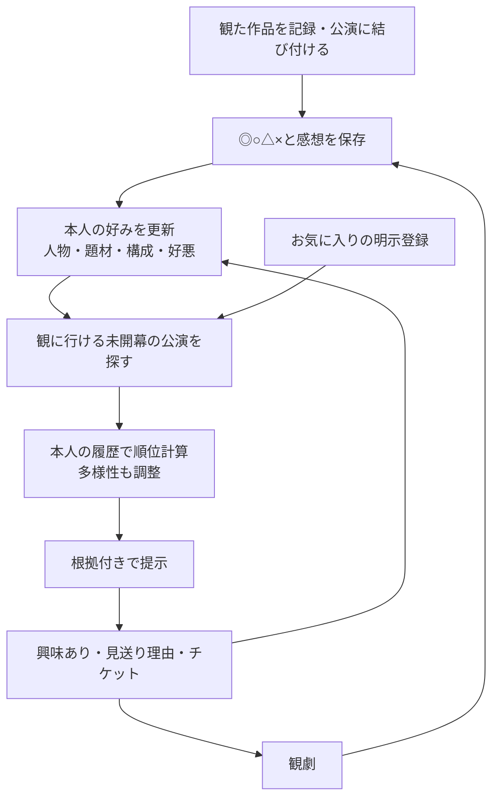

# たぐり：使うほど好みに近づく推薦を実現する計画と検証

作成日：2026-10-12（日本時間）  
対象：公開用リポジトリ `island-6848/taguri-demo`、確認時のmaster `e9eeb8066ba982fcbc224f6b68810c91ff5a1ad3`  
状態：設計・作業計画。下記の接続、感想分析、学習、検証は未実装・未実施。既存のテスト通過は推薦精度の証明ではない。

## 1. 結論と売り文句

最初に採用するのは、**利用者別の人物実績＋感想の観点別の好み＋あらすじの意味的な近さを組み合わせる推薦**。その後、実際のフィードバックで各信号の重みを調整し、似た公演だけで埋まらないようにする。

実装するだけで「使えば使うほど、推薦の質が上がる」とは証明できない。記録の追加で好みの推定は更新できても、ノイズ、好みの変化、候補不足によって質が下がる場合がある。毎回・全員の単調改善を保証するアルゴリズムは採用前提にしない。

- 循環の接続と表示の検証後に使える表現：**「評価や感想を重ねると、おすすめがあなたの好みに合わせて変わります」**。
- 実利用で改善を確認した後の表現：**「記録するほど、あなたの好みに近づくおすすめへ」**。検証条件・対象人数・期間を併記できるようにする。
- 「使えば使うほど、推薦の質が上がる」は、下記の学習曲線と実利用比較が裏付けた範囲の主張に限定する。クリック増だけを観劇後の満足度向上と言い換えない。

## 2. 現在どこで循環が切れているか

| 箇所 | 現在のコードの挙動 | 必要な変更 |
| --- | --- | --- |
| `app._load(user_id)` | 共通の `recommend2.json` を読み、反応・お気に入り・効かせ方を利用者別に当て直す | 利用者本人の評価・感想から生成した順位と理由を読む |
| `serve.on_rate` | 利用者の評価を保存する | 保存を契機に本人のプロフィールと推薦を更新する |
| `serve.on_note` | 感想を保存する。順位には使わない | 感想の観点を抽出し、その人の推薦へ反映する |
| `measure_nets.load_rated(user_id)` | 利用者別に読めるが、公演に結び付いていない記録は人物等が空 | 記録と公演を照合し、情報不足を別扱いにする |
| `recommend2.py` | `--user-id` に対応するが、主な画面経路は共通の事前計算結果 | 共通候補の生成と利用者別の順位計算を分離する |
| 見本96件 | 93件は架空の評価・感想、3件は未評価。stage_idは空 | デモ実演用と実利用の学習・精度検証用を分ける |
| データ保存 | README上、公開デモは再起動時に入力・復旧コードがリセットされる | 継続利用の実験・本サービスでは再起動しても履歴を維持する |

既存の個人用・実験用リポジトリの意味類似・MMR・時系列評価実装は参考にできる。ただし、別PRの実装を公開デモへ適用済みとは扱わない。利用者分離、イベントの由来、日付の制約を確認して移植する。

## 3. 目標とする循環



「観なかった」は「嫌いだった」と同じにしない。見送りの理由が日程・地域・予算なら、その制約に使う。内容への好悪が明示された場合だけ好みの信号にする。

## 4. 推薦アルゴリズムの採用案

### 4.1 最初の構成：内容に基づく複数信号の推薦

候補を集める処理と順位を付ける処理を分離する。お気に入り、人物、物語の要素、意味類似の各経路の候補を和集合で集め、利用者の条件を満たすものを順位付けする。現在の共通上位15件だけを並べ直す方式では、本人向けの候補が最初から欠けるため、共通の全候補を使う。

| 信号 | 計算するもの | 採用上の注意 |
| --- | --- | --- |
| 人物の実績 | 本人が観た作品における人物・役職ごとの評価と、本人全体の評価との差 | 少数履歴を縮約する。役職の既定重みは現行を比較基準に残す |
| 明示したお気に入り | 人物・団体・原作者・題材との一致 | 申告枠は別に残し、推定の精度に混ぜない |
| 感想の観点 | 題材、人物関係、物語構成、トーン、演技などへの肯定・否定・不明 | 根拠のある観点だけ使う。対象や極性が不明なら保留 |
| 意味的な近さ | 評価した作品のあらすじと候補あらすじの文章ベクトルの類似度 | 「似ている」だけで「好き」と判断しない。日本語モデルを別途評価 |
| 現実の条件 | 地域、初日、日程、予算等の確認できる情報 | 好みと制約を分ける。取得できない価格等を捏造しない |
| 多様性 | すでに選んだ公演と候補の類似・人物の集中 | MMRで調整し、関連性の低い公演を数合わせで入れない |

意味類似の基盤はSentence-BERT系を候補とする。[Sentence-BERT, Reimers & Gurevych, 2019](https://arxiv.org/abs/1908.10084)は文章埋め込みと類似度計算の手法であり、好悪や観劇満足度を推定する能力をそのまま保証する論文ではない。

感想から好まれた内容に沿う正のプロフィールと、苦手とされた内容に沿う負のプロフィールを持つ。初期の説明可能な比較モデルは次の形とする。

```text
score(user, item)
  = w_person × 人物の寄与
  + w_aspect × 観点ごとの好みとの一致
  + w_semantic × (好みの作品との類似 − 苦手な作品との類似)
```

これはたぐり向けの設計案で、論文のモデルをそのまま再現する式ではない。各信号は同じ尺度に校正し、重みは時系列検証で選ぶ。候補集合ごとの正規化を使う場合は候補追加による不安定性も測る。信号が欠けたときは欠損マスクを持ち、ゼロ点を「嫌い」と解釈しない。

### 4.2 感想の観点分析

参考は[Explicit Factor Models for Explainable Recommendation based on Phrase-level Sentiment Analysis, Zhang et al., 2014](https://www.cs.cmu.edu/~glai1/papers/yongfeng-guokun-sigir14.pdf)。レビューを対象と評価の組に分け、説明可能な推薦に使う考え方を採る。EFMの協調的な因子分解を、少数のデモ利用者で直ちに学習するわけではない。

全体の文章のポジティブ／ネガティブ判定だけでは不十分。次のように分析する。

| 感想例（検査用の人工文） | 抽出する好み | 抽出してはいけないもの |
| --- | --- | --- |
| 「悲しい結末だけど、姉妹の関係が丁寧で好き」 | 姉妹関係の丁寧な描写＝肯定 | 悲しい物語全般＝嫌い |
| 「話は好きだが、歌が多すぎた」 | 物語＝肯定、歌の頻度＝否定 | ミュージカル全般への永久禁止 |
| 「父親の行動は嫌いだが、描き方はよかった」 | 描写＝肯定、登場人物への嫌悪 | 父子もの＝嫌い |
| 「長くて疲れたが、伏線の回収に満足」 | 伏線回収＝肯定、長さ＝負担 | 劇全体＝不満 |
| 「面白くなくはない」「皮肉が効いている？」 | 不明／保留の可能性 | 確信の高い好き・嫌い |
| 「仕事で間に合わなかった」 | 日程上の制約 | 題材・出演者＝嫌い |

抽出結果は `aspect / target / polarity / evidence_span / confidence / source_note_version / extractor_version` を持つ。根拠は感想原文の位置と一致しなければ採用しない。confidenceは未校正のモデル自己申告を確率として扱わず、保留・確認の判断材料から始める。

画面には「家族の関係を丁寧に描く話を好む傾向」のように、本人が確認・修正・削除できる形で返す。たった1件から性格や私生活を推測しない。演技や歌への感想を、候補のあらすじだけから照合できるとは限らない。候補に該当特徴の裏付けがない場合は、プロフィールとして保存しても加点しない。

LLMを使う場合も、役割は構造化抽出まで。保存済みの抽出結果から順位と理由を再現できるようにする。外部APIに原文を送る実装は入力内容と送信先を明示した選択制にし、ローカル処理または未分析のまま保存する経路を用意する。公開デモの現在の「操作から外部LLMを呼ばない」方針は維持し、事前計算またはローカル分析を使う。

### 4.3 評価が増えた後：正則化した利用者別学習

最初から大量の特徴と複雑なモデルを利用者ごとに学習しない。まず人物・観点・意味類似等の少数の特徴を入力とする、正則化した線形／順序モデルを比較する。

- 現行の「◎か否か」は人物モデルの比較基準に残す。
- 新しいモデルでは◎＞○＞△＞×という順序を使う案も比較する。○を嫌いと同一視しない。
- 数値への写像は仮説であり、固定した正解にしない。学習・調整用の期間だけで決める。
- 履歴が少ない間は説明可能な既定重みに寄せ、独立した作品が増えたら本人のデータを重くする。
- 同じ作品を15回観ても、独立した15作品の証拠として扱わない。再観劇の選択と、各回の評価の違いは別に保存する。
- 興味ありは観劇後の満足より弱い信号。クリック、購入、観劇評価を一つの同じ目的変数に混ぜない。
- 好みの変化を扱う減衰は、無減衰モデルと比較してから採用する。感想の編集・削除時は再構築して古い信号を除く。

重み更新があれば自動的に精度が上がるわけではない。履歴が少ない人での過学習、説明の変化、順位の不安定さを合格条件に含める。

### 4.4 多様性と探索：役割を分ける

[MMR, Carbonell & Goldstein, 1998](https://www.cs.cmu.edu/afs/cs/Web/People/jgc/publication/MMR_DiversityBased_Reranking_SIGIR_1998.pdf)を、関連性を保ちながら似た候補の重複を減らす再順位付けに使う。MMRだけでは学習も未知の好みの発見も行わない。

探索の学習は後段で[LinUCB, Li et al., 2010](https://arxiv.org/abs/1003.0146)を候補とする。まだ確信の低い候補を一定割合で提示して反応を集める。ただし、この論文はニュースのクリックを対象とし、低頻度で満足の結果が遅れて返る演劇にそのまま効果を保証しない。

- 初期は探索枠を明示する。割合や関連性の下限は検証で決める。
- 候補特徴を共有する方式を使い、新作ごとにゼロから学ぶ設計を避ける。
- 表示・候補集合・表示確率・方策バージョンを保存する。クリックなしは露出や閲覧状況次第なので即座に嫌いにしない。
- 観劇後の評価と、観る前の興味の二つを別の目的で評価する。
- 決定論的な旧ログだけでバンディットの優劣を証明しない。確率的な収集と十分な支持が必要。

### 4.5 利用者が増えた後の候補

[BPR, Rendle et al., 2009](https://proceedings.mlr.press/r7/rendle09a.html)は、利用者が選ぶアイテムの順位を学ぶ方式として比較候補にする。ただし演劇は新作・単発公演が多く、利用者間の共通評価が少ない。最初の主方式は内容に基づく推薦とし、BPR等の協調フィルタリングは、十分な実利用者・重複する作品・露出ログが集まった後に追加する。

未評価を負例として無条件にサンプリングしない。公演を知らない・遠い・高い・日程が合わない可能性がある。作品／上演／会場の識別を揃え、内容特徴を併用し、新規作品と新規利用者を別に評価する。

## 5. 実装する作業と順序

### P0：データと循環をつなぐ

- [ ] **由来を保存する。** 評価と感想それぞれに `demo_generated / user_entered / imported / unknown` 等の由来、入力日時、変更履歴を持つ。利用者が編集したフィールドだけ由来を変更する。
- [ ] **見本と実データを分離する。** 見本93件は動作の実演には使用可能だが、品質検証・本物の利用者の学習には混ぜない。モードを画面・ログで区別する。
- [ ] **過去の由来を捏造しない。** 現状のseed JSONのdemo_generatedはDBの各フィールドの由来を保証しない。既存データで由来を判別できない分はunknownとし、明確な変更ログがないまま実評価へ昇格させない。
- [ ] **記録の公演照合。** 既存の `link_stage` を使い、タイトル・観劇日・会場で候補を絞る。同名作品、再演、翻案、同日の別回を区別し、曖昧なら本人に確認する。
- [ ] **未結合でも保存可能にする。** 人物は不明とし、本人が入力・確認したあらすじや感想の観点があれば利用する。タイトルだけから筋や出演者を生成しない。
- [ ] **利用者別の順位計算を実装。** 共通カタログは読み取り専用。user_idを必須とする `build_profile` と `rank_candidates` を用意する。全候補の作品・上演IDを保ち、共通JSONを上書きしない。
- [ ] **更新イベントを接続。** 評価・感想・公演結合・お気に入り・反応・重み・削除／統合／解除で、その人のプロフィール／推薦のrevisionを更新する。保存時の変更とキャッシュ無効化を一貫させる。
- [ ] **計算結果の取り違えを防ぐ。** キャッシュキーはuser_id、profile_revision、catalog_revision、model_version、絞り込み条件。遅い旧ジョブが新しい結果を上書きしない。
- [ ] **表示を接続。** 保存成功、計算中、反映済み／失敗を分ける。保存後の次の画面読み込みで更新結果か明示した状態を返す。無言で以前の個人順位を最新として見せない。
- [ ] **再起動に耐える保存。** SQLite等の保存先、バックアップ、復旧コードを含む利用者識別の継続性を確認する。デモのリセット運用は本サービスと分ける。
- [ ] **対象公演の制約。** 日付・地域・既回答・購入済み・公演終了・ツアー重複を既存の束の意味に沿って扱う。日付不明を黙って未開幕と断定しない。

### P1：感想分析と意味類似を組み込む

- [ ] 共通の観点語彙、別名の正規化、候補側で照合できる属性を定義する。
- [ ] 日本語の否定、混合評価、人物への嫌悪、感動による悲しみ等の確認用データを人手で作る。
- [ ] 根拠位置を持つ構造化抽出、保留、本人の訂正を実装する。抽出失敗でも保存を失敗させない。
- [ ] 原文・抽出結果・モデル・設定のバージョンを記録し、編集／削除で再分析する。
- [ ] あらすじのベクトル索引を準備する。長文の切捨て、モデル変更、欠損、キャッシュ整合を検査する。
- [ ] 正と負のプロフィール、現行人物モデル、意味類似単独、観点単独、組み合わせを比較する。
- [ ] 理由を実際に加点した根拠から生成する。「家族ものが好き」ではなく、どの感想・評価から分かったか確認できるようにする。
- [ ] 根拠のない演出・演技の予測を理由に書かない。デモ感想の引用は架空と分かる表示を維持する。

### P2：質の改善を測って重みを学ぶ

- [ ] 表示ログ、反応、観劇結果を時系列で収集する。履歴の件数は独立作品数と再観劇回数を分ける。
- [ ] 正則化した利用者別モデルを導入し、少数履歴では既定モデルへ縮約する。
- [ ] 学習曲線、信号の除去比較、時間減衰、多様性を測る。
- [ ] 比較画面／機能フラグを用意し、現行へ戻せる状態で実利用比較を行う。
- [ ] 品質が悪化した利用者群を確認して修正する。全体平均の改善だけで全利用者の改善を主張しない。

### P3：探索と協調学習

- [ ] 十分な実ログが集まったら探索枠を導入し、表示確率を記録する。
- [ ] LinUCB等を影で比較し、興味と観劇後満足の両方を測る。
- [ ] 共通作品の実評価が増えたらBPR等の協調方式を追加比較する。
- [ ] 売り文句の使用条件を検証結果に合わせて見直す。

## 6. 検証項目：機能・分析・運用

すべて未実施。必須の不変条件は100%合格を要求する。抽出品質・推薦品質の数値目標は、評価データを作り、調整用期間の予備調査を行ってから、本評価を見る前に固定する。

| ID | 検証内容 | 合格条件／記録するもの |
| --- | --- | --- |
| V01 | Aの評価を変更し、A/Bのプロフィールと推薦を比較 | Aのrevisionと入力が変わる。Bの結果・データは変わらない。すべての操作で1位が変わることは要求しない |
| V02 | 制御した候補と履歴で◎→×を変更 | 関連特徴の寄与が想定方向へ変化。条件を揃えた順位変化が観測できる |
| V03 | 評価なしの利用者、すべて同じ評価の利用者 | エラー・NaN・空理由の高得点を出さず、明示した初期推薦へ戻る |
| V04 | 作品の結合・解除・削除・統合を行う | 対応する人物・観点の寄与が再構築され、消した信号が残らない |
| V05 | 同名作品・再演・別会場・別回を照合 | 別の作品へ誤結合しない。曖昧な組を確認なしで自動確定しない |
| V06 | 同一作品を複数回評価 | 独立作品数を水増ししない。再観劇の扱いをログで説明できる |
| V07 | 興味なしに日程理由、内容理由を付ける | 日程理由だけで人物・題材の負例を作らない |
| V08 | 無反応・閲覧なし・未評価 | 負の好みとして扱わない |
| V09 | 混合評価、否定、二重否定、皮肉、登場人物への嫌悪 | 人手の対象・極性ラベルと比較。適合率、再現率、保留率を種類別に記録 |
| V10 | 抽出の根拠位置と確信度 | 根拠位置は原文と100%一致。人手判定に対する確信度区分の誤りを測る |
| V11 | 架空のデモ93件だけで学習・評価を走らせる | 実品質の指標には入らない。デモモードの動作結果としてのみ記録 |
| V12 | 本人が評価だけ／感想だけを書き換える | 変更したフィールドの由来だけがuser_enteredになる |
| V13 | 根拠のない演技等の特徴を抽出 | 候補側に裏付けがない属性で加点・断定しない |
| V14 | あらすじの欠損、長文、モデル切替 | 欠損を嫌いにしない。長文の後半も処理する。別モデルのキャッシュを混ぜない |
| V15 | 同じ入力・モデル・候補で繰り返し計算 | 順位・寄与・根拠が再現する。同点処理も固定する |
| V16 | MMRを有効／無効にする | 類似重複の減少と関連性の変化を記録。関連性下限を満たす |
| V17 | 感想編集・削除とジョブの順序逆転 | 旧抽出・旧順位を新しい結果として採用しない |
| V18 | 推薦理由と計算寄与を突合 | 実際の信号と根拠だけで説明する。本人以外の感想を引用しない |
| V19 | 更新・表示の時間、同時利用、失敗時 | 応答時間p50/p95、再計算時間、失敗率を測る。暫定目標：保存p95≤1秒、通常更新≤5秒。Renderのコールド起動・外部抽出待ちは別計測 |
| V20 | 再起動、バックアップ復元、復旧コード | 本サービスの履歴・利用者識別が維持される。デモリセットの仕様と混同しない |
| V21 | 感想にHTMLや抽出への命令文を入力 | 表示でエスケープする。文中の命令で抽出仕様や推薦方針が変わらない |
| V22 | 推薦日時・地域・既回答・購入済み | 対象制約と束の意味を守る。全候補から検索され、共通上位15件だけに閉じない |
| V23 | プロフィールの訂正・分析無効化 | 訂正が次の順位に反映し、感想を分析しなくても評価による推薦が利用可能 |
| V24 | 候補増減・ユーザーの重み変更 | 正規化が設定効果を相殺しない。理由用の上位抜粋だけで再計算しない |
| V25 | 真の履歴が増えたときの更新 | 入力revision、採用信号数、順位変化を追跡できる。順位変化自体を品質改善とは報告しない |

## 7. 検証項目：「使うほど改善する」をどう測るか

### 7.1 実データがない現在にできること

見本96件でV01〜V25のうち動作・整合性を検査できる。ただし、架空の評価・感想を互いに似せて作ったので、そのデータで高い精度が出ても実力の証拠にならない。人手で作る感想の分析問題は日本語理解の検査に使えるが、観劇満足の検査にはならない。

現時点の品質判定は**未検証**とする。実利用者の評価が集まるまで、AUC等の過去の個人実験結果を公開デモの精度として転用しない。

### 7.2 時系列のオフライン比較

| ID | 検証 | 手順・判断 |
| --- | --- | --- |
| Q01 | 未来情報の漏洩 | 推薦時点より前に入力された評価・感想だけを学習。観劇日だけで順序を作らず、入力・編集日時を使う |
| Q02 | 候補の時点整合 | その時点で取得済み、観劇可能、未開幕の候補を再現。後から得たあらすじ・クレジットを当時既知として使わない |
| Q03 | 作品の漏洩 | 同作品の再演・ツアーをまとめて分割。新規作品への推薦と再観劇の推薦を別に測る |
| Q04 | 比較基準 | 共通順位、現在の人物方式、意味類似単独、感想なしの組み合わせ、感想あり、学習重み、MMRありを同じ条件で比較 |
| Q05 | 学習曲線 | 同じ利用者・同じ将来のテスト候補と評価を固定し、過去の独立作品5/10/20/40件等で学習。足りない人は対象外とし人数を報告 |
| Q06 | 主指標 | 主指標は観劇後の順序評価に基づくNDCG@10を候補とし、本評価前に固定。◎到達率・候補Recall@50・多様性・提供不能率を併記 |
| Q07 | ラベルの限界 | 未観劇は不明。評価済み集合での順位一致は、全公演からの発見能力と区別。検索で候補に入らない既知の正例は失敗として数える |
| Q08 | 分母と不確実性 | kを固定した指標、候補件数、評価件数、利用者数を記録。利用者単位の信頼区間を示し、同一作品の複数回を独立標本としない |
| Q09 | 各信号の効果 | 感想を外したモデルとの差、人物を外した差、意味類似を外した差を比較。同じ感想を学習と評価の両方に使わない |
| Q10 | 好みの変化 | 古い履歴と最近の履歴の差を比較。直近の入力数が増えた人だけを見ることによる選択の偏りも記録 |
| Q11 | データ量の効果 | 完全モデルと、追加履歴を受け取らない固定モデルを同じ将来期間で比較。候補更新だけによる改善と区別する |
| Q12 | 調整と最終判定 | モデル・重み・減衰・MMR係数を調整する期間と最終テスト期間を分ける。良かったテストだけを選ばない |

履歴件数の違う別の利用者同士を比較するだけでは、使うほど改善した証拠にならない。また、過去に本人が選んだ作品だけの評価では選択の偏りが残る。オフライン比較は実利用比較の準備と位置付ける。

### 7.3 実利用の比較と主張の使用条件

- [ ] 利用者単位で「履歴を更新する推薦」と「初期プロフィールを固定する推薦」を比較する。候補・日程・表示条件はそろえる。
- [ ] 更新方式の比較用に現行とのA/Bを行う。少人数なら比較画面の選択結果は予備検査に留める。後の期間へ好みが持ち越されるため安易な交互切替は避ける。
- [ ] 主目的は観劇後の本人の満足。興味あり率、理由の納得度、見逃し、候補の新しさは補助指標にする。
- [ ] 推薦から観劇まで時間がかかるので、追跡期間と評価を依頼する時点を先に決める。未回答を×にしない。
- [ ] 観劇に至らなかった人、評価を返さなかった人も分母・脱落率に含めて報告する。観劇者だけの満足度は条件付き指標として示す。
- [ ] 最低検出差、必要人数、追跡期間、検定／信頼区間の方法を事前に決める。現状は実評価がないため必要人数を確定しない。
- [ ] 主指標の改善の信頼区間下限が事前に決めた基準を満たし、多様性・負担・提供不能率が許容範囲で、複数の履歴量の層でも傾向が再現することを確認する。
- [ ] 感想のある人／ない人、初期利用者／継続利用者、地域や候補の少ない人の結果を併記する。
- [ ] 満足度を十分に観測できない場合、「質が上がった」は保留し、「好みに合わせて更新される」という機能の説明に留める。

## 8. 実装時のファイル配置案

| ファイル・保存先案 | 役割 |
| --- | --- |
| `tools/review/user_recommender.py` | 利用者別のプロフィール構築・候補順位計算。user_id必須、共通候補を変更しない |
| `tools/review/review_aspects.py` | 感想から根拠付き観点を抽出。抽出器を交換できる境界 |
| 既存DBへの由来・revision・イベント表の追加 | 評価／感想の由来、編集履歴、プロフィール、抽出・推薦のバージョン |
| `tools/taguri/app.py` | `_load` を利用者別の結果へ接続。根拠確認・訂正・分析の設定 |
| `tools/taguri/serve.py` | 保存・結合・削除のイベントで更新。キャッシュとジョブの整合 |
| 既存の意味類似索引／MMR実験コードの移植 | 共有する公演の特徴量。モデルと入力ハッシュを固定 |
| `tools/review/evaluate_user_learning.py`（新設案） | 時点別の候補・履歴、比較方式、学習曲線、区間推定を出力 |
| `tools/taguri/test_user_recommendation.py`（新設案） | 分離・更新・説明・欠損・編集削除等の受入検査 |

実装順はP0→P1→P2→P3。最初の完了条件は「本人の評価変更が本人の次の推薦へ届き、他人を変えない」こと。その次に「感想で褒めた／苦手とした点が、確認できる根拠として次の推薦に使われる」こと。品質改善の宣言はQ01〜Q12と実利用比較を通過した後に行う。
