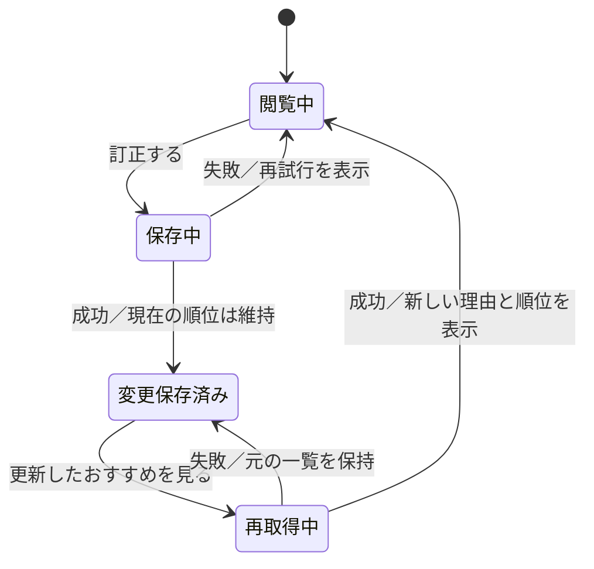

# たぐり：推薦を中心にしたUI/UX詳細設計

設計日：2026-10-11。状態：**次に作る試作・実装の仕様。画面変更は未実装、効果は未検証。**

[機能案と検証の全体計画](recommendation-product-ux-plan.md)を具体化する文書。
画面構成・初期実装の範囲は本書を優先する。研究上の知見と製品としての判断を分ける。
参照IDは[文献調査](research/recommendation-ux-literature.md)に対応する。

## 1. 中心の体験と設計の結論

**おすすめから観たい一本を選ぶ。その理由を必要な分だけ理解し、推測が違うときに直せる。**
記録や感想は次の推薦を育てるために使う。通常の入口をプロフィール分析や入力タスクにしない。

初期設計では次を採用する。

1. おすすめを入口にし、地域・候補・興味ありを先に見せる。
2. 上位15件は維持。ランキング順の縦1列にして、表示件数を減らす前に情報量を整える。
3. 公演の顔としてポスターを強調し、公演名、選択中の地域の会場・日程、推薦理由の短い要点、興味ありを常時表示する。
4. 詳しい推薦理由、根拠の感想、解釈の訂正はカード内で開く。
5. 興味あり／今回は見送る／購入済みを区別し、見送りを一般的な嫌いの学習にしない。
6. 保存結果を伝える。訂正後も表示順位を保ち、明示的な更新または次回取得で反映する。
7. 読み込みを実際の状態として示し、分からない進捗の百分率は表示しない。
8. モバイルとキーボードで、推薦から選択・理由確認・訂正を完了できるようにする。

5件表示、探索枠、気分選択、比較は後続の実験。初期画面にすべてを積み上げない。
サイズ・色・件数などの設計値は製品側の初期判断であり、論文が保証する最適値ではない。

## 2. 現状との対応と決定理由

公開コードとローカルの感想補正実装を確認した。実際の利用者による画面評価はまだ行っていない。

| ID | 現状・論点 | 決定 | 根拠／適用上の限界 |
|---|---|---|---|
| D1 | 推薦の前に地域の選択肢や重み設定がある | 地域は選択結果と変更ボタンに要約。重みは詳細設定へ | G1。地域自体は選択に必要なので隠し切らない |
| D2 | 最大15件、各カードに複数の理由・操作 | 15件を維持し、短いカードの縦1列。自動追加・カルーセルは採用しない | R1・R4。5件が最適という根拠はない |
| D3 | 推薦理由は人物・内容等の行を列挙 | 要点1文＋詳細。元の作品、特徴、引用、訂正を結び付ける | R2・R3・G1。説明への納得は精度向上と別に測る |
| D4 | 理由の×は登録解除や「出さない語」につながる | 「この感想の解釈を訂正」と「今後この語を除外」を別操作にする | R2。対象範囲が異なるため同じ×にしない |
| D5 | 興味なしが候補への反応になる | 一覧では「今回は見送る」。理由は任意。好みと事情を分離する | G2と製品判断。学習への影響もサーバ側で区別する |
| D6 | 保存成功でキャッシュは失効するが現在画面は再取得されない | 保存状態と「更新したおすすめを見る」を表示。閲覧中は順位を固定 | R2。既存の取得時補正と整合させる |
| D7 | 経過時間を用いて進捗が95%に近づく | 不定進捗と待機説明、エラー時の再試行に変更 | G2。実際の工程進捗を取得していない |
| D8 | PC左サイドバー、モバイル上部の横スクロールナビ | PC左ナビを維持、モバイルはおすすめ・興味あり・観た公演・その他 | G2と製品判断。4項目の有効性は操作観察で確認 |
| D9 | 控えコードが復元手段 | 復元の案内を保持し、推薦と無関係な追加プロフィールは必須にしない | コード上の認証要件。任意に飛ばしてよい入力と混同しない |

確認した主な場所：`app.py`の`_recommend_body`、`render_recommend.py`の`filtered`・`reason_rows`・`buttons`、
`web/app.js`の`startLoading`と画面キャッシュ、`web/style.css`。
お気に入りは登録名に当たる一覧で、推定による推薦とは異なる。推薦一覧へ混ぜない。

## 3. 情報構成・ナビゲーション

### 3.1 入口と行き先

- おすすめ：既存の`/recommend`。アカウントの利用準備ができた後の既定入口。
- 興味あり：既存の`/recommend/interest`。選んだ公演の購入・日程確認を続ける場所。
- 観た公演：既存の`/rate`への入口。評価と感想は同じ観劇記録に結び付ける。
- その他：お気に入り、開幕リマインド、カレンダー、チケット、登録、記録、検索、設定への入口。

既存のURLは保持する。「観た公演」は表示ラベルの整理であり、新しい別DBや別入力フローを作らない。
PCは既存の左ナビ幅228pxを維持し、おすすめのグループを最初に置く。
記録の可視化や高度な設定は折り畳み可能な下位項目にする。
モバイルは4項目の下部ナビを試作する。アイコンには常に文字を添える。
「その他」は開閉するメニューで、現在地は`aria-current`等で示す。

認証・復元コードの案内は利用準備として保持する。安全にアカウントへ戻れることを犠牲にしない。

### 3.2 おすすめ画面の読む順序

1. 見出し「おすすめ」と短い説明「観た公演や感想をもとに、好みに合いそうな公演を並べています」。
2. 条件「全国［地域を変更］」、推薦情報の更新日時、表示件数。
3. 公演カードのランキング順の一覧。
4. 表示範囲の説明、任意の「推薦の設定」、見送った公演を開く入口。

初期は地域だけを主要条件にする。既定は全国を維持し、端末位置から勝手に変更しない。
地域変更はカード一覧を覆う常設の大きな地図にせず、「地域を変更」で開く。
複数県を選べる既存機能と地図を詳細内に保持し、［適用］［全国に戻す］を明示する。
適用時に件数を知らせ、0件なら別の地域に戻せる。

期間選択は初期には追加しない。既存のおすすめは開幕前の候補が中心で、開幕済みは別扱い。
「今夜行ける」という導線には対象拡張と会場ごとの開催日情報が必要になる。
「今週」は更新周期と上演期間を混同しやすいため見出しから外し、実際の更新日を表示する。

### 3.3 件数・順序

上位15件を通常の縦スクロールで表示する。1画面に15件を詰め込まず、一定の幅・情報順を揃える。
順位を大きな競争表示にせず、画面上部に「好みに合いそうな順」と記載する。
上限より多い対象がある場合は「対象N件のうち上位15件」と示す。
すべて出している場合は「N件」。対象件数が不明なときに架空の件数を作らない。

「次の5件」を押す段階表示は初期採用しない。カードがなお重い場合に15件表示との比較を行う。
ポスターの横スワイプや無限スクロールも初期採用しない。

## 4. 推薦カードと詳細

### 4.1 常に見せる情報

| 順 | 内容 | 仕様 |
|---|---|---|
| 1 | 公演名、劇団・主催の識別情報 | 題名はリンク。長い題名を末尾省略しない |
| 2 | 会場、地域、上演期間 | 地域条件に一致する会場の日程を主表示。巡業の代表会場だけで判断しない |
| 3 | 値段・販売情報 | 信頼できる値がある場合だけ表示。取得できないときは「料金未確認」等 |
| 4 | 推薦理由の要点 | 原則1文、意味を削る行数制限はしない。詳細へのボタンを添える |
| 5 | 主操作 | ［興味あり］を強調。［今回は見送る］は弱い強調 |

ポスターは公演の顔としてカードの主要要素にする。縦横比を保ち、文字を含む画像全体を見せる。
題名・日程・会場は画像と近接させる。画像がなくても公演を識別して選べるようにする。
これは利用者の指摘を反映した設計変更で、今回のログ追加でカードの見た目まで変更するものではない。
カード全体をリンクにして内部のボタンと競合させず、公演名・詳細・各操作を独立させる。
価格不明を0円、販売情報未取得を発売前・完売と扱わない。
公演の外部ページへ出る場合は行き先を示し、リンクが購入そのものを実行するように見せない。

複数会場は「ほかの会場・日程を確認」で開く。選択地域に一致する会場が複数あるときは
該当分を読めるようにし、行ける会場を件数上限で消さない。

### 4.2 理由の要点を作る規則

外部LLMを使わず、実際に順位計算に使用した根拠からテンプレートで作る。
一般の作品紹介を個人化の理由に見せない。要点と詳細は同じ根拠を参照する。

| 根拠 | 要点の例 | 避ける表現 |
|---|---|---|
| 感想での特徴への好評 | 「会話劇を楽しんだ感想と共通する特徴があります」 | 「あなたは会話劇が絶対に好き」 |
| 作り手と観劇履歴の関連 | 「これまで気になった公演と、演出家が共通しています」 | 作品全体への◎だけで「この演出家を高く評価しています」 |
| 参考が少ない | 「少ない記録を参考にしたおすすめです」 | 根拠のない確率・的中率 |
| 内容への好評と不評が混在 | 「会話劇への好評を参考にしています。題材には苦手と書いた要素もあります」 | 正の理由だけを出して重要な不評の補正を隠す |

関連の種類に合わせ、好評・興味あり・観ればよかったを区別する。
本人の原文を引用することと、システムがその原文を一般化したことを分けて書く。
要点の長さが増える場合も、公演の選択に重要な留意点を落とさない。
内部の網a/b/c、lift、スコアの小数は通常の選択に要求しない。

### 4.3 詳しい理由を開いたとき

［推薦理由を見る］でカード内を展開し、別画面への往復を減らす。

1. 順位計算に使った公演の特徴・作り手と、本人の記録の対応。
2. 根拠となる観た作品名と短い原文引用。原文へのリンクを添える。
3. 「この感想から、他の公演にも当てはまる好みとして少し参考にしています」。
4. 感想の解釈ごとの［好みとして合っている］［この作品だけ］［読み取りが違う］。
5. 推薦情報の限界・情報の出典を必要に応じて確認できる補足。

引用と訂正は自分のアカウント内だけに表示する。原文はHTMLとして解釈しない。
閉じると開いたボタンへ戻れる。開閉状態を読み上げに伝える。
訂正までさらに何段もの詳細を開かせない。

## 5. 反応・好みの訂正・反映

### 5.1 候補への反応

［興味あり］は候補保存。確認モーダルや理由入力を必須にしない。
保存成功後に「興味ありに追加しました」［取り消す］［一覧へ］をカード内で表示する。
現在のカードは状態付きで残し、ページ取得時に既存ルールに沿って一覧から除く。
書き込み中は同じ操作を重複送信しない。失敗時は保存済み表示にせず再試行できる。

［今回は見送る］はこの公演を今の一覧から外す判断で、一般的な嫌いの表明ではない。
成功後に理由を任意で開ける。日時／場所／予算／内容／その他／答えないを区別する。
日時・場所・予算・無回答は特徴への負例にしない。
「内容」だけでも全特徴を嫌いと判断しない。一般的な好みとして反映するなら、特徴を特定した別の明示操作が必要。
見送った候補から取り消せる。学習処理・計測でもこの意味を守る。

購入済みは［公演の詳細］内の［チケットを持っている］へ移す。
すでに購入済みと分かる候補には状態表示を付け、追加購入を促す主操作を出さない。
「興味ありの理由」は保存後の任意入力として保持し、15カードに空欄を常設しない。

### 5.2 感想の一般化の訂正

| 操作 | データと推薦の意味 | 表示する結果 |
|---|---|---|
| 好みとして合っている | この解釈を確認済みにする。1票を複数票に増やさず、補正の上限を維持 | 「この解釈を確認しました」 |
| この作品だけ | この感想・特徴の組を、他作品への好み補正から除く。原文・作品評価は残す | 「この感想は、他の公演への好みの判断に使いません」 |
| 読み取りが違う | この感想・特徴の解釈を無効化。初期は正負の反転を自動で行わない | 「この読み取りを取り消しました」 |
| 訂正を取り消す | 元の弱い推測へ戻す。設定から後日も解除可能 | 「元の扱いに戻しました」 |

「この作品だけ」は当該感想からの1つの特徴の一般化を止める。他の感想の同じ特徴まで無効にしない。
「今後この語を除外」は全候補へ広く効く既存の設定として残し、範囲を説明した別操作にする。
お気に入りの解除も別操作。単純な×を三つの意味に使い回さない。

訂正記録は利用者ID、元作品のキー、特徴キー、原文の版、処置、更新日時で識別する想定。
これは新規データ設計で未実装。原文の編集で古い版への訂正を再利用せず、削除後は引用・補正を消す。
別端末で編集された版への古い訂正は適用せず、最新状態を再取得する。
正負を選び直す高度な編集は初期に入れない。まず無効化と取り消しを確実にする。

### 5.3 保存と順位更新



成功時は「保存しました。次におすすめを開くと反映します」［更新したおすすめを見る］。
保存直後にカードを移動・消去してフォーカスを失わせない。
更新は再取得であり、データ収集の週次処理を起動する意味ではない。
再取得後は見出しへ焦点を移し、件数と更新完了を伝える。戻る操作では地域条件を復元する。
保存失敗では入力・原文・開いていた理由を保持する。
古いレスポンスが新しい操作結果を上書きしないよう、要求の世代を識別する。

## 6. 視覚設計・レスポンシブ

劇場を感じる既存のえんじ色とチケットの表現を保持する。
切り取り線などの装飾は公演の識別・読みやすさを妨げない程度にし、カード内を広告のように派手にしない。

| 項目 | 初期設計値 | 用途・注意 |
|---|---|---|
| 背景／カード | `#e7eae6`／`#f8f9f6` | 既存の穏やかな面を保持 |
| 本文／補足 | `#191b18`／`#4e534d` | 補足も十分なコントラストを確保 |
| 文字の弱い色 | `#62685f` | 既存の薄いmuteより濃く。必要な文字を薄くしない |
| 主操作 | `#26467d`＋白文字 | ［興味あり］等。色以外にラベルを付ける |
| ブランド | `#7a1e2b` | ロゴ・見出しのアクセント。全操作をブランド色で競わせない |
| 操作の枠線／フォーカス | `#767d72`／`#26467d` | 装飾の薄い境界と、操作に必要な境界を分ける |
| 本文／補足／題名／画面見出し | 16／14／20／24px | 本文行高1.7。ブラウザの文字拡大を尊重 |
| 余白 | 4px単位、カード内16px、カード間16px | PCは内側24pxを許容。密度を上げすぎない |
| 操作ターゲット | 主操作44px以上の高さ、間隔8px以上 | 製品側の値。WCAG AAの必須値と混同しない |
| カード角丸 | 12px | チケット装飾を残す場合も押しやすさ優先 |
| 主要コンテンツ幅 | 最大960px、PCサイドバー228px | 本文が長い詳細の行幅は別に制限する |

指定した単色の組合せをWCAGの相対輝度式で確認した。本文／カード16.41:1、
補足／カード7.45:1、弱い文字／背景4.72:1、白文字／主操作9.31:1、
操作の枠線／背景3.50:1。実装時は透過・ホバー・無効・フォーカスも別途検証する。

これらの色はライトモードの仕様。既存ダークモードも維持し、意味を同じにする。
ダークでは既存の背景`#101210`、カード`#191c18`、本文`#eef0ec`、補足`#b6bbb2`、
主操作`#86aae8`＋濃い文字`#101210`を出発点にし、実装時に状態ごとの組合せを検証する。
灰色の無効表示に重要な保存状況やエラーを任せない。

PC・モバイルとも順位順の縦1列。820px以下ではサイドバーをモバイルナビに置き換える。
320 CSS pxで必要な横スクロールを出さず、200%の文字拡大でも操作が欠けないようにする。
画面幅ではなく文字量に応じてボタンを折り返す。
下部ナビはsafe areaを考慮し、本文下余白・`scroll-padding`で最後のカードとフォーカスを隠さない。

### モバイルの構成例（例示内容は実データではない）

```text
たぐり                         ［検索］
おすすめ
観た公演や感想をもとに選んでいます
全国 ［地域を変更］    更新：10/11
好みに合いそうな順・上位15件

┌──────────────────────────┐
│ 公演名                     │
│ 劇団名                     │
│ 東京・○○劇場               │
│ 11/6–11/15   料金未確認      │
│ 会話劇を楽しんだ感想と       │
│ 共通する特徴があります       │
│ ［推薦理由を見る ▾］        │
│ ［興味あり］［今回は見送る］ │
│ ［公演の詳細］              │
└──────────────────────────┘
              次の公演 …

おすすめ｜興味あり｜観た公演｜その他
```

## 7. 状態ごとの表示と復帰

| 状態 | 表示・操作 | 守ること |
|---|---|---|
| 初回読み込み | 「おすすめを読み込んでいます」＋不定進捗 | 実測していない%を出さない。空状態を一瞬見せない |
| 時間がかかる | 5秒経過で「接続に時間がかかっています。しばらくお待ちください」 | サーバ起動と確認できない場合に原因を断定しない |
| 再取得中 | 現在の一覧を残し「更新中」 | 旧一覧と新しい条件が混ざる場合は旧条件も明示する |
| 取得失敗 | 「おすすめを取得できませんでした」［再試行］ | 古い一覧があれば更新日時付きで残す。保存とは別の失敗 |
| 保存失敗 | 「保存できませんでした」［再試行］ | 入力を消さない。成功したように見せない |
| 記録不足 | 個人化できない理由＋［観た公演を評価］ | 根拠なしを好みに合うと装わない。登録済みお気に入りへの別リンクは可能 |
| 選択地域で0件 | 「この地域のおすすめはありません」［地域を変更］［全国に戻す］ | 履歴がない状態と区別 |
| 推薦対象が0件 | 更新日時と次に確認できる行動 | 人気順の公演を個人化した推薦と偽らない |
| カタログ情報不足 | 当該項目を「未確認」とする | 架空の日時・価格・残席を補わない |

5秒は既存の待機案内を引き継ぐ暫定値。タイムアウトは既存の通信設定に合わせ、実測して調整する。
画面を移動したときは古い読み込みとタイマーを止める。
動きは`prefers-reduced-motion`で抑え、待機情報をアニメーションだけで伝えない。

## 8. アクセシビリティの実装条件

WCAG 2.2 AAを目標に、推薦の主要操作を実際に確認する（A1）。

- 見出しの順序、`main`・`nav`・カードの意味を保ち、見た目だけの疑似ボタンを使わない。
- TabとShift+Tab、Enter・Spaceで選択・詳細・訂正ができる。モーダルはEscapeで閉じ、起点に戻す。
- フォーカスを見える形にし、固定ナビで隠さない。カードの消去で焦点を本文先頭へ飛ばさない。
- 通常文字4.5:1、必要な非テキスト部分3:1などを適用。選択・評価・エラーは色だけに頼らない。
- 名前の似たボタンは公演との関係が分かるアクセシブル名にする。視覚ラベルと矛盾させない。
- 保存・取得状態は適切な`role="status"`等で伝える。一覧全体をライブ領域にして全文を読み上げない。
- 開閉は`aria-expanded`等で状態を伝える。原文のリンク、外部リンクの行き先を判別可能にする。
- 画像が識別情報を追加しない場合は空の代替テキストにし、題名を何度も読み上げさせない。
- 320px、文字200%拡大、ライト・ダーク、動きの軽減、キーボード、スクリーンリーダーを確認する。

この一覧はサイト全体の適合確認を置き換えない。

## 9. 観劇後と、後続機能の扱い

観た公演の◎○△×を中心にする。感想は任意で、解析に合わせた定型文を要求しない。
「自分に合ったか」と「期待との差」は別。追加の振り返りを初期に必須化しない。
評価後は簡潔に保存を伝え、次のおすすめへのリンクを置く。
未評価の件数があっても、推薦一覧を遮る催促モーダルにしない。

| 後続機能 | 導入の条件 | 仮の置き場所 |
|---|---|---|
| 今の気分 | 気分と公演の特徴を対応付けられ、解除の意味を理解できる | 地域の隣から任意で開く。今回限定と明示 |
| 発見のための探索 | 好みとの一致を損なわず、未知で観たい公演が増える | 推薦内に少量。根拠の弱さを説明し、別の大量一覧を足さない |
| 2–3件の比較 | 実際に迷う利用者がいて、カードの改善だけでは解決しない | 興味ありから起動。モバイルは項目ごとに候補を縦に並べる |
| 好みの全体編集 | カード内訂正が散らばり、解除しにくい問題が確認される | 設定内。「推測」「確認済み」「今回だけ」を区別 |

探索比率や気分ラベルは今回決め切らない。カタログの特徴情報と効果の検証が先になる。

## 10. 検証計画

### 10.1 実装前：課題の確認と試作

最初は初利用者と記録のある利用者を合わせて5–8名程度から操作を観察する。
これは問題を見つけるための初回の人数で、十分な人数という科学的保証ではない。
モバイル中心にしつつ、PC・キーボード・読み上げ利用も別途確認する。

試作は同じ公演・順位・条件を使い、現行表示と新カードを比較する。
順序を入れ替え、同じ課題を覚える影響を抑える。発話しながらの操作時間を通常の操作速度と比較しない。
実際に見たくなる内容かを判断できる題材を使い、架空の強い推薦理由で成果を良く見せない。

| 課題 | 成功の定義 | 記録する失敗 |
|---|---|---|
| 行ける地域の公演を1つ選ぶ | 地域・会場・期間を確認して興味ありにする。候補が合わないと説明して終了する判断も別記録 | 別地域の代表会場を誤認、必要な情報を発見できない |
| 理由を自分の言葉で説明する | 公演の特徴と本人の記録の関連を説明でき、好みの断定ではないと分かる | 作り手個人への評価と混同、確率と誤解 |
| 「この作品だけ」に直す | 指定の感想・特徴だけを一般化から外す。原文は残ると分かる | 全作品の除外や原文削除だと思う |
| 訂正を取り消す | 操作を見つけ、元の扱いに戻ることを理解する | 元に戻せない、設定との範囲を混同 |
| 保存後に更新する | 保存と再取得を区別し、更新操作を実行できる | 保存した瞬間の順位変更を期待して混乱 |
| 通信失敗・0件から復帰 | 再試行・地域変更など状態に合う操作を選ぶ | 何もできない、初期設定が必要だと誤認 |

選択完了率、理由の理解、訂正範囲の理解を主に確認する。
「候補が自分に合わない」と判断したことと、UIで選べずに諦めたことを分ける。
所要時間と戻り操作は補助指標。説明を読むための時間増加を一律に悪化としない。

### 10.2 質問票と品質評価を分ける

試作後は5段階で「選びやすい」「薦められた理由が分かる」「間違いを直せる」
「知らなかった観たい公演が見つかる」を聞き、具体的な困りごとも聞く。
これはR1・R5を参考にした独自の短い質問で、妥当性検証済みの尺度ではない。
高い納得感だけで推薦の精度が上がったと結論しない。

推薦品質は別の比較で確認する。時点までの観劇履歴・感想だけを学習に使い、
その後の候補・評価で補正あり／なしを比較する。評価対象の感想を事前入力に使わない。
観劇後の◎○△×、未知の劇団で観てよかったか、訂正後の順位・理由の変化を追う。
観ていない候補の満足度は不明なので、未クリック・未観劇を不評にしない。

### 10.3 本番計測の最小設計

このうち推薦の取得・訪問・画面内接触は[ログ仕様](recommendation-exposure.md)に沿ってローカル実装済み。
理由閲覧・反応・訂正・観劇後評価との自動結合は、この計測実装には含めていない。

既存の提示記録は持ち主中心なので、利用者全体の評価にそのまま流用しない。
利用者ごとの認証・分離を前提に、必要な範囲だけ計測する新設計とする。

| イベント | 最小の内容 | 用途 |
|---|---|---|
| recommendation_presented | 提示ID、方式の版、日時、地域、候補ID・順位 | 比較の分母。取得だけでなく実際の表示を識別 |
| reason_opened | 提示ID、公演ID、理由種別 | 理由が見つかるか。開かないことを不満にしない |
| candidate_reacted | 提示ID、公演ID、反応種別、事情の分類（任意） | 興味ありと事情による見送りを区別 |
| interpretation_corrected | 元記録の識別子、特徴キー、処置、版 | 訂正の範囲と反映を確認 |
| outcome_rated | 公演ID、既存の評価、関連する提示IDがあればそれ | 観劇後の結果。別経路で知った候補も区別 |

個人の感想全文・引用・復元コード・認証トークンは分析ログへ出さない。
画面取得の重複・キャッシュ再表示・実際に見えた候補を区別して分母を作る。
オンライン比較は利用者単位で割り当て、同じ利用者内の繰り返しを独立標本と見なさない。
UI変更とランキング変更を同時に実験して効果の原因を混ぜない。

### 10.4 採用の条件

リリース前の必須条件は、主要操作の完了、保存失敗の復帰、取り消し、利用者分離、
古い原文引用の消去、キーボードと読み上げでの操作を確認し、重大な誤解・操作不能を残さないこと。
少人数で全員が完了しても、母集団の完了率が100%だとは扱わない。

UI比較の第一指標は「条件を理解して候補を選べた割合」。理由・訂正範囲の理解を安全条件にする。
推薦品質の第一指標は、推薦を経て観た公演の本人評価。ただし観劇する候補の偏りを併記する。
利用者数・観劇頻度・現行の分散を調べてから、最小改善幅、必要人数、期間、解析方法を事前に決める。
材料不足なら優劣は保留とし、検証したように見える任意の目標値を置かない。

## 11. 実装の分割と完了条件

| 段階 | 実装対象 | 完了条件 |
|---|---|---|
| P0a | 現行の操作観察、カード・地域・ナビの試作 | 選択に必要な情報と操作の理解を確認 |
| P0b | カードの要点／詳細、地域パネル、待機・失敗状態、文字と操作サイズ | ランキングを変えず主要課題を完了。PC・モバイル・支援技術で確認 |
| P1 | 解釈の訂正DB・API、取り消し、反映の表示 | 利用者分離・原文の版管理・編集削除・訂正の適用範囲を検証 |
| P2 | 提示と観劇後評価を結び付けた品質の比較 | 見かけの納得感と品質の変化を分離して報告 |
| P3 | 必要が確認された気分・探索・比較を個別に試す | 個々の追加負担を上回る効果を確認 |

実装箇所の目安：

- `tools/review/render_recommend.py`：カード・要点・詳細・反応。根拠の生成と表示を対応させる。
- `tools/taguri/app.py`：推薦本文、地域・設定の配置、ページとAPI画面の共通HTML、ナビ。
- `web/app.js`：非同期状態、保存、訂正、取り消し、明示更新。ローカル配信側のJSも整合させる。
- Python側CSSと`web/style.css`：生成元と配布用を揃える。静的CSSだけを修正して差を作らない。
- 感想補正・ユーザーDB・API：訂正の処置と原文版を適用し、旧版・他利用者へ作用させない。

ここまでが設計判断。今回の作業はMarkdownへの記録であり、これらの画面・APIを実装したものではない。
