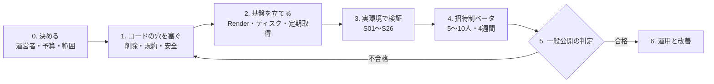

# たぐり サービス化の進め方と検証項目

2026-10-13（日本時間）。デモではなく、**実際に使い続けてもらうサービス**として出すまでの道のりをまとめる。

合否の条件（S01〜S12）は [サービス公開計画](service-launch-plan.md) にある。この文書はそれを土台に、**何をどの順で進めるか、誰が何を決めるか、合否条件に足りない検証項目は何か**を足したもの。足した検証項目には S13 から番号を振る。

## いまどこまで来ているか

| 区分 | 済んでいること | 残っていること |
| --- | --- | --- |
| 版の切り分け | デモ版とサービス版を `TAGURI_EDITION` で分けた。サービス版は見本を入れず、永続ディスクが無ければ起動しない（[デモ版とサービス版](editions.md)） | サービス版のサーバーそのものが、まだ無い |
| 利用者の分離 | 記録・評価・反応・推薦は利用者ごと。書き出しは本人の行だけで、共有の ZIP は公開版では出さない（2026-10-13 修正） | 実環境での A/B 利用者確認（S01・S05） |
| 保存と復元 | 保存先をカタログと分けた。停止中のバックアップと復元（v2）を作り、検査した | 実ホストで再デプロイ・復元を通すこと（S06・S07） |
| 取得 | 名乗り・robots.txt・間隔・断られたら引く、を全取得に適用。カタログは毎日更新して S3 へ | EC2 に定期実行を入れ、実際に回すこと |
| 推薦 | 本人の評価が次のおすすめに届く（人物の得点） | **精度は未検証**。記録 0 件の人の最初の体験も未検証 |
| 説明と規約 | 説明の草案（[保存に関する説明](service-privacy-draft.md)） | 運営者・問い合わせ先・保持期間・削除手段・取得元の許諾 |

## 全体の流れ

段階を飛ばさない。とくに **3 の前に人を入れない**（実環境で消えない・混ざらないことを確かめる前に記録を預からない）、**4 を経ずに一般公開しない**（記録 0 件から使い始める人の体験は、作り手には確かめられない）。

### 0. 決める（起案者）

ここが決まらないと先へ進めない。

| 決めること | 選択肢 | 勧め |
| --- | --- | --- |
| 運営者名と問い合わせ先 | 個人名＋専用アドレス／屋号＋フォーム | 専用のアドレスを 1 つ作る。個人の普段のアドレスは載せない |
| 月額の上限 | 無料枠のみ／月 1,000〜2,000 円程度 | 永続ディスクは有料プランが前提。上限を先に決め、Render の請求通知を設定する |
| 最初に使ってもらう範囲 | 招待制ベータ／誰でも | 招待制ベータから。知り合いの観劇好き 5〜10 人 |
| 公演情報・ポスターの扱い | 出典表示して表示／許諾を取る／ポスターは出さない | 取得元の利用条件を読んでから決める（S11）。確認が取れるまではポスターを出さない選択肢も持つ |
| 画面の入口 | Render が配る画面（同じオリジン）／GitHub Pages の `/app/` | 最初は Render が配る画面。Pages の `/app/` は S04・S09 の実ブラウザ検査の後 |

### 1. コードの穴を塞ぐ

公開前に必ず要るもの。

1. **本人による削除**（規約 R7・S10）。復旧コードで本人確認し、記録・認証・推薦露出・依頼をまとめて消す。消した後にバックアップに残る期間も決めて説明する
2. **利用規約の更新**（S25）。「12 単語の復旧フレーズ」「Claude API」など実装と違う記述を直し、デモ版とサービス版の違い、削除の方法、保持期間を書く
3. **接続元の扱いの確認**（S13）。登録・復旧の試行回数の制限は接続元のアドレスで数えているが、Render ではアプリから見える接続元がプロキシになっている可能性がある。そうなら、制限が全員で共有され、20 人が 10 分以内に来ると新規登録が止まり、1 人の総当たりで全員の復旧が止まる
4. **画面の安全の上乗せ**（S14）。Content-Security-Policy などのヘッダを足し、利用者が入れた文字（感想・題名・お気に入り名）が画面で動かないことを試す
5. **公演情報の出典表示**（S11 で決めた範囲で）

### 2. 基盤を立てる

1. Render に新しいサービスを作る（[構成案](../deploy/render-service.yaml)。最初はメンテナンスモード・自動デプロイなし）
2. 永続ディスクを付け、保存先を `/var/data/taguri` にする
3. 秘密（S3 の読み取り鍵・`TAGURI_NAMES_TOKEN`）は Render の画面だけに入れる。Git やチャットに書かない
4. EC2 に定期取得を入れる（`tools/taguri/deploy/`）。取得処理の `TAGURI_NAMES_URL` は**サービス版**へ向ける
5. 外形監視（`/api/health`）と、請求・ディスク容量の通知を設定する（S22）

### 3. 実環境で検証する

下の「検証項目」を上から順に通す。結果は [実行・検証記録](service-launch-verification.md) に残す。秘密の値は記録しない。

### 4. 招待制ベータ

- 5〜10 人に、4 週間使ってもらう。最初の画面で復旧コードを控えることを、口頭でも伝える
- 週 1 回、下の「ベータで見るもの」を確かめる。困りごとは問い合わせ先 1 か所で受ける
- この間に起きた障害は、[公開計画](service-launch-plan.md)の「公開先の変更と失敗時」の手順で戻す。少なくとも 1 回は、障害を想定した復元の予行をする（S26）

### 5. 一般公開の判定

S01〜S26 の必須項目がすべて合格し、ベータで記録の消失・混在が 0 件であること。合格したら、メンテナンスを解き、README とデモ版の画面から案内する。

### 6. 運用と改善

公開後に取り組むもの（初期には入れない）: 推薦精度の比較検証、購入確認メールの取り込みの再開（Google の審査の費用次第）、複数インスタンス化、独自ドメイン。

## 検証項目

「いつ」は上の段階の番号。「必須」は一般公開の判定に要るもの。S01〜S12 の詳しい条件は [公開計画](service-launch-plan.md) を見る。

### A. 記録が混ざらない・消えない

| ID | 確かめること | 確かめ方 | 合格の基準 | いつ | 必須 |
| --- | --- | --- | --- | --- | --- |
| S01 | デモとサービスの URL・DB・鍵が別 | 実サービスで初回登録 | 新しい利用者の記録が 0 件 | 3 | ○ |
| S02 | 永続ディスクの上に保存している | 起動の検査＋書き込みの確認 | 一時領域なら起動しない | 3 | ○ |
| S03 | 書き出しは本人の分だけ | 人工の A・B で全表を比べる | B の行が A の書き出しに 1 行も無い | 1・3 | ○ |
| S05 | 評価・感想・推薦・露出が利用者ごと | A・B の回帰試験 | 他人の記録を読めない・変えられない | 3 | ○ |
| S06 | 再起動・再デプロイ・カタログ交換の後も同じ記録に戻る | 実サービスで Cookie と復旧コードの両方 | 3 つの操作の後、件数と中身が一致 | 3 | ○ |
| S07 | バックアップから戻せる | 停止→退避→空の領域へ復元→起動 | 復元後に A・B がそれぞれ自分の記録に戻る | 3 | ○ |

### B. 安全

| ID | 確かめること | 確かめ方 | 合格の基準 | いつ | 必須 |
| --- | --- | --- | --- | --- | --- |
| S04 | Cookie・復旧・端末追加が人を取り違えない | HTTP の試験＋実ブラウザ | 別の端末・別のオリジンから他人の記録に届かない | 3 | ○ |
| S08 | 感想・Cookie・鍵がログに出ない | 目印の文字列を入れて全ログを探す | 目印が 1 つも見つからない | 3 | ○ |
| S13 | 試行回数の制限が訪問者ごとに効く | 実サービスでアプリが見る接続元を確かめる。プロキシなら転送元ヘッダの扱いを決めて直す | 2 つの回線から試し、片方の制限がもう片方に効かない | 1・3 | ○ |
| S14 | 入れた文字が画面で動かない | 感想・題名・お気に入り名に `<script>` や `"onerror=` を入れ、全画面を開く。ヘッダを確認 | 何も実行されない。CSP が付いている | 1・3 | ○ |
| S15 | 濫用されても取得と費用が増えすぎない | 1 人で依頼を連打、登録を繰り返す | 依頼は 1 人 30 件まで、1 回の取得は依頼 60 件・登録名 300 件まで。上限を超えない | 3 | ○ |

### C. 使える・続けられる

| ID | 確かめること | 確かめ方 | 合格の基準 | いつ | 必須 |
| --- | --- | --- | --- | --- | --- |
| S16 | 記録 0 件の人が最初に迷わない | 初めての人に横で使ってもらう（3 人以上） | 説明なしで「はじめる」→お気に入り登録→おすすめで 1 件反応、まで進める | 4 | ○ |
| S17 | 本人の評価が次のおすすめに効く | 実環境で ◎ を付け、次に開いたおすすめの理由を見る | その人物の公演に理由が付いて出る。画面は「精度は検証中」と書き、言いすぎない | 3 | ○ |
| S18 | 記録を手で入れる手間が許せる範囲 | ベータの人に 10 件入れてもらい時間を測る | 10 件を 10 分以内。超えるなら入力画面を直す | 4 | |
| S19 | スマホで主な操作ができる | iPhone の Safari と Android の Chrome の実機 | 登録・反応・評価・復旧・ツアーが最後まで通る | 3 | ○ |
| S09 | 画面が正しいサーバーにつながる | Pages の設定と、`/api/health` の版を確かめる | サービスの画面がデモのサーバーへ行かない | 3 | ○ |

### D. 速さと止まらないこと

| ID | 確かめること | 確かめ方 | 合格の基準 | いつ | 必須 |
| --- | --- | --- | --- | --- | --- |
| S20 | おすすめが待たずに開く | 記録 100 件の人工利用者で、実サービスの応答を測る。同時 10 人も試す | 95% が 3 秒以内 | 3 | ○ |
| S21 | ディスクが足りる | 1 人あたりの DB の増え方を測り、1 GB で何人分か見積もる | 見積もりの 2 倍の余裕がある | 3 | |
| S22 | 止まったら気付ける | 外形監視・ディスク使用率・請求の通知を、わざと鳴らして確かめる | 通知が届く先が決まっていて、実際に届く | 2・3 | ○ |
| S12 | 更新・停止・復元の手順と費用が回る | 手順書どおりに一度通す | 月額が上限内。手順で詰まらない | 3 | ○ |

### E. 公演情報の取得

| ID | 確かめること | 確かめ方 | 合格の基準 | いつ | 必須 |
| --- | --- | --- | --- | --- | --- |
| S11 | 取得・表示・出典の条件を確かめた | 取得元の利用条件を読む。必要なら問い合わせる | 表示してよい範囲が文書で残っている。非公開の S3 に置いていることは許諾の代わりにならない | 0・1 | ○ |
| S23 | カタログの更新が止まったら気付ける | `manifest.json` の日付を監視し、2 日止めてみる | 2 日以内に気付ける。画面に古い日付が出る | 3 | ○ |
| S24 | 取得元の robots.txt に従っている | EC2 から実際の robots.txt を読み、取得の記録と突き合わせる | 禁止されたパスに 1 度も行っていない | 3 | ○ |
| S27 | LLM の費用が上限で止まる | `GEMINI_MAX_CALLS_PER_MONTH` を小さくして取得を回す | 上限で止まり、取得のほかの部分は続く | 3 | |

### F. 説明と約束

| ID | 確かめること | 確かめ方 | 合格の基準 | いつ | 必須 |
| --- | --- | --- | --- | --- | --- |
| S10 | 問い合わせ・保存の説明・保持期間・削除が実際にできる | 本人と別人で削除を試す | 本人は消せる。別人は消せない。バックアップに残る期間が書いてある | 1・3 | ○ |
| S25 | 利用規約が実装と合っている | 規約の各条を実装と突き合わせる | 復旧コードの形式・LLM の提供元・版の違い・削除方法が実装どおり | 1 | ○ |
| S26 | 障害から戻す予行をした | メンテナンス→退避→空の領域へ復元→再開を 1 回通す | 手順書どおりに戻り、かかった時間が記録してある | 4 | ○ |

## ベータで見るもの

数は少なく、毎週同じものを見る。推薦の表示と反応は推薦露出の記録（`recommendation_exposure.py`）から数える。利用者 ID は集計に出さない。

- **戻ってくる人**: 2 週目にも開いた人の割合
- **反応**: おすすめを見た回のうち、1 件以上「興味あり」か「興味なし」を押した割合
- **評価**: 1 人あたりの ◎○△× の件数（記録が増えているか）
- **困りごと**: 問い合わせの件数と中身、画面のエラーの件数
- **消失・混在**: 0 件であること（1 件でも出たら新規の受け付けを止めて調べる）

推薦の精度（当たった割合）は、ベータの人数では比べられるほど集まらない。この段階では「本人の評価が次のおすすめに効いている」ことの確認にとどめ、精度をうたわない。

## 最初はやらないこと

- 複数インスタンス・別の DB への移行（SQLite・1 台で始める）
- 購入確認メールの自動取り込み（Google の審査と費用のため凍結のまま）
- 推薦の重みの自動学習・大きなモデル
- 有料化・広告

## 次の一手

1. 起案者が「0. 決める」の 5 項目を決める（とくに運営者・問い合わせ先・月額上限）
2. 「1. コードの穴を塞ぐ」の削除機能・規約の更新・接続元の確認から実装する
3. 予算が決まったら、Render にサービス版を作る（メンテナンスモードのまま）
