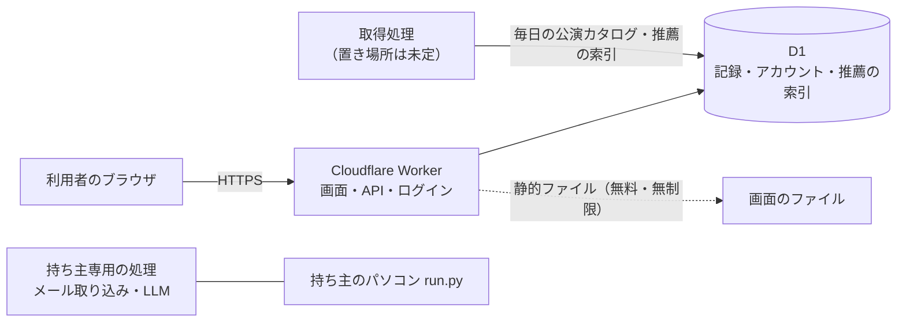
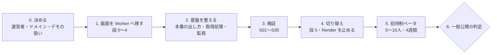

# たぐり サービス化の進め方と検証項目

2026-10-13（日本時間）。デモではなく、**実際に使い続けてもらうサービス**として出すまでの道のりをまとめる。

- **2026-10-13、起案者がサービス版を Cloudflare Workers＋D1 に寄せると決めた**〔dec-workers-d1〕〔dec-render-full-migration〕。この文書の前の版（VM＋Cloudflare の前段）は置き換えた〔dec-vm-cloudflare〕
- 調べたこと・今後調べること・決めたことは [ナレッジグラフ](knowledge/README.md) で管理する。文中の `〔…〕` はその項目
- 画面を Render から Worker へ移す細かい段取りは、ブランチ `cloudflare-d1-preview` の `docs/render-migration-plan.md` にある。リリース前の確認の広い洗い出しは [リリースまでにやること](release-readiness.md)（2026-10-12 時点、Render 前提で書かれた部分を含む）
- 合否の条件 S01〜S12 の元は [サービス公開計画](service-launch-plan.md)。この文書で S13 以降を足し、Workers＋D1 に合わせて読み替える

## 構成

| 部分 | 使うもの | 根拠 |
| --- | --- | --- |
| 画面と API | Cloudflare Worker。元の画面は見た目を変えずに JS へ移し、全部そろってから一度だけ切り替える | 〔dec-render-full-migration〕 |
| 保存 | D1。誤操作や障害からは無料で 7 日前、有料で 30 日前まで戻せる | 〔d1-time-travel〕〔d1-free-limits〕 |
| ログイン | Firebase（Google・メールのリンク）とパスキー、復旧コード | 〔dec-firebase-auth〕〔dec-passkeys〕 |
| おすすめ | 利用者によらない索引を前もって作り、Worker は本人の分だけ計算して保存する | 〔dec-reco-on-worker〕 |
| 公演情報の取得 | **EC2 は無い**ので、毎日の更新は今どこでも動いていない可能性が高い。置き場所は、非公開の別リポジトリの GitHub Actions を勧める（今のコードがそのまま動き、月 2,000 分の無料枠に収まる見込み、ログが公開されない） | 〔no-ec2〕〔dec-crawler-gha-private〕〔q-catalog-source〕 |
| 持ち主専用の機能 | 持ち主のパソコンの run.py に残す | 〔dec-render-full-migration〕〔no-ec2〕 |

**費用の方針:** **無料枠の中だけで動かす。有料プランには上げない**（起案者の指示 2026-10-13「必ず無料の範囲内にして。絶対超えないで」〔dec-free-tier-only〕。上限の一覧は `docs/free-tier-budget.md`）。以前の「1000 人規模で月 5 ドルの有料プランに上げる」〔dec-scale-workers〕は取り消した。無料枠に近づいたら、新規登録を止める・取得を減らすなど使う量を減らす〔scale-1000-estimate〕。

**やめるもの:** Render（画面の移行がそろったら止める）。Render の利用者の記録と持ち主の手元の記録は新しいアカウントへ移さない〔dec-no-render-data-migration〕。

## いまどこまで来ているか

| 区分 | 済んでいること | 残っていること |
| --- | --- | --- |
| Worker 版 | workers.dev で動いている。ログイン・完全削除・推薦の計算〔workers-d1-preview-state〕 | 元の画面の移行（段 0〜5）。今はまだ Render へ中継している |
| 本番への出し方 | Workers Builds で自動 deploy。**本番の公開元を master にした**（PR #5 はマージ済み）〔production-branch-master〕 | PR のブランチに push しても本番に出ないことの確認（S33） |
| 無料枠に収まるか | 手元の見積もり | 実カタログでの測定〔q-real-catalog-stats〕〔q-workers-cpu-real〕 |
| 説明と規約 | 説明の草案（[保存に関する説明](service-privacy-draft.md)） | 運営者・問い合わせ先・保持期間・取得元の許諾 |

## 全体の流れ

### 0. 決める（起案者）

| 決めること | 勧め |
| --- | --- |
| 運営者名と問い合わせ先 | **運営者名は @return1_end（X）に決めた**〔dec-operator-name〕。問い合わせ用のアドレスは起案者が後で作る〔q-contact-email〕 |
| ドメイン | workers.dev のまま始めるか、独自ドメインを取るか。**パスキーはドメインに結び付くので、独自ドメインにするなら公開前に決める**〔passkey-rpid-domain〕〔q-domain〕 |
| 有料プランに上げる時期 | **上げない**〔dec-free-tier-only〕。使用量が上限の 8 割を越えたら知らせ、使う量を減らす |
| Render を止めたあとのデモ版 | **触れるがデータを持たないお試し版にすると決めた**〔dec-demo-trial-no-data〕。作り方は〔q-demo-trial-design〕 |
| 公演情報・ポスターの扱い | 取得元の条件を読んでから決める〔q-source-terms〕 |

### 1. 画面を Worker へ移す

`render-migration-plan.md` の段 0〜4 を進める（別のセッションが担当）。各段で、Python と同じ HTML が出ることを一致テストで確かめる。

### 2. 基盤を整える

1. **本番は master からだけ出す**〔q-production-branch〕。PR のブランチから自動で出る今の設定をやめる
2. 取得処理の置き場所を決める〔q-crawler-host〕。索引と公演カタログを D1 へ入れる手順を定期実行にする
3. 回数制限（登録・ログイン・検索）を Worker で掛ける〔q-rate-limiting〕
4. バックアップ: Time Travel の期間（無料 7 日）より長く残す書き出しを決める〔q-d1-backup〕〔q-offsite-backup〕
5. 監視: Worker のエラー率、D1 の使用量（無料枠の何割か）、カタログの日付〔q-monitoring〕

### 3. 検証する

下の「検証項目」を通す。結果は [実行・検証記録](service-launch-verification.md) に残し、分かったことはナレッジグラフに足す。

### 4. 切り替える

段 5。本番で全画面を Worker で答えるようにし、Render への中継を外す。切り替えたあと Render へ要求が 1 件も飛ばないことを確かめてから、Render を止める。

### 5. 招待制ベータ・6. 一般公開の判定

5〜10 人に 4 週間。必須の検証項目がすべて合格し、記録の消失・混在が 0 件なら一般公開する。

## 検証項目

「いつ」は上の段階の番号。「必須」は一般公開の判定に要るもの。

### A. 記録が混ざらない・消えない

| ID | 確かめること | 確かめ方 | 合格の基準 | いつ | 必須 |
| --- | --- | --- | --- | --- | --- |
| S01 | サービス版の新しい利用者が空から始まる | 本番で初回登録 | 見本の記録も他人の記録も無い | 3 | ○ |
| S02 | 記録が消えない | 本番で記録をつけ、再 deploy・カタログの入れ替えの後に見る | 件数と中身が一致 | 3 | ○ |
| S03 | 書き出しは本人の分だけ | 人工の A・B で全表を比べる | B の行が A の書き出しに 1 行も無い | 3 | ○ |
| S05 | 評価・感想・推薦・反応が利用者ごと | 2 人の利用者で同じ手順を流すテスト | 他人の記録を読めない・変えられない | 1・3 | ○ |
| S07 | 戻せる | Time Travel で別の DB に戻し、A・B が自分の記録に戻るか見る〔d1-time-travel〕 | 手順どおりに戻る。かかった時間が記録してある | 3 | ○ |
| S31 | 長期のバックアップから戻せる | Time Travel の期間を超えた書き出しから、新しい D1 に戻す | 戻る。置き場所と鍵が文書にある | 3 | ○ |

### B. 安全

| ID | 確かめること | 確かめ方 | 合格の基準 | いつ | 必須 |
| --- | --- | --- | --- | --- | --- |
| S04 | ログイン・端末追加・セッションが人を取り違えない | HTTP の試験＋実ブラウザ | 別の端末・別のオリジンから他人の記録に届かない | 3 | ○ |
| S08 | 感想・Cookie・鍵がログに出ない | 目印の文字列を入れ、Worker のログを探す | 目印が 1 つも見つからない | 3 | ○ |
| S13 | 回数制限が訪問者ごとに効く〔q-rate-limiting〕 | 2 つの回線から試す | 片方の制限がもう片方に効かない | 2・3 | ○ |
| S14 | 入れた文字が画面で動かない | 感想・題名・お気に入り名に `<script>` などを入れ、全画面を開く。CSP を確認 | 何も実行されない | 3 | ○ |
| S15 | 濫用されても取得と費用が増えすぎない | 1 人で依頼を連打、登録を繰り返す | 決めた上限を超えない | 3 | ○ |
| S33 | レビュー前の変更が本番に出ない〔pr-branch-is-production〕 | 本番の deploy 元の設定を見る。PR のブランチに push してみる | master 以外からは本番に出ない | 2 | ○ |
| S10 | 本人による完全削除〔dec-account-deletion〕 | 本人と別人で削除を試す | 本人は消せる・別人は消せない。Time Travel に残る期間（無料 7 日）を画面と説明に正しく書く | 3 | ○ |

### C. 使える・続けられる

| ID | 確かめること | 確かめ方 | 合格の基準 | いつ | 必須 |
| --- | --- | --- | --- | --- | --- |
| S34 | 移した画面が元と同じ | 一致テスト（Python と同じ HTML）と、PC・スマホの見た目の比較 | 全画面で一致。見た目の差が無い | 1・3 | ○ |
| S16 | 記録 0 件の人が最初に迷わない | 初めての人に横で使ってもらう（3 人以上） | 説明なしでおすすめに 1 件反応するまで進める | 5 | ○ |
| S17 | 本人の評価が次のおすすめに効く | 本番で ◎ を付け、次のおすすめの理由を見る | その人物の公演に理由が付いて出る | 3 | ○ |
| S19 | スマホで主な操作ができる | iPhone の Safari と Android の Chrome の実機。パスキーも〔q-passkey-real-devices〕 | ログイン・反応・評価・削除・ツアーが通る | 3 | ○ |
| S18 | 手で入れる手間が許せる範囲 | 10 件入れる時間を測る | 10 分以内 | 5 | |

### D. 無料枠と止まらないこと

| ID | 確かめること | 確かめ方 | 合格の基準 | いつ | 必須 |
| --- | --- | --- | --- | --- | --- |
| S20 | 各画面が CPU の上限に収まる〔q-workers-cpu-real〕〔q-real-catalog-stats〕 | 実カタログ相当の量で、画面ごとに CPU 時間を測る | 無料なら 10 ミリ秒以内（超えるならその画面は移さない。有料にはしない〔dec-free-tier-only〕） | 1・3 | ○ |
| S21 | D1 の読み書き・容量が足りる | 画面ごとの読み込み行数を数え、索引の入れ替えの書き込み行数を測る〔d1-free-limits〕〔d1-free-db-size〕 | 想定の利用者数で、使う枠の半分以下 | 3 | ○ |
| S35 | 切り替え後に Render へ要求が飛ばない | 中継を外した状態のテストと本番のログ | 0 件 | 4 | ○ |
| S22 | 止まったら気付ける | エラー率・D1 の使用量・カタログの日付の通知を、わざと鳴らす | 通知が届く | 2・3 | ○ |
| S12 | 運用の手順と費用が回る | 手順書どおりに一度通す | 費用が決めた上限の中 | 3 | ○ |

### E. 公演情報の取得・F. 説明と約束

| ID | 確かめること | 合格の基準 | 必須 |
| --- | --- | --- | --- |
| S11 | 取得・表示・出典の条件を確かめた〔q-source-terms〕 | 表示してよい範囲が文書で残っている | ○ |
| S23 | カタログの更新が止まったら 2 日以内に気付ける | 通知が届く | ○ |
| S24 | 取得元の robots.txt に従っている〔corich-robots-unchecked〕 | 禁止されたパスに 1 度も行っていない | ○ |
| S27 | LLM の費用が上限で止まる〔gemini-budget-cap〕 | 上限で止まり、ほかの取得は続く | |
| S25 | 利用規約・説明が実装と合っている〔q-privacy-law〕 | ログイン方法・保存先（Cloudflare）・削除と保持期間が実装どおり | ○ |
| S26 | 障害から戻す予行をした | 手順どおりに戻り、時間が記録してある | ○ |

VM 案のときに足した S28（OS の更新）・S29（VM の回収）・S30（受け口）は不要になった。S06（再デプロイ）・S09（画面のつなぎ先）は S02・S35 に含めた。

## ベータで見るもの

- 戻ってくる人（2 週目にも開いた割合）、おすすめへの反応、1 人あたりの評価の件数
- 困りごと（問い合わせ・エラーの件数）
- **無料枠の使用量**（要求数・CPU・D1 の読み書き・R2・Actions の分。取得の Free-tier check が毎日表にし、8 割を越えたら失敗して知らせる。有料にはしない〔dec-free-tier-only〕）
- 消失・混在が 0 件であること

## 次の一手

1. **公演カタログの古さを確かめる**〔q-catalog-source〕。公開の `/api/health` と、毎日の GitHub Actions（Catalog age）で日付が分かるようにした〔catalog-age-check〕
2. **取得処理の置き場所を決める**〔q-crawler-host〕。無料の候補は GitHub Actions（ログが公開される点に注意）と Workers の定期実行
3. 無料枠に収まるかを測る〔q-real-catalog-stats〕。カタログのある場所で `cloudflare/scripts/build_recommend_index.py --stats` を実行する
4. PR のブランチに push しても本番に出ないことを確かめる（S33）
5. 画面の移行の続きをどのセッションが受け持つかを決める〔q-migration-owner〕
