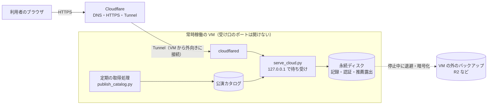
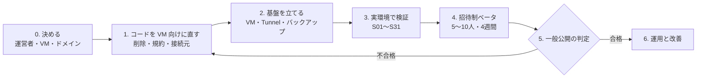

# たぐり サービス化の進め方と検証項目

2026-10-13（日本時間）。デモではなく、**実際に使い続けてもらうサービス**として出すまでの道のりをまとめる。

- 合否の条件（S01〜S12）は [サービス公開計画](service-launch-plan.md) にある。この文書はそれを土台に、**何をどの順で進めるか、誰が何を決めるか、足りない検証項目（S13〜）**を足したもの
- **調べたこと・今後調べること・決めたことは [ナレッジグラフ](knowledge/README.md) で管理する。** この文書の判断の根拠は、そこから辿れる。文中の `〔…〕` はナレッジグラフの項目

## 構成（2026-10-13 に変更）

**サービス版は、常時稼働の VM で今の Python のサーバーをそのまま動かし、前段に Cloudflare を置く**〔dec-vm-cloudflare〕。Render の有料サービスで立てる案は置き換えた〔dec-render-service-beta〕。

| 部分 | 使うもの | 理由 |
| --- | --- | --- |
| サーバー | 常時稼働の VM（Oracle Always Free か今の EC2〔q-vm-host-choice〕）＋ systemd | コードをほぼそのまま動かせ、ディスクも消えない〔stdlib-server-sqlite〕 |
| 入口 | Cloudflare Tunnel ＋ 独自ドメイン〔dec-own-domain〕 | 受け口のポートを開けずに HTTPS で出せる〔cf-tunnel-free〕。画面と API が同じサイトになり Cookie で困らない〔cross-origin-cookies〕 |
| 画面 | 最初は VM が配る画面（1 つのオリジン）。Pages の画面は独自ドメインを付けてから | 実ブラウザで Cookie を確かめるまで別サイト構成にしない〔q-safari-cookies〕 |
| カタログ | 取得処理を同じ VM に載せられれば VM の中で入れ替え。別の機械なら R2〔r2-free-tier〕 | 受け渡しの部品を減らす |
| バックアップ | 停止中に一組で退避し、暗号化して VM の外へ〔q-offsite-backup〕 | VM ごと失っても戻せる |
| デモ版 | Render の無料プランのまま〔dec-demo-stays-render-free〕 | 記録が消えてよい前提なので、スリープ・一時保存を許せる |

**費用はドメイン代（年額）だけを目指す。** VM の無料枠と回収の条件、今の EC2 の請求は確かめていない〔q-oracle-official〕〔q-ec2-cost〕。

**採らなかった案**

- Render の無料プラン: 永続ディスクが付かず、サービス版が起動しない〔render-free-no-disk〕
- Render の有料プラン: 動くが、月額がかかる〔render-paid-disk-cost〕
- Cloudflare Workers への完全移行: サーバーと DB まわりの書き直しと、おすすめの事前計算化が要る〔workers-free-cpu-10ms〕〔reco-computed-per-request〕。利用者が増えて VM の運用がつらくなったら段階的に移す〔dec-defer-workers〕

## いまどこまで来ているか

| 区分 | 済んでいること | 残っていること |
| --- | --- | --- |
| 版の切り分け | デモ版とサービス版を `TAGURI_EDITION` で分けた。サービス版は見本を入れず、永続の保存先が無ければ起動しない（[デモ版とサービス版](editions.md)） | サービス版の VM そのものが、まだ無い |
| 利用者の分離 | 記録・評価・反応・推薦は利用者ごと。書き出しは本人の行だけで、共有の ZIP は公開版では出さない〔public-export-leak〕 | 実環境での A/B 利用者確認（S01・S05） |
| 保存と復元 | 保存先をカタログと分けた。停止中のバックアップと復元（v2） | VM 用の保存先の検査〔serve-cloud-render-guard〕、VM の外への退避 |
| 取得 | 名乗り・robots.txt・間隔・断られたら引く〔dec-polite-crawling〕。カタログは毎日更新 | 定期実行を実際に回すこと、取得元の条件の確認〔q-source-terms〕 |
| 推薦 | 本人の評価が次のおすすめに届く | **精度は未検証**。記録 0 件の人の最初の体験も未検証 |
| 説明と規約 | 説明の草案（[保存に関する説明](service-privacy-draft.md)） | 運営者・問い合わせ先・保持期間・削除手段・取得元の許諾 |

## 全体の流れ

段階を飛ばさない。**3 の前に人を入れない**（消えない・混ざらないことを実環境で確かめる前に記録を預からない）。**4 を経ずに一般公開しない**（記録 0 件から使い始める人の体験は、作り手には確かめられない）。

### 0. 決める（起案者）

| 決めること | 選択肢 | 勧め |
| --- | --- | --- |
| 運営者名と問い合わせ先 | 個人名＋専用アドレス／屋号＋フォーム | 専用のアドレスを 1 つ作る。普段のアドレスは載せない |
| VM | Oracle Always Free／今の EC2 | 先に両方の費用と条件を調べる〔q-vm-host-choice〕。取得処理も同じ VM に載せられる方が部品が減る |
| ドメイン | .jp／.com など | Cloudflare の DNS に置けるもの〔q-domain〕。Tunnel にも、同じサイトでの Cookie にも要る |
| 最初に使ってもらう範囲 | 招待制ベータ／誰でも | 招待制ベータから。観劇好きの知り合い 5〜10 人 |
| 公演情報・ポスターの扱い | 出典を出して表示／許諾を取る／ポスターは出さない | 取得元の条件を読んでから決める〔q-source-terms〕。確認が取れるまではポスターを出さない選択肢も持つ |

### 1. コードを VM 向けに直し、穴を塞ぐ

1. **保存先の検査を VM でも効かせる**〔serve-cloud-render-guard〕。今は Render の外だと実ディスクの検査を飛ばす。VM でもマウントを確かめ、一時領域なら起動しない
2. **127.0.0.1 で待ち受ける**。Tunnel の後ろに置くので、外から直接つながる口を作らない
3. **接続元を Cloudflare のヘッダで数える**（S13）〔throttle-keyed-by-client-address〕〔cf-tunnel-origin-localhost〕。今は接続元のアドレスで試行回数を数えているが、Tunnel の後ろでは全員が自分自身に見える。このままだと 20 人が 10 分以内に来ると新規登録が止まり、1 人の総当たりで全員の復旧が止まる。**cloudflared からの接続のときだけ `CF-Connecting-IP` を信じる**〔q-cf-connecting-ip-trust〕
4. **カタログを VM の中で受け取る口**。取得処理を同じ VM に載せるなら、S3 を経由せず手元の出力から入れ替える。別の機械なら接続先を R2 に変えられるか確かめる〔q-r2-boto3〕
5. **本人による削除**（規約 R7・S10）。復旧コードで本人確認し、記録・認証・推薦露出・依頼をまとめて消す
6. **利用規約の更新**（S25）。「12 単語の復旧フレーズ」「Claude API」など実装と違う記述を直し、版の違い・削除方法・保持期間を書く
7. **画面の安全の上乗せ**（S14）。Content-Security-Policy などのヘッダを足す
8. **公演情報の出典表示**（0 で決めた範囲で）

### 2. 基盤を立てる

1. VM を作り、OS の自動更新を入れる。サービス専用のユーザーで動かす（規約 E5）
2. 永続のディスクに保存先（`TAGURI_STATE_DIR`）を置く
3. ドメインを Cloudflare の DNS に置き、Tunnel を作る。cloudflared と serve_cloud.py を systemd で常時動かす
4. **受け口のポートを開けない**。SSH も Tunnel 経由か、許可元を絞る（規約 E6）
5. 検証中は自分だけが入れるようにする。Cloudflare Access の無料枠で足りるか確かめる〔q-cf-access〕
6. 定期取得を入れる（`tools/taguri/deploy/`）。依頼と登録名を読む先（`TAGURI_NAMES_URL`）はサービス版に向ける
7. バックアップを VM の外へ置く。認証の情報を含むので暗号化する〔q-offsite-backup〕
8. 外形監視（`/api/health`）・ディスク使用率・カタログの日付の通知を設定する〔q-monitoring〕

### 3. 実環境で検証する

下の「検証項目」を上から順に通す。結果は [実行・検証記録](service-launch-verification.md) に残し、新しく分かったことはナレッジグラフに足す。秘密の値はどちらにも書かない。

### 4. 招待制ベータ

- 5〜10 人に 4 週間使ってもらう。最初の画面で復旧コードを控えることを、口頭でも伝える
- 週 1 回、下の「ベータで見るもの」を確かめる。困りごとは問い合わせ先 1 か所で受ける
- 少なくとも 1 回、障害を想定した復元の予行をする（S26）

### 5. 一般公開の判定

必須の検証項目がすべて合格し、ベータで記録の消失・混在が 0 件であること。合格したら、自分だけに絞っていた入口を開け、README とデモ版の画面から案内する。

### 6. 運用と改善

公開後に取り組むもの: 推薦精度の比較検証、Pages の画面を独自ドメインで配る、購入確認メールの取り込みの再開（Google の審査の費用次第〔gmail-restricted-scope〕）、利用者が増えたときの Workers への段階的な移行〔q-d1-python-workers〕。

## 検証項目

「いつ」は上の段階の番号。「必須」は一般公開の判定に要るもの。S01〜S12 の詳しい条件は [公開計画](service-launch-plan.md)。どの検証項目がどの問い・調べたことにつながるかは [ナレッジグラフ](knowledge/README.md) の「検証項目」の列で引ける。

### A. 記録が混ざらない・消えない

| ID | 確かめること | 確かめ方 | 合格の基準 | いつ | 必須 |
| --- | --- | --- | --- | --- | --- |
| S01 | デモとサービスの URL・DB・鍵が別 | 実サービスで初回登録 | 新しい利用者の記録が 0 件 | 3 | ○ |
| S02 | 永続ディスクの上に保存している | VM で起動の検査＋書き込みの確認。保存先を一時領域にして起動させてみる | 一時領域なら起動しない。VM を再起動しても記録が残る | 1・3 | ○ |
| S03 | 書き出しは本人の分だけ | 人工の A・B で全表を比べる | B の行が A の書き出しに 1 行も無い | 3 | ○ |
| S05 | 評価・感想・推薦・露出が利用者ごと | A・B の回帰試験 | 他人の記録を読めない・変えられない | 3 | ○ |
| S06 | 再起動・更新・カタログ交換の後も同じ記録に戻る | 実サービスで Cookie と復旧コードの両方 | 3 つの操作の後、件数と中身が一致 | 3 | ○ |
| S07 | バックアップから戻せる | 停止→退避→空の領域へ復元→起動 | 復元後に A・B がそれぞれ自分の記録に戻る | 3 | ○ |
| S31 | VM を失っても戻せる | VM の外の暗号化したバックアップだけで、新しい VM に復元する | 鍵とバックアップがあれば戻る。鍵の置き場所が文書にある | 3 | ○ |

### B. 安全

| ID | 確かめること | 確かめ方 | 合格の基準 | いつ | 必須 |
| --- | --- | --- | --- | --- | --- |
| S04 | Cookie・復旧・端末追加が人を取り違えない | HTTP の試験＋実ブラウザ | 別の端末・別のオリジンから他人の記録に届かない | 3 | ○ |
| S08 | 感想・Cookie・鍵がログに出ない | 目印の文字列を入れ、アプリ・systemd・cloudflared のログを探す | 目印が 1 つも見つからない | 3 | ○ |
| S13 | 試行回数の制限が訪問者ごとに効く | 2 つの回線から試す。cloudflared を通らない接続から `CF-Connecting-IP` を偽って送る | 片方の制限がもう片方に効かない。偽ったヘッダは無視される | 1・3 | ○ |
| S14 | 入れた文字が画面で動かない | 感想・題名・お気に入り名に `<script>` や `"onerror=` を入れ、全画面を開く。ヘッダを確認 | 何も実行されない。CSP が付いている | 1・3 | ○ |
| S15 | 濫用されても取得と費用が増えすぎない | 1 人で依頼を連打、登録を繰り返す | 依頼は 1 人 30 件まで、1 回の取得は依頼 60 件・登録名 300 件まで | 3 | ○ |
| S30 | 外から VM に直接つながらない | VM の公開アドレスに外からつなぐ（HTTP・SSH） | Tunnel 以外の受け口が閉じている | 2・3 | ○ |
| S28 | OS の更新が止まらない | 自動更新の記録を見る。再起動後にサービスが戻るか | 1 か月分の更新が当たり、再起動で自動的に戻る | 4 | ○ |

### C. 使える・続けられる

| ID | 確かめること | 確かめ方 | 合格の基準 | いつ | 必須 |
| --- | --- | --- | --- | --- | --- |
| S16 | 記録 0 件の人が最初に迷わない | 初めての人に横で使ってもらう（3 人以上） | 説明なしで「はじめる」→お気に入り登録→おすすめで 1 件反応、まで進める | 4 | ○ |
| S17 | 本人の評価が次のおすすめに効く | 実環境で ◎ を付け、次に開いたおすすめの理由を見る | その人物の公演に理由が付いて出る。画面は精度をうたわない | 3 | ○ |
| S18 | 記録を手で入れる手間が許せる範囲 | ベータの人に 10 件入れてもらい時間を測る | 10 件を 10 分以内。超えるなら入力画面を直す | 4 | |
| S19 | スマホで主な操作ができる | iPhone の Safari と Android の Chrome の実機 | 登録・反応・評価・復旧・ツアーが最後まで通る | 3 | ○ |
| S09 | 画面が正しいサーバーにつながる | `/api/health` の版を確かめる。Pages の `/app/` を使うなら設定も | サービスの画面がデモのサーバーへ行かない | 3 | ○ |

### D. 速さと止まらないこと

| ID | 確かめること | 確かめ方 | 合格の基準 | いつ | 必須 |
| --- | --- | --- | --- | --- | --- |
| S20 | おすすめが待たずに開く | 記録 100 件の人工利用者で応答を測る。同時 10 人も試す〔q-vm-performance〕 | 95% が 3 秒以内 | 3 | ○ |
| S21 | ディスクが足りる | 1 人あたりの DB の増え方を測り、何人分入るか見積もる | 見積もりの 2 倍の余裕がある | 3 | |
| S22 | 止まったら気付ける | 外形監視・ディスク使用率・Tunnel の切断を、わざと起こして確かめる | 通知が届く先が決まっていて、実際に届く | 2・3 | ○ |
| S29 | VM が回収・停止されない | 無料枠の条件と照らし、4 週間の使用量を記録する〔q-oracle-official〕 | 回収の警告が来ない。来たときの移し先と手順が決まっている | 4 | ○ |
| S12 | 更新・停止・復元の手順と費用が回る | 手順書どおりに一度通す | 費用がドメイン代と決めた上限の中。手順で詰まらない | 3 | ○ |

### E. 公演情報の取得

| ID | 確かめること | 確かめ方 | 合格の基準 | いつ | 必須 |
| --- | --- | --- | --- | --- | --- |
| S11 | 取得・表示・出典の条件を確かめた | 取得元の利用条件を読む。必要なら問い合わせる〔q-source-terms〕 | 表示してよい範囲が文書で残っている | 0・1 | ○ |
| S23 | カタログの更新が止まったら気付ける | カタログの日付を監視し、2 日止めてみる | 2 日以内に気付ける | 3 | ○ |
| S24 | 取得元の robots.txt に従っている | VM から実際の robots.txt を読み、取得の記録と突き合わせる〔corich-robots-unchecked〕 | 禁止されたパスに 1 度も行っていない | 3 | ○ |
| S27 | LLM の費用が上限で止まる | `GEMINI_MAX_CALLS_PER_MONTH` を小さくして取得を回す〔gemini-budget-cap〕 | 上限で止まり、ほかの取得は続く | 3 | |

### F. 説明と約束

| ID | 確かめること | 確かめ方 | 合格の基準 | いつ | 必須 |
| --- | --- | --- | --- | --- | --- |
| S10 | 問い合わせ・保存の説明・保持期間・削除が実際にできる | 本人と別人で削除を試す〔q-privacy-law〕 | 本人は消せる。別人は消せない。バックアップに残る期間が書いてある | 1・3 | ○ |
| S25 | 利用規約が実装と合っている | 規約の各条を実装と突き合わせる | 復旧コードの形式・LLM の提供元・版の違い・削除方法が実装どおり | 1 | ○ |
| S26 | 障害から戻す予行をした | 入口を閉じる→退避→空の領域へ復元→再開を 1 回通す | 手順書どおりに戻り、かかった時間が記録してある | 4 | ○ |

## ベータで見るもの

数は少なく、毎週同じものを見る。推薦の表示と反応は推薦露出の記録（`recommendation_exposure.py`）から数える。利用者 ID は集計に出さない。

- **戻ってくる人**: 2 週目にも開いた人の割合
- **反応**: おすすめを見た回のうち、1 件以上「興味あり」か「興味なし」を押した割合
- **評価**: 1 人あたりの ◎○△× の件数
- **困りごと**: 問い合わせの件数と中身、画面のエラーの件数
- **消失・混在**: 0 件であること（1 件でも出たら新規の受け付けを止めて調べる）

推薦の精度は、ベータの人数では比べられるほど集まらない。この段階では「本人の評価が次のおすすめに効いている」ことの確認にとどめ、精度をうたわない。

## 最初はやらないこと

- 複数の VM・別の DB への移行（SQLite・1 台で始める）
- Cloudflare Workers への移行〔dec-defer-workers〕
- 購入確認メールの自動取り込み（凍結のまま）
- 推薦の重みの自動学習・大きなモデル
- 有料化・広告

## 次の一手

1. 起案者が「0. 決める」を決める。とくに運営者・問い合わせ先、VM、ドメイン
2. 並行して、今後調べることのうち VM とドメインの選択に効くもの〔q-oracle-official〕〔q-ec2-cost〕〔q-domain〕〔q-cf-tunnel-official〕を調べ、ナレッジグラフに記録する
3. 「1. コードを VM 向けに直す」の、保存先の検査・待ち受け・接続元の扱いから実装する
