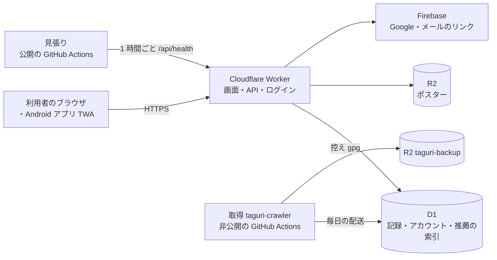
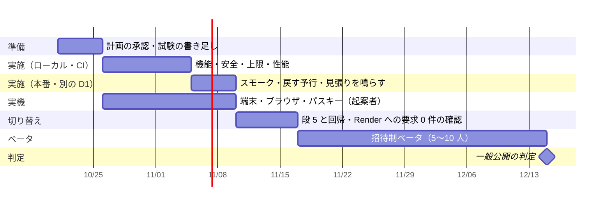

# たぐり サービス版 システムテスト計画書

| 項目 | 内容 |
|---|---|
| 版 | 第 1 版（案）。2026-10-20 作成 |
| 対象 | サービス版（Cloudflare Workers＋D1、`https://app.taguri.workers.dev/`）と Android アプリ（TWA） |
| 承認 | 起案者（承認待ち）〔dec-system-test-plan〕 |
| 元にした文書 | [サービス化の進め方と検証項目](service-roadmap.md)（S01〜S35）・[リリースまでにやること](release-readiness.md)・[無料枠の約束と上限の一覧](free-tier-budget.md)・[通し検証の記録](verification/e2e-walk-2026-10-18.md)・[記録が残るかの検証](verification/records-survive-2026-10-18.md)・[控えと戻し方](backup-restore.md) |

> **この試験も無料枠の中だけで行う。** 試験のために有料プラン・従量課金・独自ドメインを使わない。
> 本番で流す試験は、下の「8. 試験で使ってよい量」を越えない。8 割に近づいたら試験を止めて起案者に知らせる〔dec-free-tier-only〕。

---

## 1. 目的

一般公開（招待制ベータのあと）に進んでよいかを、**要件どおりに動くこと**と、**記録を失わず・混ぜず・無料枠の中で止まらずに動き続けること**の両面から判定する。

具体的には次の 4 つを確かめる。

1. 利用者が使う機能（登録から削除まで）が、要件どおりに最初から最後まで通る（機能要件）
2. 可用性・性能・運用・移行・安全・動作環境の 6 観点で、決めた基準を満たす（非機能要件。IPA の非機能要求グレードの大項目に沿う）
3. Render から Worker への切り替え（段 5）のあとも、同じ画面・同じ振る舞いが続く
4. 合否を、一般公開の判定（[サービス化の進め方](service-roadmap.md) の 6）にそのまま使える記録として残す

単体試験（`npm test`・`tools/taguri/test_*.py`）は各部品が正しいかを見る。システムテストは、**部品をつないだ全体を、本物に近い環境と利用者の手順で**確かめる点が違う。

## 2. 対象システムの概要

| 部品 | 中身 | 主な試験の置き場所 |
|---|---|---|
| 画面と API | `cloudflare/src/worker.js`・`src/screens/*` | `cloudflare/test/*.test.js`（128 本）・`test/e2e-walk.js`・`test/runtime-smoke.js` |
| 保存 | D1（migration `0001`〜`0043`） | `migrations-keep-records.test.js`・`redeploy-keeps-records.test.js` |
| ログイン | パスキー・復旧コード・Firebase | `firebase-auth.test.js`・`e2e-walk.js`（仮想認証器） |
| おすすめ | 前もって作る索引＋本人の分だけ Worker で計算 | `recommend` 系の試験・`scripts/measure_worker.mjs` |
| 取得・配送 | taguri-crawler の Catalog（毎日）・Restore drill（月 1 回） | `test_delivery_keeps_records.py`・Free-tier check |
| 見張り | `service-watch.yml`（毎時）・`catalog-age.yml`（毎日） | `tools/taguri/test_check_service.py` |

## 3. テスト全体の方向性（基本方針）

1. **無料枠を越えない試験にする。** 負荷試験・限界試験は本番では行わず、ローカル（wrangler dev と手元の D1）で測る。本番では、量を決めた少しの確かめ（スモーク）だけを流す。R2 は越えると請求されるので、R2 の上限の試験はローカルでだけ行う〔r2-free-tier-billed〕
2. **本番の記録を壊す試験をしない。** 壊す・戻す試験（Time Travel・控えからの戻し・migration の失敗）は、別に作った D1（`taguri-restored` など）か手元で行う。本番で書く試験は、試験用に作った人工の利用者（A・B）だけで行い、終わったら削除する
3. **今ある試験を土台にし、足りない所だけ足す。** S01〜S35 と通し検証の 41 段を、この計画の試験項目に結び付ける（下の表の「元」の列）。同じことを二度試験しない
4. **ローカルの合格と本番の合格を分けて書く。** ローカルで通っても「本番で通った」とは書かない〔records-survive-1018〕
5. **合否は証拠で決める。** 画面の写し・D1 の行・ログ・実行の Summary を残し、記録から合否を誰でも追えるようにする
6. **実データ・個人の情報を使わない。** 試験データは作り物の公演一覧（`test/screens/catalogue.py` など）と人工の利用者だけ。ログに出ないかを見る試験には、決めた目印の文字列を使う
7. **見つけた不具合は直してから同じ試験をやり直す。** 直したら、その試験と、影響しうる周りの試験（回帰）をもう一度流す

## 4. 範囲（スコープ）

### 対象にするもの

| 区分 | 中身 |
|---|---|
| 画面・API | Worker が答える全画面（おすすめ・記録・日記・眺める・暦・探す・お気に入り・劇場制覇・アカウント・規約・プライバシー）と `/api/*` |
| ログイン | パスキー・復旧コード・Google・メールのリンク・ログアウト・端末の追加 |
| データ | 利用者ごとの分離、書き出し・取り込み（iCal・.eml）、完全削除、再配備・migration・カタログの入れ替えのあとの保持 |
| 定期の処理 | Worker の定期実行（片付け `cleanup.js`）、取得の配送、控え（`backup_d1.py`）と戻す予行 |
| 無料枠の守り | `free-tier.js` の各上限（R2 の読み出し・D1 の大きさ・利用者の数・新規の数・修正依頼）、Free-tier check、`/api/health` の `free_tier` |
| 見張り | Service watch・Catalog age の通知 |
| 切り替え | 段 5（Render への中継を外す）の前後 |
| Android アプリ | TWA の起動・帯が出ないこと（`assetlinks.json`）・主な操作 |

### 対象にしないもの

| 中身 | 理由 |
|---|---|
| デモ版（GitHub Pages＋Render） | 止める予定。お試し版の作り方は別に決める〔dec-demo-trial-no-data〕 |
| iPhone のネイティブアプリ | まだ作っていない〔plan-app-release〕。Safari での Web 版は対象にする |
| 持ち主専用の機能（手元の `run.py`・管理画面 `tools/admin`） | 利用者に出さない。ただし「一般の利用者から見えないこと」は安全の試験で見る |
| 推薦の精度（よいおすすめか） | 公開版の利用者でまだ測れない〔reco-accuracy-unverified〕。この試験では「評価が理由に効くか」（S17）までを見る |
| 取得元の規約・法律の適否 | 試験ではなく確認の作業（S11・S25）。結果だけをこの計画の完了条件に入れる |
| Cloudflare・GitHub・Firebase そのものの障害 | 事業者の責任範囲。こちらは「止まったら気付けるか」を見る |

## 5. 確認の観点

### 5.1 機能要件

主な操作を、通し検証（`e2e-walk.js`）の段に結び付けて確かめる。「元」の列は、今ある項目か段の番号。

| ID | 機能 | 確かめること | 方法 | 元 |
|---|---|---|---|---|
| FN-01 | 新規登録・規約の同意 | 同意なしでは始まらない。復旧コードは 1 回だけ出る。改定した規約に再同意できる | 通し検証（ローカル）＋本番のスモーク | 段 1〜3・S01 |
| FN-02 | ログイン | パスキー・復旧コード・Google・メールのリンクでログインでき、ログアウト後は前のセッションが使えない | 通し検証。Google・メールのリンクは本番で人工の利用者で 1 回ずつ | 段 23〜25・S04 |
| FN-03 | 観劇記録 | 手で足す・探すから足す・候補から選ぶ・同じ日と開演の重複を断る | 通し検証 | 段 4・5・9 |
| FN-04 | 評価・感想 | 星・◎○△×・感想が保存され、開き直しても残る。通信が切れても書いた文が消えない | 通し検証 | 段 6〜8・10 |
| FN-05 | おすすめ | 理由が出る。興味あり／なしが一覧とおすすめに反映される。評価が次のおすすめの理由に効く | 通し検証＋本番 | 段 11・S17 |
| FN-06 | お気に入り・開幕リマインド | 名前の追加・削除、近く開く公演が出る | 通し検証 | 段 12・13 |
| FN-07 | 暦・行く日・購入済み | 足す・消す、Google カレンダーへの書き出し | 通し検証。Google カレンダーは本番で 1 回 | 段 14・15 |
| FN-08 | 眺める・劇場制覇マップ | 図が出る。重い 2 枚はブラウザで組む | 画面の試験＋実ブラウザ | `charts.test.js`・`conquest.test.js` |
| FN-09 | 取り込み・書き出し | iCal・.eml を取り込める。書き出しは本人の分だけ | 通し検証＋全表の比べ | 段 19・20・22・S03 |
| FN-10 | 完全削除 | 本人は消せ、別人は消せない。消したあと、どの表にも行が残らない | 通し検証＋本番 | 段 40・41・S10 |
| FN-11 | 公演の修正依頼 | 送れる。1 人 1 日 5 件・知らせは 1 日 30 通で止まる | 単体試験＋本番で 1 件 | 〔impl-fix-request〕 |
| FN-12 | 移した画面が元と同じ | Python と同じ HTML が出る。PC・スマホで見た目の差が無い | 一致試験・見た目の比べ（`visual_fixtures.py`） | S34 |
| FN-13 | Android アプリ | 起動して全画面（帯なし）で開き、FN-01〜05・10 が通る | 実機 | 〔impl-android-twa〕 |

### 5.2 非機能要件（IPA の 6 観点）

各観点で、まず**たぐりの基準**（何をもって合格とするか）を決め、その基準を確かめる試験を置く。

#### (1) 可用性

無料枠のサービスには稼働率の保証（SLA）が無い。だから「止まらないこと」より、**止まったら早く気付き、記録を失わずに戻せること**を基準にする。

| 基準 | 値 |
|---|---|
| 止まってから気付くまで | 1 時間以内（Service watch が毎時） |
| カタログの更新が止まってから気付くまで | 2 日以内（S23） |
| 戻せる時点（失ってよい記録の幅、RPO） | Time Travel で直近 7 日の任意の時点。7 日より前は毎日の控え（最大 1 日分を失う）〔d1-time-travel〕〔dec-d1-backup〕 |
| 戻すまでの時間（RTO） | 目標 4 時間以内（予行で測った時間で見直す） |

| ID | 確かめること | 方法 | 合格の基準 | 元 |
|---|---|---|---|---|
| AV-01 | 外から見て動いているか分かる | Service watch を手動で、存在しない URL を入れて動かす | 失敗し、持ち主に通知が届く | S22 |
| AV-02 | カタログが古くなったら分かる | Catalog age を、古い日付を返す状態で動かす | 失敗し、通知が届く | S23 |
| AV-03 | Time Travel で戻せる | 別の D1 に、印（bookmark）を指定して戻す | A・B が自分の記録に戻る。かかった時間が記録してある | S07 |
| AV-04 | 控えから新しい D1 に戻せる | Restore drill（月 1 回）を流す | `"ok": true`。置き場所と鍵が文書にある | S31 |
| AV-05 | 無料枠の上限に当たっても壊れない | ローカルで D1 の大きさ・R2 の読み出し・1 日の新規の上限に当てる | 書き込みと登録だけが止まり、読む・外す・削除・ログアウトは通る。日本語の案内が出る〔dec-cap-allows-shrinking〕 | 〔dec-account-cap-counted〕 |
| AV-06 | 思わぬ失敗でも英語のエラー画面を出さない | ローカルで例外を起こす | Cloudflare の 1101 ではなく日本語の案内 | コミット `25ec281`・〔q-workers-cpu-overrun〕 |
| AV-07 | 障害から戻す予行 | 手順書どおり、カタログの巻き戻し → D1 の戻し → 削除の再実行の順に一度通す | 手順どおりに戻り、時間が記録してある | S26・〔q-restore-redelete〕 |

#### (2) 性能・拡張性

Workers の無料枠は 1 回の CPU が 10 ミリ秒まで〔workers-free-cpu-10ms〕。越える画面は有料にせず、作りを変える（ブラウザで組むなど）。

| ID | 確かめること | 方法 | 合格の基準 | 元 |
|---|---|---|---|---|
| PF-01 | 各画面の CPU 時間 | 実カタログ相当の量で、画面ごとに測る（`measure_worker.mjs`・`measure_worker_replay.mjs`）。記録 0・20・200・重い記録の 4 通り | 10 ミリ秒以内。越える画面は移さないか作りを変える | S20・〔q-workers-cpu-real〕〔q-real-catalog-stats〕 |
| PF-02 | D1 の読み書きの量 | 画面ごとの読み込み行数、索引の入れ替えの書き込み行数を数える | 利用者 300 人を想定して、1 日の枠（読み 500 万行・書き 10 万行）の半分以下 | S21・〔d1-free-limits〕 |
| PF-03 | 応答の速さ | Service watch の測った時間と、ローカルで主な画面を 20 回ずつ | 主な画面の 95% が 1 秒以内（本番は毎時の見張りの値で見る） | `check_service.py` |
| PF-04 | 上限の人数までの伸び | ローカルの D1 に人工の利用者 300 人・1 人 200 記録を入れ、PF-01・PF-02 を測り直す | 300 人でも PF-01・PF-02 が合格。D1 の大きさが 4 GB の 8 割より十分小さい | 〔dec-account-cap-counted〕 |
| PF-05 | 濫用されても増えすぎない | ローカルで 1 人が依頼を連打・登録を繰り返す | 回数制限が効き、決めた上限を越えない | S15・〔dec-rate-limit〕 |

拡張性は「無料枠の中で、人数が増えたらどこで止めるか」で見る。300 人・1 日 30 人の上限を越えたら新規登録を止める（`ALLOW_REGISTRATION=false`）ことを AV-05 で確かめる。

#### (3) 運用・保守性

| ID | 確かめること | 方法 | 合格の基準 | 元 |
|---|---|---|---|---|
| OM-01 | 本番は master からだけ出る | Workers Builds の設定を見る。作業ブランチに push してみる | master 以外から本番に出ない | S33・〔pr-branch-is-production〕〔q-branch-builds-fail〕 |
| OM-02 | 再配備・migration・配送で記録が残る | 既存の試験を流し、本番でも人工の利用者で 1 回 | 件数と中身が一致 | S02・〔records-survive-1018〕 |
| OM-03 | migration が途中で失敗したとき | 別の D1 で、わざと失敗する migration を当てる | 記録が壊れない。戻し方が文書にある | 〔q-d1-migration-failure〕 |
| OM-04 | 無料枠の見張りが鳴る | Free-tier check に 8 割を越えた数を与える | 失敗し、通知が届く | `free_tier.py check` |
| OM-05 | 控えが毎日できる | 7 日続けて R2 の控えの一覧を見る | 毎日 1 つ。30 日より古いものは消える | 〔dec-d1-backup〕 |
| OM-06 | 運用の手順が回る | [控えと戻し方](backup-restore.md)・[カタログの定期更新](catalog-refresh.md)を手順書どおりに一度通す | 書いてないことをせずに通る。費用は 0 | S12 |
| OM-07 | 定期の片付けが正しい | 既存の `cleanup.test.js` と、本番の定期実行のログ | 消すのは決めた条件の人だけ | 〔dec-sweep-recheck〕 |

#### (4) 移行性

Render の利用者の記録は新しいアカウントへ移さない〔dec-no-render-data-migration〕。だから移行性は、**画面と振る舞いの移し替え**と、**利用者が自分の記録を持ち出せ・持ち込めること**で見る。

| ID | 確かめること | 方法 | 合格の基準 | 元 |
|---|---|---|---|---|
| MG-01 | 移した画面が元と同じ | FN-12 と同じ | 全画面で一致 | S34 |
| MG-02 | 切り替え後に Render へ要求が飛ばない | 中継を外した状態の試験と、本番のログを 7 日見る | 0 件 | S35 |
| MG-03 | 切り替えの前後で同じ利用者が同じ記録を見る | 切り替え前に人工の利用者で記録をつけ、切り替え後に開く | 件数と中身が一致 | S02 |
| MG-04 | 持ち出し・持ち込み | 書き出した記録を、新しいアカウントに取り込む | 取り込める範囲が説明どおり。他人の行が入らない | S03・FN-09 |
| MG-05 | 新しい D1 への引っ越し | 控えから新しい D1 に戻し、migration を当て、Worker を向け替える（予行） | 画面がすべて開き、記録が一致 | S31・AV-04 |
| MG-06 | 移行の案内 | Render 版を使っていた人向けの案内を読む | 移らないこと・書き出し方が書いてある | 〔q-migration-data-page〕 |

#### (5) セキュリティ

| ID | 確かめること | 方法 | 合格の基準 | 元 |
|---|---|---|---|---|
| SC-01 | 他人の記録を読めない・変えられない | 利用者 A・B で同じ手順を流し、B から A の `work_key`・`stage_id` を名指しで書く | 読めない。書き込みは拒否 | 段 36〜39・S05 |
| SC-02 | ログイン・端末の追加・セッション | 別の端末・別のオリジンから、他人の記録に届くかを試す | 届かない | S04 |
| SC-03 | 書き出しは本人の分だけ | 全表を比べる | B の行が A の書き出しに 1 行も無い | S03 |
| SC-04 | 入れた文字が画面で動かない | 感想・題名・お気に入り名に `<script>` などを入れ、全画面を開く。CSP を見る | 何も実行されない | S14・〔q-original-ui-csp〕 |
| SC-05 | 回数制限が訪問者ごと | 2 つの回線から試す | 片方の制限がもう片方に効かない | S13 |
| SC-06 | 感想・Cookie・鍵がログに出ない | 目印の文字列を入れ、Worker のログを探す | 1 つも見つからない | S08 |
| SC-07 | 追える記録が残る | 不正なログインの試み・削除・上限の発動が、利用者の中身を出さずにログに残るかを見る | 何が・いつ起きたかが追える。感想などの中身は出ない | S08 |
| SC-08 | 持ち主専用の機能が見えない | 一般の利用者で、年表・人物の分析・管理の URL を開く | 403 か見つからない | [リリースまでにやること](release-readiness.md) の U3 |
| SC-09 | 依存の弱点 | `npm audit`（CI に入っている） | 本番の依存に high 以上が無い | `cloudflare-preview-check.yml` |
| SC-10 | 秘密がリポジトリに無い | 秘密の検査を流す。鍵・Secrets の置き場所を見る | 見つからない | 〔dec-twa-fixed-signing〕 |
| SC-11 | セキュリティヘッダ | 全画面の応答のヘッダを見る | CSP・`X-Content-Type-Options`・`frame-ancestors`・HSTS が決めたとおり | [セキュリティ点検](cloudflare-security-review.md) |

#### (6) システム環境・エコロジー

たぐりは自前の機械を置かない（Cloudflare・GitHub・Firebase の上で動く）。設置場所の温度・湿度・耐震・電圧は事業者の責任範囲なので、**この試験では扱わない**。代わりに次の 2 つで見る。

- **システム環境:** 利用者の端末とブラウザ、動く場所の制約（Workers の実行環境・D1・TWA）
- **エコロジー:** 無駄な要求・計算・取得を減らし、使うエネルギーを小さく保つ。たぐりでは、これが無料枠を守ることとほぼ同じになる

| ID | 確かめること | 方法 | 合格の基準 | 元 |
|---|---|---|---|---|
| EN-01 | 端末・ブラウザ | iPhone の Safari、Android の Chrome・アプリ（TWA）、PC の Chrome・Edge・Safari・Firefox | 下の「対象の動作環境」の全部で FN-01〜05・10 が通る | S19 |
| EN-02 | パスキーの実機 | iPhone・Android・Mac・Windows で登録・ログイン | 通る | 〔q-passkey-real-devices〕 |
| EN-03 | Safari の Cookie | iPhone の Safari で 7 日後もログインが保たれるか | 保たれる（保たれなければ案内を出す） | 〔q-safari-cookies〕 |
| EN-04 | 狭い画面・文字の大きさ | 幅 360 px・文字を大きくした設定 | はみ出さない。暦の「(貸)17:00」が升に収まる | 〔q-ttb-kas-phone-fonts〕 |
| EN-05 | 静的ファイルとポスターを使い回す | 応答のキャッシュの指定を見る。2 回目の表示の要求数を数える | 静的ファイルは Worker を通らない。ポスターは 1 週間ブラウザに置く | 〔workers-static-assets-free〕 |
| EN-06 | 取得の作法 | 取得のログを見る | 1 秒に 1 回以下。robots.txt で禁止されたパスに行かない | S24・[取得の方針](crawler-policy.md) |
| EN-07 | 使う量の目安 | ベータの 4 週間、1 人 1 日あたりの要求数・CPU・D1 の読み書き・Actions の分を数える | 想定の範囲（300 人で無料枠の半分以下）。増えていれば理由を調べる | ベータで見るもの |

**対象の動作環境（案）:** iOS 17 以上の Safari、Android 10 以上の Chrome と TWA、PC の Chrome・Edge・Firefox・Safari の最新版。古いものは「見られるが保証しない」とする。起案者の決定が要る（下の「12. 未決事項」）。

## 6. 試験の環境とデータ

| 環境 | 中身 | 使う試験 | 無料枠への影響 |
|---|---|---|---|
| ローカル | `wrangler dev`（workerd）＋手元の D1（毎回まっさらな一時フォルダ）＋ Playwright の Chromium | 通し検証・性能・上限・壊す試験のほとんど | 無い |
| CI | 公開リポジトリの GitHub Actions（`cloudflare-preview-check.yml` ほか） | 単体・一致・runtime smoke・`npm audit`・ナレッジグラフ | 無い（公開リポジトリは無料） |
| 別の D1 | 本番と同じ口座に作る試験用の D1（戻す試験のあと消す） | AV-03・AV-04・OM-03・MG-05 | **口座の 1 日の枠を本番と分け合う**。書く行は 1 万行まで（`CAPS` の `drill_d1_writes`） |
| 本番 | `app.taguri.workers.dev`。人工の利用者だけ | 本番のスモーク・Firebase・切り替えの確かめ | 下の「8. 試験で使ってよい量」の中だけ |
| 実機 | 起案者とベータ参加者の端末 | EN-01〜04・FN-13 | 本番と同じ |

**試験データ:** 作り物の公演一覧（`test/screens/catalogue.py`・`recommend_fixture.py`）、人工の利用者 A・B（性能の試験では 300 人）、ログを探す目印の文字列。本物の観劇記録・実名・連絡先は使わない。

**時計:** Worker の試験時計（`env.CLOCK`）は wrangler の vars から渡せない。日付を進める試験（開幕リマインド・片付けの 1 か月・控えの 30 日）は、時計を差し替えられる単体試験で行う。

## 7. 進め方と体制

### 役割

| 役割 | 誰 | 受け持つこと |
|---|---|---|
| 承認・判定 | 起案者 | この計画の承認、本番で流す試験の許可、一般公開の判定 |
| 試験の設計・実施・記録 | Claude（セッション） | 試験を書く・流す・結果をまとめる・不具合を直す |
| 実機 | 起案者・ベータ参加者 | EN-01〜04・FN-13 |
| アカウントの作業 | 起案者 | Workers Builds の設定・Firebase の管理画面・Play Console |

起案者にしかできない作業は [起案者のやることリスト](owner-todo.md) に足す。

### 始める条件・終わる条件

| 段 | 始める条件 | 終わる条件 |
|---|---|---|
| 準備 | この計画の承認 | 試験項目ごとに方法と合格の基準が決まり、試験用の人工の利用者が用意できた |
| 実施 | 対象のコミットを決めて記録した。CI が緑 | 必須の項目をすべて 1 回流した |
| 再試験 | 不具合を直したコミットがある | 直した項目と影響しうる項目が合格 |
| 完了 | 下の「10. 合否の判定」を満たす | 起案者が判定した |

### 不具合の扱い

GitHub の issue に 1 件ずつ記録し、重さを付ける。

| 重さ | 例 | 扱い |
|---|---|---|
| 致命 | 記録が消える・他人の記録が見える・無料枠を越えて請求される | すぐ試験を止め、直すまで次へ進まない。起案者に知らせる |
| 重い | 主な操作が通らない・ログインできない | 直してから判定 |
| 軽い | 表示の崩れ・文言 | 判定までに直すか、残す理由を記録 |

## 8. 試験で使ってよい量（無料枠）

本番と同じ口座で流す試験は、1 日あたり次の量を越えない。数字は無料枠の 2〜10% 程度に抑え、利用者の操作の分を残す。上限そのものの数字は `free_tier.py` の `CAPS` と `free-tier.js` にだけ書く約束なので、ここに書くのは試験の目安である。

| もの | 無料枠 | 試験で使ってよい量（1 日） | 守り方 |
|---|---|---|---|
| Workers の要求 | 1 日 10 万 | 2,000（2%） | 本番では負荷試験をしない。スモークは手で回数を決める |
| D1 の書き込み | 1 日 10 万行 | 2,000 行（取得の 8 万行を引いた残りの 1 割） | 人工の利用者は 2 人。記録は 1 人 20 件まで |
| D1 の読み出し | 1 日 500 万行 | 5 万行 | 重い画面を繰り返し開かない |
| R2 の読み出し | 月 1,000 万回（越えると**請求**） | 1 日 1,000 回 | ポスターの上限の試験はローカルだけ |
| Actions（非公開） | 月 2,000 分 | Restore drill 1 回（約 20 分）だけ | `free_tier.py plan --mode drill` が通るときだけ。止められたら月初に回す |

試験の前と後に `/api/health` の `free_tier` と Free-tier check の表を見て、結果の記録に写す。どれかが 8 割を越えていたら、その日の本番の試験を止めて起案者に知らせる。

## 9. スケジュール

日付は目安。画面の移行（段 0〜4）は別のセッションが受け持っていて、終わる日がまだ決まっていない〔q-migration-owner〕。移行が遅れたら、移した画面から先に試験し、残りは切り替えの前にまとめて流す。

| 段 | 期間（目安） | 中身 | 主な項目 |
|---|---|---|---|
| 0. 準備 | 10/21〜10/25 | 承認・人工の利用者の用意・足りない試験を書く（AV-05・PF-04・OM-03・SC-07・SC-11） | ― |
| 1. ローカル・CI | 10/26〜11/4 | 自動の試験と通し検証を流す | FN・SC・AV-05〜06・PF・OM-02〜03・MG-04 |
| 2. 本番・別の D1 | 11/5〜11/9 | 量を決めたスモーク。戻す予行。見張りをわざと鳴らす | FN-02・07・11、AV-01〜04・07、OM-01・04〜06 |
| 3. 実機 | 10/26〜11/9（1・2 と並行） | 起案者の端末で | EN-01〜04・FN-13 |
| 4. 切り替え | 11/10〜11/16 | 段 5、回帰を全部流し直す、Render への要求を 7 日見る | MG-01〜03・MG-05 |
| 5. ベータ | 11/17〜12/14 | 5〜10 人に 4 週間 | EN-07・S16・S18、消失・混在 0 件 |
| 6. 判定 | 12/15 ごろ | 結果をまとめ、起案者が判定 | 下の「10」 |

Restore drill は、Actions の分が月初に戻ってからのほうが通りやすい（10/19 は分の見積もりで止まった）。2 の段のうち AV-04 は 11/1 以降に回す。

## 10. 合否の判定（完了の条件）

次をすべて満たしたら、一般公開に進んでよいと判定する。

1. 必須の項目（S01〜S35 の必須と、この計画の FN・AV・PF・OM・MG・SC の全部、EN-01〜03）が合格。ローカルだけの合格は、本番で確かめる項目には数えない
2. 致命・重い不具合が 0 件
3. 記録の消失・混在がベータを通して 0 件
4. 試験の期間を通して、無料枠のどの項目も 8 割を越えていない。請求は 0 円
5. 取得元の条件（S11）・説明と実装の一致（S25）の確認が済んでいる
6. 結果の記録とナレッジグラフが更新されている

一部が残ったときは、残った項目・影響・回避の手段を書き、起案者が判定する。

## 11. リスクと対処

| リスク | 起きると | 予防 | 起きたとき |
|---|---|---|---|
| 試験で無料枠を食う | 利用者がその日使えない。R2 なら請求 | 「8. 試験で使ってよい量」を守る。負荷試験はローカルだけ。試験の前後に `free_tier` を見る | 本番の試験を止め、起案者に知らせる。R2 は Worker の上限で止まることを確かめる |
| 本番の記録を試験で壊す | 信頼を失う | 壊す試験は別の D1 か手元で。本番は人工の利用者だけ。試験の前に Time Travel の印を控える | 印に戻す（AV-03 の手順）。影響した人を調べて記録する |
| 並行する作業で対象が動く | 結果がどのコードのものか分からない | 実施の前に `git fetch` し、対象のコミットを記録に書く。方針の食い違いは question に記録して起案者に伝える | 動いた分の回帰を流し直す |
| 画面の移行が遅れる | 切り替え・ベータが後ろにずれる | 移した画面から順に試験する | 日程を引き直して起案者に知らせる |
| 実機が足りない（とくに iPhone） | EN-01〜03 が終わらない | 早めに起案者・ベータ参加者に頼む（owner-todo に足す） | 足りない端末を「未確認」として判定に出す |
| 外のサービスに頼る所（Firebase・Google カレンダー）が手元で試せない | ログインの一部が本番でしか確かめられない | 本番で人工の利用者で 1 回ずつ。回数を決める | Firebase の利用者一覧から人工の利用者を消す〔q-firebase-user-deletion〕 |
| 日付を進める試験ができない | 期限の振る舞いの漏れ | 時計を差し替えた単体試験で補う | 不具合が出たら単体試験を足す |
| Restore drill が Actions の分で止まる | AV-04 が終わらない | 月初に流す | 手元で同じ手順を流して代わりにし、本番の口座での予行は翌月に回す |
| D1 の migration の失敗時の振る舞いが分からない | 配備で記録が壊れるおそれ | 別の D1 で OM-03 を先に行う | 戻し方を文書にし、それまで大きな migration を控える |
| 推薦の結果の良し悪しが判定できない | 「おすすめが役に立つか」は分からないまま公開する | この試験では S17 までに絞ると最初に決める | ベータの反応を記録し、別の計画で測る〔q-reco-personal-backtest〕 |
| 試験データに個人の情報が混ざる | 公開のリポジトリ・ログに残る | 作り物と人工の利用者だけ。目印の文字列はあらかじめ決める | 該当の記録を消し、起案者に知らせる〔q-pii-git-history〕 |
| ベータの参加者が集まらない | 消失・混在 0 件や S16 の根拠が弱い | Play の非公開テスト（12 人・14 日）と一緒に集める | 人数と期間を記録し、判定で補う |

## 12. 未決事項（起案者に決めてもらうこと）

- この計画の承認と日程〔dec-system-test-plan〕
- 本番で流す試験の量（「8」の目安）でよいか
- 対象の動作環境（OS・ブラウザの範囲）
- 戻すまでの時間（RTO）の目標を 4 時間にしてよいか
- 問い合わせ先〔q-contact-email〕・ドメイン〔q-domain〕・取得元の条件〔q-source-terms〕・個人情報保護法〔q-privacy-law〕は、判定の前提として先に決まっている必要がある

## 13. 成果物と記録

| 成果物 | 置き場所 |
|---|---|
| この計画書 | `docs/system-test-plan.md` |
| 実施の記録（段ごと、日付・対象のコミット・環境・結果・証拠・無料枠の使用量） | `docs/verification/system-test-<日付>.md` |
| 不具合 | GitHub の issue |
| 分かったこと・決めたこと・残った問い | `docs/knowledge/notes/`（finding・decision・question） |
| 一般公開の判定の結果 | [サービス化の進め方](service-roadmap.md) の「いまどこまで来ているか」 |
